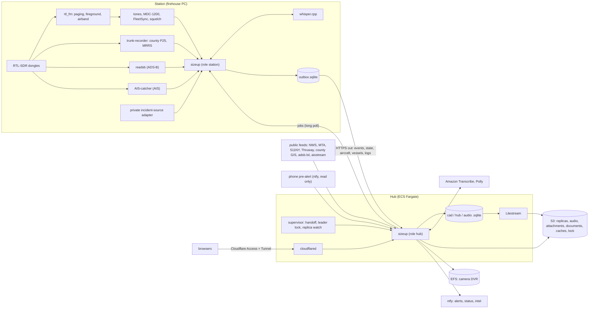

# sizeup architecture

How the system is put together, as the code on `main` has it. This page is the map; the detail is in
[`cloud.md`](cloud.md) (operations), [`../deploy/station/README.md`](../deploy/station/README.md) (the station) and the
module docstrings, which are long and current. Every claim here names the module that holds it.

Contents: [components](#components) · [hub and station](#hub-and-station) · [ingest pipelines](#ingest-pipelines) ·
[speech-to-text](#speech-to-text) · [the CAD](#the-cad) · [incident sources](#incident-source-priority) ·
[data model](#data-model) · [pre-alerts and radio intelligence](#pre-alerts-and-radio-intelligence) ·
[map and data layers](#map-and-data-layers) · [notifications](#notifications) · [voice](#voice) ·
[durability and deploys](#durability-and-deploys) · [security and privacy](#security-and-privacy-boundaries) ·
[cost drivers](#cost-drivers) · [module map](#module-map) · [tests and tools](#tests-and-tools) ·
[known gaps](#known-gaps--in-flight)

## Components

One codebase, one entry point: `python -m sizeup --config <file>` (`sizeup/app.py`). `[cloud] role` picks the role.

| role | where | what it runs |
|---|---|---|
| `hub` | AWS ECS Fargate, one arm64 task (0.5 vCPU, 2 GB) | The CAD of record, the web UI, Amazon Transcribe and Polly clients, the map data providers, pushes. No radios. |
| `station` | A PC at a firehouse (Windows + WSL2 + Ubuntu 24.04, systemd) | RTL-SDR receivers, trunk-recorder, decoders, whisper.cpp, the incident-source adapters, a local status page. No CAD. |
| none (no `[cloud]`) | A dev machine | All-in-one: both halves in one process. JSON files and WAVs under `captures/` instead of the hub's databases. |



## Hub and station

The station only ever connects out. The hub has no inbound port: people and the station both reach it through the
Cloudflare Tunnel. Every station request carries a bearer token and a Cloudflare Access service token
(`sizeup/cloud/client.py`). The hub side is `sizeup/cloud/hub.py`; the station side is `sizeup/cloud/station.py`.

| call | direction | carries | delivery |
|---|---|---|---|
| `POST /api/station/events` | station to hub | Pages, transcripts, transmissions with their clips (8 kHz WAV), re-run results, radio IDs heard, talkgroup activity, alarms, incident-source reports | Durable, in order. `outbox.sqlite` keeps each event until the hub acks its sequence number. The hub applies each once per outbox epoch. |
| `POST /api/station/state` | station to hub | Who is talking now, a page going out now, radio / SDR / STT status, health | Latest wins, never queued. Sub-second on change, every 5 s otherwise. The answer carries the hub's build. |
| `GET /api/station/jobs?wait=25` | hub to station (long poll) | `tts`, `call` (mode and talkgroup switches, re-transcribe, catch-up, channel preferences, reception test, all clear), `sources_reset` | The station answers with `POST /api/station/jobs/<id>`. |
| `POST /api/station/aircraft` | station to hub | The station's ADS-B receiver, changes only, gzipped | Every 1 to 5 s as the hub asks. Dropped while offline. |
| `POST /api/station/vessels` | station to hub | The station's AIS receiver | Every 5 to 30 s as the hub asks. Never queued. |
| `POST /api/station/logs` | station to hub | The station's journal, scrubbed | Spooled on disk while the hub is away. The hub writes it to CloudWatch Logs. |
| `GET /api/station/status` | read only | Builds and health alerts for the deploy check | A station token or a status-only token. |

Every one of these resolves its bearer to a station id first (`Hub._principal`, `sizeup/cloud/stations.py`;
[How station authentication works](cloud.md#how-station-authentication-works)).

The same `App` code applies an event on the hub as on the station (`_page_heard`, `_transcribed`, `_retext`), so
all-in-one and hub + station behave alike.

**Auto-update.** The hub's answer to every state post names its build (the git sha CI built). The station builds that
sha beside the running release, preflights it, switches in a quiet moment and switches back if `/healthz` does not come
up (`sizeup/cloud/autoupdate.py`). A station's `/etc/sizeup/config.toml` is never overwritten; one-time additions go
through `sizeup/cloud/configupdate.py`.

**Station services** (`deploy/station/systemd/`): `sizeup-station`, `sizeup-whisper`, `sizeup-trunk-recorder`,
`sizeup-adsb`, `sizeup-ais`, `sizeup-logread`, `sizeup-update` (path and timer), `sizeup-health` (timer),
`sizeup-usbfs`. trunk-recorder runs as its own unit so a Python-only update leaves P25 on its control channel
(`sizeup/radio/trunkrecd.py`).

**Health.** The station reports CPU, memory, disk, temperature, uptimes and each radio program every 5 s. The hub
decides behind / updating / failed / silent, shows it in Settings and pushes to the status topic
(`sizeup/cloud/health.py`). The hub also watches its own error rate (`sizeup/errwatch.py`).

## Ingest pipelines

```
receiver -> squelch -> transmission (clip) -> decoders -> speech-to-text -> radio log -> consumers
```

| source | receiver | what is decoded | module |
|---|---|---|---|
| Paging (South 2), analog FM | `rtl_fm`, noise squelch | Two-tone sequential pairs (Quick Call II) against the county tone book; the voice after the last tone. A live decode names who is being paged while the carrier is up. | `radio/fm.py`, `tones.py`, `page.py`, `livepage.py` |
| Fireground (FG1, FG2), analog FM | `rtl_fm`, noise squelch, per-channel squelch settings | MDC-1200 and FleetSync PTT-IDs and emergency packets, live at the key-up and again from the finished clip | `radio/fm.py`, `tap.py`, `mdc1200.py`, `fleetsync.py` |
| County P25 (Fire/EMS 15, 60 Control, Airport Incident and more) | trunk-recorder, one WAV + JSON per call | Talkgroup, radio IDs and aliases per talker, the emergency flag; grants read from its log for "talking now" | `radio/recorder.py`, `trunkrecd.py`, `p25.py`, `live.py` |
| A second P25 system (MTA MRRS: local police dispatch, Metro-North) | Its own trunk-recorder, one directory per system | The same, per talkgroup tier (below). Context only: never Main, never on an incident, never an incident source | `radio/systems.py`, `tiers.py` |
| HPN ATC (Tower, Ground, NY Approach), AM airband | `rtl_fm -M am` with carrier squelch; optionally several channels from one dongle | Steady tones removed before the clip is kept | `radio/am.py`, `channelize.py`, `amtones.py` |
| ADS-B (1090 MHz) | readsb on the one dongle named for it | `aircraft.json` every second | `radio/adsbd.py`, `cloud/aircraftlink.py` |
| AIS (marine VHF) | AIS-catcher on the one dongle named for it. Off until the hardware is installed | Each vessel's latest messages | `radio/aisd.py`, `cloud/vessellink.py` |

Talkgroup tiers for P25 systems other than the county's (`sizeup/tiers.py`): `alert` (record, transcribe, may raise a
pre-alert), `text` (record and transcribe), `record` (audio only), `off`, and `activity` (encrypted: never recorded,
only that it keyed). The default comes from the system's `talkgroups.csv`; Settings changes it per talkgroup.

**Dongles.** A dongle is always opened by its exact USB serial (`radio/sdr.py`); `sdrserial.py` rewrites a duplicate
serial. sizeup and shortfinal share dongles through claim files in `~/.local/state/rtl-claims/` (`radio/claims.py`,
[`handoff-shortfinal-dongles.md`](handoff-shortfinal-dongles.md)). The ADS-B and AIS dongles are never auto-assigned.

**Reception test.** An admin lends one dongle to another P25 system (or a probe of the county's) for a set time and
gets a verdict (`radio/reception.py`, `radio/probes.py`, [`reception-test.md`](reception-test.md)).

**After the clip.** Every transcribed transmission becomes one `radio_traffic` row (`sizeup/cad/comms.py`). Consumers
of a new or changed transcript:

| consumer | what it does | module |
|---|---|---|
| Dispatch parse and geocode | A page with our tones becomes a queued CAD event with type, address, cross street and point | `dispatch.py`, `geo/pagegeo.py`, `incidents.py` |
| Radio log links | Puts the transmission on an event: by unit radio ID, dispatcher turn, airport talkgroup, page, mention, fireground channel, or by hand | `cad/comms.py`, `cad/radiolog.py` |
| Status hints | "E64 on location?": a suggestion a dispatcher accepts or dismisses, never a status change by itself | `cad/statushints.py`, `cad/statusrepair.py` |
| Alarms | Emergency button (P25, MDC, FleetSync) and mayday keywords on our fire channels | `cad/alarms.py` |
| Airport pre-alerts | ATC rules on airband transcripts; multi-transmission watches; "alert level N" on the fire radio | `atc.py`, `airport_watch.py`, `cad/airport_alerts.py` |
| Radio intelligence | Rule packs over other systems' transcripts (`Comms.on_context_text`) | `sizeup/intel/` |
| Search | FTS5 index over incidents, the chronology and the radio log | `cad/history.py` |

The radio log has a change log (`radio_changes`) so pages fetch only what changed, named views (`ours`, `police`,
`ems`, `transit`, `air`, `all`), and per-source keys (`fm:<label>`, `air:<label>`, `p25:<system>:<tg>`:
`sizeup/sourcekeys.py`).

## Speech-to-text

Two engines, chosen per channel in Settings > Radios (`sizeup/channels.py`): `local`, `aws` or `both`.

| engine | where | notes |
|---|---|---|
| whisper.cpp server | The station (CPU) | `sizeup/stt.py`. A strict priority queue: pages, Fire/EMS 15 and the firegrounds; the airband; other live traffic; a person's re-run; another system's alert talkgroups; context talkgroups; catch-up. A lower-class clip that waits too long is shed ("skipped: busy") and stays re-runnable. |
| Amazon Transcribe streaming | Called from the hub | `sizeup/transcribe.py`. Standard library only: its own WebSocket client, event-stream framing and SigV4. One long-lived stream per channel. |

- **Routing.** For a channel set to `aws` the station skips whisper and forwards the clip marked pending; the hub
  transcribes it. `both` keeps whisper's text as the alternative.
- **Budgets.** Billed seconds are counted per month in the CAD database, in two pools that never share: ours (fire
  channels and the airband; `aws_monthly_limit_usd`, default 25, with a reserve for pages and Fire/EMS 15) and context
  (another system's talkgroups, such as police dispatch; `aws_context_budget_usd`, default 15). Past a limit the
  channel goes to the station's whisper.
- **Never stuck.** Each job has a deadline; a watchdog fails it as timed out and the fallback (the station's whisper)
  runs. A circuit breaker sends new clips straight to whisper while AWS keeps failing and retries on a timer. A late
  AWS answer is kept as the alternative text.
- **Vocabularies.** Custom vocabularies are generated from public data in the repo: units from the county mutual aid
  plan, departments, channels, busy streets (`sizeup/stt_vocab.py`, [`stt-vocabulary.md`](stt-vocabulary.md)). ATC has
  its own, kept up with the operators seen near HPN (`sizeup/atc_vocab.py`). Per-source profiles are in
  `data/stt/profiles.json`. ATC transcripts are normalised and callsigns snapped to aircraft on ADS-B
  (`atc_normalize.py`, `atc_snap.py`).
- **Hyphens.** AWS writes a vocabulary phrase back with hyphens ("Example-Post-Road"). `transcribe.Display` turns each
  known phrase back to its written form on arrival and again when a stored transcript is read (radio log rows, an event's
  remarks and timeline, the monitor's pages); stored text is never rewritten, and the radio log search treats a hyphen
  and a space alike. Nothing is sent to AWS for it.
- **Talker hints.** Radio aliases heard on the call are passed to whisper as a prompt (`sizeup/talkers.py`).
- **Catch-up.** Shed clips are run again when the engine is idle and no event, alarm or carrier of ours is open. The
  re-run is quiet: nothing alerts on words that may be hours old (`sizeup/sttcatchup.py`).

## The CAD

`sizeup/cad/` is the department's own CAD: `service.py` is the service, `api.py` the JSON API under `/api/cad/`,
`store.py` the SQLite store.

| area | what | module |
|---|---|---|
| Events | Queued (from a page or feed), pending, active, closed or dismissed. Emergency and non-emergency. Numbered `YY-NNNNNN`. | `store.py`, `service.py` |
| Units | Two status boards, assignments with dispatched / en route / on scene / cleared times, full unit history | `store.py`, `lists.py` |
| Department placeholders | A mutual-aid department's placeholder unit is assigned first and released when a real unit of that department shows up. Never located or mapped. | `automode.py`, `sources.py` |
| Run cards | Event type (and subtype) to ordered slots; recommendations use estimated drive time and where each rig is now | `runcards.py`, `eta.py`, `mapview.py` |
| Dispatch | Composed text, alert tones and a rendered voice. Transmit is off: `NullTransmitter` is the only transmitter. | `dispatcher.py`, `speech.py`, `voicequeue.py`, `transmit.py` |
| Dispatch modes | Who moves a feed's incident through the call: 60 Control (default) or PCFD | `automode.py` |
| Who was dispatched | Full department or specific units. Page: apparatus named gives units; else a department's tones plus a call type, "full department" said (as speech-to-text hears it), or its own all-call tones with a place and no test or meeting wording give the full department. Feed: a department entry or placeholder with no unit listed, or a comment that says so. The page's reading shows whenever it has one. | `scope.py` |
| Rig routes | The probable path of each responding rig on a road graph built from OpenStreetMap; motion estimates; routes leave and enter firehouses by the bay doors (an ingress may be `via: "lot"`, back in through a lot's drive aisles). `Cad.positions` is the single hook for a live AVL feed; no provider sets it yet. | `routes.py`, `roadgraph.py`, `mapview.py` |
| Alarms | Emergency button and mayday, acknowledged and cleared at the console, pushed | `alarms.py` |
| Radios | Radio ID to rig registry (MDC, FleetSync, P25); new IDs are asked about, never guessed | `radios.py`, `newids.py` |
| Tone book | Agencies, places, services and their tone pairs | `tonelist.py` |
| History and search | Address and building keys, "History here", premise notes, the Search page | `addrkey.py`, `history.py`, `premise.py` |
| Pre-plans | Points on a building (Knox box, FDC, shutoffs) and site documents (floor plans overlaid on the map, PDFs, photos) | `preplan.py`, `preplan_docs.py`, `docfiles.py`, `docstore.py`, `pdfcheck.py` |
| Attachments | Camera clips and radio transmissions kept with an incident for a year, every view audited | `sizeup/attachments.py` |
| Settings and audit | Edits are overrides over `data/cad_lists.json`, validated like the file, every change audited | `settings.py`, `lists.py` |
| People | Roles `admin` / `dispatcher` / `viewer`, keyed by the Cloudflare Access email; a per-person activity log | `settings.py`, `activity.py`, `cloud/access.py` |
| Export | CSV in the department's old sheet's columns | `export.py` |

**The write path.** The store has one connection and one lock. `Store.tx()` is one `BEGIN IMMEDIATE` transaction under
that lock. On the hub every write also goes through a guarded connection: a task that is no longer the leader raises
`FencedWrite` and the request answers 503 (see [durability](#durability-and-deploys)).

## Incident source priority

`sizeup/cad/sources.py` ranks where incidents come from.

| rank | source | role |
|---|---|---|
| 1, 2, ... | External CAD feeds, through a private station-only incident-source adapter (`sizeup/sources/`) | Primary. The first healthy tier is the acting primary. |
| below every feed | The paging decoder (South 2 two-tone) | Backup. Healthy while the station is connected. |
| never | Radio phrases, the phone pre-alert, intel events, ATC | Pre-alerts only. They never make an incident. |

- **Create is never delayed.** A page for us makes its incident at once, whatever the feeds' health. An occasional
  duplicate is accepted; a delay is not.
- **Matching.** A page and a feed report join one open incident when place and time agree. The rules handle a
  street-only report, a doubled house number and a misheard street (`cad/fuzzy.py`). Anything that may be the same but
  cannot be proved is noted "possibly the same" on both, never joined silently.
- **Promotion.** A feed is healthy while its last report says ok and is fresh; primaries are promoted and demoted
  automatically. The console and Settings > Station > Health say which is acting.
- **Adapters run only on the station.** The hub refuses to load one (`sizeup/cloud/adapters.py`,
  `sources/runner.py`); it receives only forwarded `source_event` / `source_health` events through the outbox.

## Data model

On the hub everything durable is SQLite under the state dir, replicated by Litestream (`sizeup/cloud/hubstore.py`).

| database | what lives there |
|---|---|
| `cad.sqlite` | The CAD of record: units, incidents, assignments, run cards, the chronology, unit history, dispatches, the radio registry, the radio log (`radio_traffic`, `radio_links`, `radio_changes`, `radio_activity`), alarms, settings overrides and audit, operators and their activity, source reports and health, dispatch-mode steps, status hints, premise notes, pre-plan points and document records, attachments and their audit, phone pre-alerts, airport alerts, intel events / hits / feedback, the STT usage meter, the FTS5 search index |
| `hub.sqlite` | The monitor's state: incidents, transmissions and pages (one row each, written only on change), and how far each station outbox has been applied |
| `audio.sqlite` | Metadata of received clips and rendered dispatch audio. With an audio bucket configured the bytes are in S3 (`sizeup/audiostore.py`); otherwise in the database. |
| `outbox.sqlite` (station) | Events waiting for the hub |

Bytes that are not in a database, all in S3 on the hub: clip audio (uncompressed WAV as the station sent it),
incident attachments, pre-plan site documents, the map caches' copies (`sizeup/cachesync.py`), the Litestream replicas,
the leader lock and the replica-watch record.

Retention (hub defaults, `deploy/hub/config.hub.toml`): a clip on no event 30 days (per channel or talkgroup in
Settings); a clip on an event, alarm or emergency 365 days; monitor pages and transcripts 24 h (the CAD keeps its own
records). Detail: [`cloud.md`](cloud.md) "Audio retention".

## Pre-alerts and radio intelligence

A pre-alert is a hint that a call may be coming. It is shown at the top of the console's 60 Control column and may be
pushed. It never creates an incident.

| kind | source | module |
|---|---|---|
| Phone | The headquarters phone ringing, from a separate device's ntfy feed. Read only: every request is a GET, and sizeup refuses to publish to that feed. Its topics are set in Settings > System > Push notifications (or env), never in the repo; none set: the feed is off and Health says "not configured". | `sizeup/prealert.py` |
| Airport | ATC transcripts matched to rules (`data/atc/rules.json`); watches that build over several transmissions (a go-around followed through frequency changes); emergency squawks on ADS-B; "alert level N" on the fire radio | `atc.py`, `airport_watch.py`, `cad/airport_alerts.py`, `cad/airport.py` |
| Radio intel | Rule packs over another system's transcripts | `sizeup/intel/` |

**Radio intelligence** (`sizeup/intel/`):

1. `Comms.on_context_text` hands each context transcript's id to the engine after commit (`cad/service.py`).
2. A rule pack (`data/intel/police.json`, with Settings over it) scores phrases per category. Rows from one source
   within a window merge, so a call-out and its read-back are one candidate (`rules.py`, `engine.py`). Three more
   packs (`county_police.json`, `ems.json`, `fire.json`) read the county system's police and Fire/EMS talkgroups and
   the analog fire channels through a table of speech-to-text fixes (`data/intel/tables/stt.json`). They are log
   only: nothing of theirs is pushed, mapped or shown until an admin raises the pack, the category and the rules
   (an event's mode is the rung its own rules reach; a cue's mode never moves it). Only these three packs' events
   are held at log when outside our area or at one of our own accepted emergency incidents (`out_of_area`,
   `near_incident`; never once pushed; a safety category is linked, not held: docs/cloud.md). The police pack's
   events are never held or linked; its own safety categories are weapons, barricade, EDP and dispute.
3. The window's words go through the locator (`place.py`), held to the source's home towns. Beyond what a page says, it
   reads spoken intersections ("X and Y", "corner of"), blocks ("the 100 block of X", never an exact address), relative
   cues ("rear of", "across from": a wider radius), and highway exits and mile markers (the place search). An address
   confirms by a cross street only within `corner_m` (200 m) of where they meet. A headquarters callsign said alone
   narrows to that department's town. Police text needs a higher score to confirm than a page (`DOMAIN_PARAMS`).
4. Where the rules leave a category uncertain, or an event's place unconfirmed, the **inference stage** may ask a model
   (below).
5. The policy decides whether to push: a mode ladder (off / shadow / log / map / push), a kill switch, quiet hours,
   rate caps and re-push limits (`policy.py`).
6. The push is composed from an allow-list of fields and scrubbed; a failed scrub sends nothing (`push.py`). It carries
   a **Listen** link and a ntfy "Listen" button (`listen.py`, `notify.py` `actions`).

**Listen** (`listen.py`; on by default, needs `SIZEUP_AUDIO_BUCKET`): the event's transmissions plus the same source's
from 45 s before to 60 s after, stitched into one file (AAC at 24 kbps with ffmpeg, else 8 kHz WAV; the hub image has
no ffmpeg), written under a random key in the audio bucket's `listen/` prefix and linked by a presigned URL that
expires (20 min). There is no sign-in on the link. Record-only, encrypted and activity-tier sources are never included.
The file is restitched under the same key as later transmissions arrive. It never delays the push (its own thread); a
403 from the bucket reads "not configured" and is retried after an hour.

**Inference** (`infer.py`; off by default, `infer = false`): an LLM behind the rules, on Amazon Bedrock in the
department's own account (the Anthropic SDK's Bedrock client, `.[intel-llm]` in the hub image). It runs on its own
thread and never holds the engine. It is asked only about a candidate the rules left between `infer_low` (0.3) and the
threshold, an event whose place is unconfirmed (at most once per 10 min), or a sampled few (`infer_sample_pct`,
recorded only). What is sent has radio IDs and plate-like tokens removed. Its answer backs the rules: it may push only
when it agrees with the category the rules were unsure about, their own score is at least 0.5 and its confidence at
least 0.8; anything else is held to `map` ("model: X?" on the card), never a push. Its place counts only if its words
are in the transcript and the gazetteer finds them, and is never confirmed or over a confirmed one. Capped by
`infer_daily_cap` (200 calls a day) and `infer_budget_usd` ($5 a month); a model with no known price is refused. Its
log, `intel_infer` in `cad.sqlite`, is kept 90 days. Each row holds the model's category, confidence, location and
summary (the model's own words about the traffic), plus tokens and cost.

Events, hits and feedback are in `cad.sqlite` and hold no transcript text, only transmission ids (`events.py`); the
inference log above is the one intel table that holds text about the traffic. Intel
never writes incidents, radio links or alarms. Replay / backtest runs the same engine over stored rows in memory (`intel/replay.py`, `tools/intel_replay.py`).

## Map and data layers

Every layer is fetched by the CAD of record (the hub, or all-in-one), cached, and served to the pages. Browsers talk
only to the hub, apart from the base map tiles. `sizeup/datasources.py` is the registry: status, Refresh now and a
schedule per pull, in Settings.

| layer | source | module |
|---|---|---|
| Geocoding and place search | The offline gazetteer `data/gazetteer.sqlite` (addresses, streets, intersections, landmarks, mile markers, exits, airport places) | `sizeup/geo/` |
| Rigs and routes | CAD state plus the OSM road graph | `cad/mapview.py`, `cad/routes.py`, `roadgraph.py` |
| Aircraft near HPN | adsb.lol and adsb.fi, the station's own ADS-B receiver, the FAA registry for types; phase, approach and emergency squawks | `aircraft.py`, `atc_scope.py`, `atc_talkers.py` |
| Airport | Runways, taxiways, gates, approaches, staging; alert levels and the airport run cards | `cad/airport.py` |
| Trains | Metro-North GTFS-realtime with a motion model between reporting points; MTA TrainTime for GPS, consist and track when it answers; numbered tracks, catenary pole numbers and mileposts | `trains.py`, `traintime.py`, `railassets.py` |
| Vessels | AIS: the station's receiver and aisstream.io | `vessels.py`, `wsclient.py`, [`vessels.md`](vessels.md) |
| Highways | Thruway and 511NY cameras, events, roadwork and signs; live video checked and repaired; a rolling camera DVR; a camera wall | `roads.py`, `hlsseg.py`, `dvr.py`, `httpkeep.py`, `camoverlay.py` |
| Road projects and closures | Thruway, 511NY, NYSDOT and CTDOT capital projects, village notices, WZDx | `roadprojects.py` |
| County GIS | Westchester County GIS ArcGIS layers: parcels, boundaries, fire districts, hydrants and more, by config | `gis.py` |
| Weather and water | NWS alerts, conditions and radar; NOAA tides | `weather.py` |

### The department's place names and the county's common places

Settings > Lists > Place names holds the department's own names for places ("the Waterfront"). Its **Common
places** card imports the county CAD's "common place names" list (`sizeup/cad/commonplaces.py`, admins only):

1. **Import** (or **Re-import**): pick the county's `.xlsx` or `.csv` (one row per name: address, common place, town
   code such as `PORT_CHESTER`). The headers are found in any case; pick other columns in the preview if they differ.
2. The preview gives the counts: rows, names, new, already there, removed (in the last import, not in this one), and
   the names whose address is not in the gazetteer's address points (each address is looked up with the place
   search's street words, so `1 EXAMPLE AV` is `1 Example Ave`; the row's town first). **Apply** writes them.
3. A re-import replaces every name of the last import (source "county common places", with the import date). Names
   made by hand are never touched. **Remove** takes the imported names out. The settings audit log records the
   counts only, never a name or an address.

A name whose address is not found is kept, flagged ("not found" in the card): the place search and the radio can't
place it, but a county feed location naming it still gets its address. The imported names are used:

- by the place search (a note's "@", the location box: the name, its address filled in),
- by an address typed (the place search, the location box) or clicked on the new call's map: each name at that address
  is its own suggestion, alphabetical, right before the plain address ("120 Example Ave @ Example Burger", "120
  Example Ave @ Sample Fitness", "120 Example Ave"). Picked, it is the place as by its name, at the address typed. The
  address is matched by its house number (letter and fraction too: `localaddr`) and its street's words (the
  gazetteer's spelling of an entry's address only for that very number: "189 Example St" is not "189-1/2"), then by
  its point (within 500 m) and its town (the same street across a town line is not it; a name at the very point,
  within 50 m, counts whatever its town: the import may place a row at a neighbour's point). A site is offered at any
  of its addresses, once; a range ("132-136", "136-132", "132-36", "199-01") at each number of it on that side of the
  street when its ends are at most 20 apart (`RANGE_SPAN`), else at its two ends. A name made by hand counts when it
  was pinned at an address. Only the place search's own answer and the location box get them, never a location typed
  and not picked (`PlaceIndex.places_at`),
- by the page and radio locators (`sizeup/geo/pagegeo.py`, `sizeup/intel/place.py`: "the Quillberry Marina", "the
  community hall in Sample Town"). A name of one word, or of common words only (`sizeup/geo/commonwords.py`), needs
  its town said beside it; another town said beside it is that town's; a house number said always wins, the name only
  backs the address near it,
- by the county feed (`sizeup/cad/sources.py`): a location that is nothing but a listed name ("@SAMPLE MARINA",
  optionally with that name's own town) is stored as "<its address> @ <name>", placed at its address and matched
  against calls there; the feed's own text is kept. Never one with an address or intersection before the "@", never
  another town's name.

The list stays in `cad.sqlite` (`settings_overrides`, section `places`, keys `county/...`), replicated with the
rest of the CAD. The settings export never carries it and a settings import never touches it (re-import the
county's file instead). It is never in the repository, its tests or the public gazetteer (`data/gazetteer.sqlite`,
`tools/fetch_places.py`).

### Local address points

The address points miss some real addresses: a building behind another one ("189-1/2 Example St", in its parking
lot), a station or a new building with no point of its own ("3 Sample St"). Settings > Lists > Place names has an
**Address points** card for them (admins, like the place names):

- **Add**: type the address (house number, then the street as the map data names it; "Example Street" is found as
  `Example St`), then click the map where it is, or drag the pin. Typing the address moves the map to where the data
  would put it. The town is optional: blank, it is the street's town at the pin. **Edit** moves the pin or changes
  the address; **Remove** takes it out. A pin more than 400 m from its street is refused.
- **Pin** on a common place whose address was not found (the import's "not found" list, or its preview) opens the form
  with that address filled in.

Each point is found like one of the gazetteer's own (`sizeup/geo/localaddr.py`, `Gazetteer.locate_at`): precision
`exact`, source `local`, ahead of the gazetteer's point for that number (the admin's pin wins), of an interpolation
and of a fractional number's integer part. A fraction not pinned ("3-1/2" with only 3 pinned) takes the local integer
point, `approximate`.
The place search and the location box, a page (`sizeup/geo/pagegeo.py`), a click on the new call's map
(`what_is_here`) and the common places import (`PlaceIndex.local_address`, before the address points) all see it.

House numbers are read by one helper (`localaddr.parse_number`): `189-1/2`, `189 1/2`, `189½` and `189.5` are one
number, shown `189 1/2`; `189A` is a letter suffix, as in the address points. In free text (`fractions_in`) a fraction
counts only when a street the gazetteer knows follows it, and only for that street: "3 1/2 story", "10.5 min ago",
"rt 9.5", "Box 12.25" are left alone.

They are kept in `cad.sqlite` (`settings_overrides`, section `local_addresses`, key `<number> <street>, <town>` in
lower case: `{number, street, muni, lat, lon, note}`), audited as Lists, and exported and imported with the other
settings. An imported point is checked as the form checks it (its street, its town, the pin on that town's stretch,
its key, the cap); one that fails is skipped and counted in the import's notes.

## Notifications

`sizeup/notify.py` is the one place sizeup publishes. Pushes go to ntfy, by kind:

| kind | what |
|---|---|
| alerts | Emergency buttons, mayday, aircraft emergency squawks, airport pre-alerts, their acknowledgements and all clears |
| status | Station health, Amazon Transcribe failing or over budget, hub error spikes, replica and takeover failures |
| intel | Radio-intelligence pre-alerts, with a Listen button. Its own topic only: none set, no intel pushes (never the alerts or status topic). |

Topic names are secrets: set by env / SSM or Settings, shown to admins only, never logged or exported. sizeup never
publishes to a **protected** topic: the set is derived, not listed in code (every topic the app subscribes to for the
phone pre-alert, from env, Settings or config, plus extras an admin lists). It is refused in config, in Settings and by the
Notifier before every request. If Settings can't be read, nothing is published (fail closed). Under the derived set,
a static backstop refuses a few names always, held in code as SHA-256 hashes only (`notify.py` `always_protected()`). The pre-alert topics and the
protected list are in Settings > System > Push notifications; a retired pre-alert topic stays protected.

## Voice

| piece | where | module |
|---|---|---|
| Dispatch text and the spoken form | The CAD of record | `cad/dispatcher.py`, `cad/speech.py` |
| Amazon Polly | The hub's default engine, signed with the task role | `sizeup/polly.py` |
| Kokoro TTS server | A local engine for all-in-one; run and kept warm by sizeup | `sizeup/tts.py`, `sizeup/tts_server.py` |
| Render queue | One worker, in order, bounded; the dispatch is logged and answered before the voice exists | `cad/voicequeue.py` |

The firehouse station template sets `tts_engine = "none"`: if Polly fails the hub falls back to text and says so. Audio
plays at the console. Nothing transmits on the air.

## Durability and deploys

Summary only. The detail, with the reasons, is in [`cloud.md`](cloud.md): "Deploys: the hot/cold handoff",
"Replicate before migrate", "Reseeding a replica", "Replica checks" and "The hub's storage".

- **Litestream** replicates the three databases to S3 continuously (the WAL read into a file for S3 every 30 s: a clean
  handover loses nothing, a killed hub up to ~30 s of its newest writes). A Fargate task's disk is thrown away, so a new task
  restores from the replica.
- **Leader lock** (`sizeup/leaderlock.py`): one object in the backups bucket, changed only with S3 conditional writes.
  At most one task holds it. Only the holder writes the databases, runs `litestream replicate` and runs the Cloudflare
  connector.
- **Hot/cold handoff** (`sizeup/handoff.py`, the hub container's main process). The order:
  1. ECS starts the new task beside the old one. It follows the replica into a standby directory, restores the map
     caches, starts the app gated and reports warm.
  2. ECS sends the old task SIGTERM. Its app drains, Litestream syncs every last change, and the lock is released with
     the final replica positions.
  3. The new task takes the lock (generation + 1), catches up to those positions, quick-checks the files and promotes
     them.
  4. `litestream replicate` starts and confirms its first position of each file. Only then may the app migrate
     (replicate before migrate).
  5. The app serves; the connector registers. The old task's connector stays up until the new leader says serving.

  If Litestream exits under the serving app, the supervisor runs a TRUNCATE checkpoint on each file before it starts
  Litestream again, so the first sync is a full snapshot. When the checkpoint can't be done the file is marked
  unverified, pushed and retried, and a release with such a file is unclean (#522, #523).
- **Fence** (`sizeup/fence.py`). The supervisor writes a lease file at each renew. The app refuses writes when the lease
  is not fresh, kills Litestream and itself, and never lets a write in again in that process. A fenced write is never
  silent: 503 for a request, no ack for a station event (the outbox sends it again to the next leader).
- **Replica watch** (`sizeup/replicawatch.py`). The standby and the leader restore and `quick_check` the replicas on a
  timer (a full `integrity_check` daily). Results go to an S3 record, Settings > Station > Health and the status topic. A task
  that ends badly records it and pushes before it exits; repeated failures push as a crash loop.
- **CI and deploy** (`.github/workflows/`):

| workflow | when | what |
|---|---|---|
| `test.yml` | Every push to main and every PR | pytest on Python 3.14 with the pinned Litestream; builds the hub image and checks `/healthz` |
| `deploy.yml` | After `test` passes on main | Checks every SSM parameter the task definition names exists (stops before ECS if not); builds and pushes the arm64 image; rolls the ECS service; reads the new leader's replica check; waits for the station to report the new build |
| `station-install.yml` | Changes under `deploy/station/`, `deploy/trunk-recorder/`, or to `autoupdate.py`, `configupdate.py`, `adsbd.py`, `trunkrecd.py` | shellcheck, a PowerShell parse, a real install on Ubuntu 24.04, the auto-update end to end |

- **Profiling.** Per-thread CPU accounting is always on and a sampling profiler runs on demand (`sizeup/perf.py`);
  startup, takeover and drain each log one timing line (`sizeup/timing.py`).

## Security and privacy boundaries

| boundary | how it holds |
|---|---|
| No inbound ports | The hub is reached only through the Cloudflare Tunnel. The station binds `127.0.0.1` and only connects out. |
| Sign-in | Cloudflare Access (one-time PIN by email). With `[cloud] access_team` and `access_aud` both set, the hub verifies the Access JWT on every page and CAD API request (`cloud/access.py`, `web/server.py` `_admit`); the operator on every write is that verified person. Two paths are not checked for a person: `/healthz` (the container health check) and `/api/station/` (its own bearer token, next row). With either setting empty there is no verifier at the hub: only Cloudflare's edge stands in front, and the Operator field is free text. |
| Roles | `admin`, `dispatcher`, `viewer`; premise-note categories can be limited by role (`cad/settings.py`). |
| Station link | A bearer token per station (`sz1.<id>.<secret>`, 256 random bits), plus an Access service token, which only Cloudflare's edge checks: the hub itself checks the bearer alone. The hub keeps only each token's SHA-256 (hub.sqlite `stations`, `cloud/stations.py`) and turns the bearer into the station id it proves before reading any body (`cloud/hub.py` `_principal`, constant-time). A payload naming another station id is refused. The older shared token (`SIZEUP_STATION_TOKEN`) still works as one station until an admin retires it. Admins add, rotate and revoke stations in Settings > Station > Stations (audited, the token shown once). With no token configured and no station added the hub refuses every station call. [How station authentication works](cloud.md#how-station-authentication-works). |
| Adapter credentials | The incident-source adapter runs only on the station, and only the station can read its credentials: systemd credentials, never environment variables (`sizeup/procenv.py`). A credential kept in SSM is read by the station's own IAM user (`cloud/adapterssm.py`). The hub can write one, never read it: an admin may type a new adapter password into Settings > Station > Adapter, and the hub puts it into SSM as a new version (`cloud/adapterpass.py`, #465). The value is kept out of logs, the audit, answers and errors. The hub's roles are denied reading and decrypting that parameter by the department's setup scripts, which are outside this repo. A failing adapter reports only the exception type. |
| Context and police rows | The hub's pages and API serve another system's rows, text, ids and audio only to a verified signed-in person (`sourcekeys.may_see_context`). The station's own page, all-in-one and a hub without Access serve none. Their words are never written to a log. The one way such audio leaves without a sign-in is an intel push's Listen link (next row). |
| Pushes | An intel push carries the category, town, address or block, time and level. Never transcript words, a talker, a radio ID, a plate or a person's name. A scrub checks the result and fails closed (`intel/push.py`). Its Listen link is a presigned S3 URL to the event's stitched audio, with no sign-in: whoever holds the link can play it until it expires; random key, expires in 20 min, removed by a one-day lifecycle rule on the `listen/` prefix, which a person sets up (`intel/listen.py`). |
| Station logs | Read by a separate user with no network (`cloud/logread.py`), scrubbed on the station with its credential values, scrubbed again on the hub (`logscrub.py`, `cloud/logship.py`, `cloud/cwlogs.py`, [`station-logs.md`](station-logs.md)). |
| Uploads | A site document's type is taken from its bytes. Photos lose their metadata. A PDF is cleaned and re-checked in a separate process. Documents are served only by the hub behind sign-in: no presigned links (`docfiles.py`, `pdfcheck.py`, `docstore.py`). |
| Cross-site posts | The station and all-in-one refuse a POST a browser says came from another site (`web/server.py`). |
| Secrets | AWS SSM on the hub; the macOS Keychain or `/etc/sizeup/station.env` and the systemd credstore on a station. The UI shows only "set" or "missing". |
| Outbound guard | `python -m sizeup` decides at its start whether it may reach outside services (`outbound.py`): on for the hub under its supervisor (the lease file), a station (or a config forwarding to a hub through Settings > Station > Hub link), or `SIZEUP_ALLOW_OUTBOUND=1`; off for anything else, such as a hub run by hand on a restored copy or all-in-one. Off, ntfy publishes, every AWS request (signed in `aws.py`: S3, Transcribe, CloudWatch Logs, SSM, the Listen links), Polly and Bedrock are refused before anything is sent (a refused push is dropped at once, never retried), and the phone pre-alert doesn't subscribe; this machine's own addresses stay allowed. One log line at the start, `outbound` in `/healthz`, "Outbound off" in Settings > Station > Health. |
| Public repo | No real incident data, transcripts, topic names or adapter details in code, tests or docs ([`../CLAUDE.md`](../CLAUDE.md)). Real captures for replay tests live outside the repo. |

## Cost drivers

In rough order of how much each can move. No figures here beyond the limits the code sets.

| driver | what bounds it |
|---|---|
| Fargate | One task (0.5 vCPU, 2 GB arm64) all the time; two for a few minutes per deploy |
| Amazon Transcribe | Billed per second of audio sent. Two monthly limits in code (fire and context pools), a meter per channel, 80 % and 100 % pushes, fallback to whisper |
| S3 audio | Uncompressed WAV. Bounded by retention per channel, talkgroup and tier, and a size cap for context audio |
| S3 attachments | Camera clips and transmissions attached to an incident, kept a year. The camera DVR itself is not in S3 (next row). |
| EFS | The hub's camera DVR (`/data/dvr`, an EFS volume in `deploy/aws/taskdef.json`, shared between tasks so it survives a deploy; `sizeup/dvr.py`). Bounded by its rolling window and camera limit. |
| S3 replicas | Litestream's history of three databases. Audio bytes were moved out of SQLite to keep these small. |
| CloudWatch Logs | Station logs: filtered, repeat-limited, one log group |
| Amazon Polly | A few seconds per dispatch |

`tools/stt_cost.py` reports speech-to-text and audio storage cost per source from a database copy.

## Module map

Top level of `sizeup/`:

| module | job |
|---|---|
| `app.py` | The App: receivers, STT routing, state, the cloud seams; `main()` and the gated hub start |
| `config.py` | TOML config; unknown keys are refused |
| `handoff.py`, `leaderlock.py`, `fence.py`, `replicawatch.py` | The hub supervisor, the S3 lock, the app's fencing, the replica checks |
| `stt.py`, `transcribe.py`, `stt_vocab.py`, `sttcatchup.py`, `channels.py`, `talkers.py` | Speech-to-text: whisper queue, Amazon Transcribe, vocabularies, catch-up, per-channel choices, talker hints |
| `talkgroups.py`, `tiers.py`, `sourcekeys.py` | Talkgroup switches, tiers, one key per radio source and the context visibility rule |
| `dispatch.py`, `incidents.py` | Page parsing; the monitor's incidents |
| `notify.py`, `prealert.py`, `netcut.py`, `errwatch.py` | ntfy pushes, the phone pre-alert reader (and cutting its stream short on stop), hub error spikes |
| `polly.py`, `tts.py`, `tts_server.py` | The dispatch voice |
| `aws.py` | Credentials, SigV4 and JSON APIs with no boto3 |
| `audiostore.py`, `attachments.py`, `docstore.py`, `docfiles.py`, `pdfcheck.py`, `cachesync.py` | S3 storage: audio, attachments, site documents, map caches |
| `janitor.py` | Retention under `captures/` (all-in-one and station) |
| `atc.py`, `atc_*.py`, `airport_watch.py`, `aircraft.py` | ATC transcription and rules, airport watches, the aircraft layer |
| `trains.py`, `traintime.py`, `railassets.py`, `vessels.py`, `wsclient.py` | Trains and vessels |
| `roads.py`, `roadprojects.py`, `roadgraph.py`, `hlsseg.py`, `dvr.py`, `httpkeep.py`, `camoverlay.py` | Highways, cameras, closures, routing |
| `gis.py`, `weather.py`, `datasources.py` | County GIS, weather, the data-source registry |
| `perf.py`, `timing.py`, `logscrub.py`, `procenv.py`, `tz.py` | Profiling, timing lines, log scrubbing, the station's process environment, the console time zone |

Packages:

| package | job |
|---|---|
| `sizeup/radio/` | Receivers and decoders: `fm`, `am`, `channelize`, `amtones`, `tones`, `page`, `livepage`, `tap`, `mdc1200`, `fleetsync`, `p25`, `recorder`, `trunkrecd`, `systems`, `probes`, `reception`, `live`, `sdr`, `sdrserial`, `claims`, `adsbd`, `aisd` |
| `sizeup/cad/` | The CAD (see [the CAD](#the-cad)) |
| `sizeup/intel/` | Radio intelligence: `rules`, `engine`, `events`, `model`, `place`, `policy`, `push`, `admin`, `infer`, `listen` |
| `sizeup/sources/` | The incident-source adapter interface and the station's runner |
| `sizeup/cloud/` | Hub and station: `hub`, `hubstore`, `stations` (each station's token and who a request is), `station`, `client`, `outbox`, `autoupdate`, `configupdate`, `health`, `access`, `stationmode`, `adapters`, `adapterssm`, `adapterpass` (the adapter's password written from the hub), `aircraftlink`, `vessellink`, `logread`, `logship`, `cwlogs` |
| `sizeup/geo/` | The gazetteer, page location, place and intersection search |
| `sizeup/web/` | `server.py` (stdlib HTTP, server-sent events) and `static/` (plain JS and CSS, MapLibre vendored) |

**Web UI.** Two HTML pages. `cad.html` is the console at `/cad` with views Dispatch, Overview, Radio, Search and
Settings; `/monitor` is the same page as a read-only wall board. `station.html` is the station's own page (radios, what
it heard, the hub link). State reaches pages by server-sent events (`/api/cad/stream` for the console, `/api/stream` for the monitor data and the station page), sections changed only. The design
system is in `static/style.css`.

**Stdlib-only programs.** `cloud/autoupdate.py`, `cloud/configupdate.py`, `cloud/logread.py`, `radio/adsbd.py`,
`radio/aisd.py` and `radio/trunkrecd.py` run under the station's system Python. `pdfcheck.py` runs isolated on the hub.
The hub image installs numpy plus the `docs` extra (pypdf, pypdfium2, Pillow) and the `intel-llm` extra (the Anthropic SDK with boto3, pinned in `deploy/hub/constraints-intel-llm.txt`), used only by `intel/infer.py`. Nothing else uses boto3.

## Tests and tools

- `tests/`: about 190 pytest files, flat, one per feature. `conftest.py` fakes the dongles, the claims directory and the
  Keychain. `fake_feed.py` and `fake_transcribe.py` stand in for an incident feed and Amazon Transcribe.
- `tests/fixtures/`: recorded shapes of public feeds and radio data (511NY, Thruway, MTA, county GIS, OSM, weather,
  aircraft, MDC and fireground audio, a trunk-recorder log, UI state).
- Replay tests (`tests/test_replay_*.py`, `tests/replay.py`) use real captures kept outside the repo; they skip without
  them. See the [README](../README.md).
- `tools/`: data builders (`fetch_addresses.py`, `fetch_places.py`, `fetch_airport.py`, `fetch_train_tracks.py`,
  `learn_trains_points.py`), fixture recorders, deploy helpers (`deploy_check.py`, `taskdef_params.py`), replica tools
  (`ltx.py`, `reseed_replica.py`), diagnostics (`stt_diag.py`, `stt_cost.py`, `stt_eval.py`, `intel_replay.py`, `startup_bench.py`, `airband_ab.py`,
  `atc_eval.py`, `mdc_decode.py`, `ny511_probe.py`) and `ui_consistency.py`.

## Known gaps / in flight

Not built, as the code says:

- **Transmit.** Dispatch audio plays at the console only. There is no radio transmit path (`cad/transmit.py`).
- **Rig AVL.** `Cad.positions` is a hook with no provider. Rig positions on the maps are estimates from status and
  routes.
- **Inference and Listen need AWS set up by a person** (a Bedrock model grant, a `listen/` prefix with its lifecycle
  rule). Inference is off until Settings turn it on; Listen shows "not configured" until the bucket accepts the upload.
- **AIS receiver.** The decoder service exists; it is off until a dongle and antenna are installed.

Open pull requests (2026-11-14):

| PR | title |
|---|---|
| #462 | Street view: 360° street imagery in the CAD maps (#461) |
