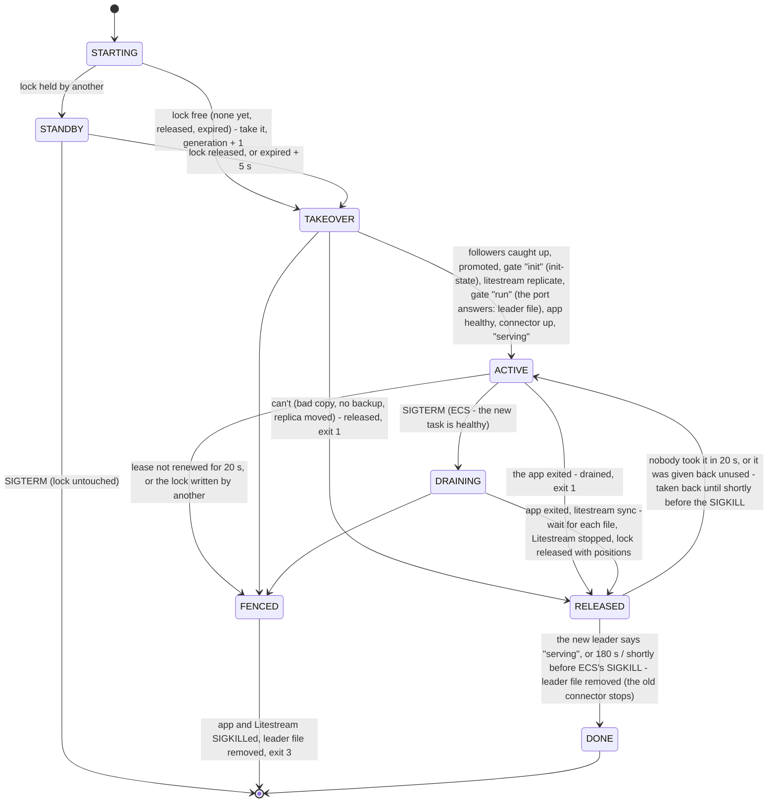

# sizeup in the cloud: hub and station

To try the CAD with firefighters who aren't at the firehouse, sizeup runs in two places from the
same code and the same entry point (`python -m sizeup --config ...`), chosen by `[cloud] role`:

| | **station** (the Mac with the SDRs) | **hub** (the cloud) |
|---|---|---|
| Radios, trunk-recorder, MDC decode | yes | none: nothing opens an SDR or starts a program |
| whisper (3.8 GB), Kokoro voice (1.4 GB) | yes | none |
| Dispatch voice | its Kokoro (all-in-one; the hub's fallback) | **Amazon Polly**, made on the hub ([below](#the-dispatch-voice-amazon-polly)) |
| Web UI | the **station page** `/` ([below](#the-station-page)): Radios, Monitor, Settings (the hub link). No CAD | CAD `/cad` (Overview, Incident, Radio, Settings), wall board `/monitor`: **the CAD of record** |
| CAD database | its own `state/cad.sqlite`, not synced: the radio-ID registry (talker names), the channel and speech-to-text settings the hub sends, the vocabulary | `cad.sqlite` (+ `hub.sqlite`, `audio.sqlite`) |
| Network | outbound HTTPS to the hub only | reached only through Cloudflare Tunnel |

No `[cloud]` section = today's all-in-one, unchanged.

### The station page

With `role = "station"` the station's own web page (http://localhost:8091 on the station PC) is about
the station only (user, 2026-10-13: "the local system doesnt show the cad bits just things relevant to
the sdr station data pulling/pushing, and maybe the monitor page too"): `static/station.html`,
`station.js`. The header says it is the station: "Station", its name (the id on hover, #271), the hub link's state ("Hub
connected" / "Hub unreachable" / "Hub not sending" / "Not forwarding") and a link to the CAD on the hub.

| view | what's on it |
|---|---|
| **Radios** (`/`, `#radios`) | the CAD's Settings > Radios (`radio-controls.js`): receivers, speech-to-text and the Hub row; each dongle's job (and who else holds it: shortfinal's claims); the paged incident; Channels (record, transcribe, engine; set on the hub while forwarding, then locked here); vocabulary; re-run speech-to-text; the disk |
| **Monitor** (`#monitor`, also `/monitor`) | the pages and transmissions this station heard, newest first: play, time, talker (rig and radio ID), channel, the transcript and the model that wrote it ("Transcribed on the hub (AWS)" for channels on AWS); search and a channel filter |
| **Settings** (`#settings`) | the **Hub link** card (`hublink.js`, the same card as the CAD's Settings → System → Station): Forward to hub on / off, the hub URL, Test connection, the status, the last contact, what waits in the outbox, the last error, where each secret came from (never a value); **This station**: id, name, role, version, build, and the `sizeup-station` commands for the rest (`status`, `doctor`, `logs -f`) |

What it doesn't have: the dispatch console, events, run cards, the CAD's lists and users, the dispatch
voice settings, the wall board. `/cad` redirects to the station page (`/?from=cad`, which then says
"This is the station. The CAD is on the hub: <hub URL>/cad"; the console's old links land on the
matching view: `#settings/radios` on Radios, `#settings/...` on Settings, `#radio` on Monitor).
Every `/api/cad/...` route answers `409 {"error": "this is the station: the CAD is on the hub
(<hub URL>)", "hub_url"}`, the mirror of the hub's `409` on `/api/station-mode`, but for the three
Settings > Radios uses (`GET /api/cad/stt`, `POST /api/cad/settings/channels`, `POST
/api/cad/settings/stt`: `sizeup/web/server.py` `STATION_CAD`).

The CAD itself still runs inside the station process: its store holds what the station's radios use
(the radio-ID registry for talker names, the channel and speech-to-text choices the hub sends with
`set_channel_prefs`, the vocabulary, the communications log), and the hub's `tts` jobs render through
it. What doesn't start on a station is the CAD's state push (the whole console rebuilt and sent to
`/api/cad/stream` once a second), which nothing there would read. Hub and all-in-one are unchanged.

**Station on / off from the UI** (user, 2026-10-08: "how do we turn on and off station mode
though? id like that to be easy to do from the ui"): on any machine that isn't the hub,
**Settings → System → Station** (on a station: the station page's **Settings**) has a *Forward to hub* switch, the hub URL, the link's status, where
each secret came from and *Test connection* (`sizeup/cloud/stationmode.py`). Switching starts or
stops only the link (forwarder, state, job long poll) and the station-only parts (the "CAD of
record is the hub" banner, the Hub row and pill): radios, speech-to-text and the voice keep
running. Off keeps the outbox: what was queued goes up first when it's back on; what is heard while
off is not queued (all-in-one). The choice is kept in `state/cloud.json` and from the first change
wins over `[cloud] role` / `hub_url`, which are only the default. Each change is in the Settings
audit (section system) with the Operator's name. The hub can't be switched (a cloud deployment):
`GET|POST /api/station-mode` answers 409 there. API: `GET /api/station-mode` → `{forward, hub_url,
from, running, status: {state, text, detail, waiting, last_error, ...}, secrets: {token, access_id,
access_secret: {set, source}}, keychain}`; `POST /api/station-mode {forward?, hub_url?, operator}`;
`POST /api/station-mode/test {hub_url?}` → `{ok, status, text}` (the hub's `/healthz`, then
`GET /api/station/hello` with the token: nothing sent, the hub doesn't count it as "seen").

Secrets on the station: the environment, else `[cloud]`, else the **macOS Keychain**
(`security find-generic-password -s <service> -w`; services `sizeup-station-token`,
`sizeup-access-id`, `sizeup-access-secret`, renamed with `[cloud] keychain_prefix` or
`keychain_token` / `keychain_access_id` / `keychain_access_secret`). Never logged or shown: only
"set (Keychain)" / "set (env)" / "missing". See `deploy/station/README.md`. A Linux station (Windows
via WSL2, or a Raspberry Pi: `deploy/station/install-windows.ps1` / `install-linux.sh`) has them in
`/etc/sizeup/station.env`, which its systemd unit loads into the environment; it has no voice
(`[dispatch] tts_engine = "none"`), so a dispatch Polly can't say is text only.

```
 station (Mac)                                                       hub (Fargate task)
 ┌──────────────────────────────────────────┐   HTTPS, outbound   ┌──────────────────────────────────┐
 │ receivers → STT → App (as all-in-one)    │   Bearer token      │ cloudflared ──► sizeup (HubApp)  │
 │   _emit ─► outbox.sqlite ─► forwarder ───┼──── POST events ───►│   same App code applies events   │
 │   talking now / status ─────────────────┼──── POST state ────►│   monitor, CAD comms, 60 Control │
 │   job runner ◄── long poll ─────────────┼──── GET jobs ◄──────│   jobs: switches, re-runs, voice │
 │     Kokoro: the voice if Polly fails ────┼──── POST result ───►│   SQLite ─► Litestream ─► S3     │
 └──────────────────────────────────────────┘                     │ dispatch voice ─► Amazon Polly   │
                                                                  └──────────────────────────────────┘
```

## What flows

**Station → hub, in order, durable** (`POST /api/station/events`, batched): the station emits at the
same places it updates its own state (`sizeup/app.py`), and the hub applies each event through the
same App code, so the hub's monitor and CAD come out as they would locally.

| event | emitted in | carries | the hub does |
|---|---|---|---|
| `page` | `_segment` (paging channel) | the page (tones, departments, times) + its clip; `stt: "aws"` (no `page_text` follows) / `"both"` | `_page_heard`: listed; a tones-only page waits for its voice; "aws": Amazon Transcribe reads the voice, then the dispatch is parsed |
| `page_text` | `_transcribed` | the page's transcript | `_transcribed`: parses the dispatch itself → monitor incident → **pending CAD event** (`from_monitor`) |
| `traffic` | `_transcribed` | a finished transmission: times, channel / talkgroup, talker, radio IDs (P25: ID + alias per talker), transcript, model, whether it attaches to our incident + its clip; `transcript_pending: "aws"` (no text: the station skipped whisper) or `stt: "both"` | rig from the **hub's** radio registry, then `_transcribed`: monitor + CAD communications log (links to events); "aws" / "both": Amazon Transcribe on the clip (below) |
| `retext` | `_retext` | new text for a page / transmission (a re-run) | `_retext`: monitor, page dispatch, CAD log; old text kept in history |
| `rerun` | `_rerun_finish` | a re-run is over, whatever came of it: `result` changed / same / failed: why | `_rerun_finish`: the transmission's `rerun_at` / `rerun_result` (the ⋯ menu's Re-transcribe waits for it) |
| `alt_text` | `_set_alt` | "both" re-run: the station's whisper text as the alternative | `_set_alt`: kept to compare, the text (AWS's) stays |
| `heard` | `_heard` | a radio ID (and P25 alias) heard on the air | the hub's radio registry learns it |
| `alarm` | `_call`, `_fm_emergency`, `_segment` (`_alarm_now`) | the emergency button: a P25 key-up trunk-recorder flagged (the call JSON's `emergency`), at the end of its call; an MDC-1200 / FleetSync emergency packet on a fireground channel (FG1, FG2) at the key-up (the live tap; id `FG1-live-<ms>`, no clip yet), then the finished transmission (`alarm_key`: the key-up's) with its clip; before speech-to-text | the emergency alarm at once (sizeup/cad/alarms.py, #128); its `traffic` event follows with the words and updates the same alarm. An older hub ignores it (the `traffic` event still carries `emergency`) |

Clips go as 8 kHz mono WAV (already band-limited to 300-3300 Hz, so nothing audible changes; half
the upload). Each event has a `seq` from the station's outbox; the hub remembers the last one applied
per outbox `epoch` (in `hub.sqlite`), so a retried batch is applied once, and pages / transmissions are
also keyed by their ids.

**Station → hub, latest wins** (`POST /api/station/state`): who is talking now and a page going out now
on South 2 (`paging`: each tone pair as it decodes, then "voice", then ended for 4 s once the page is
built; sizeup/radio/livepage.py), pushed the moment it changes (sub-second; re-sent every 2 s while
someone talks or a page goes out; the hub drops a snapshot older than 8 s; a hub from before ignores
`paging`, a station from before sends none),
and every 5 s the station's radio / SDR / STT / voice rows, SDR switches, re-run progress, outbox
size and its version (also the heartbeat). The talkgroup list goes every 30 s or when a switch
changes. The hub answers `{ok, build}`: its own build, which the station follows
([Station updates](#station-updates-it-follows-the-hubs-build)).

**Hub → station, jobs** (`GET /api/station/jobs?wait=25`, the station's long poll; the answer comes
back as `POST /api/station/jobs/<id>`), handed out once, dropped if not picked up in time:

| job | from | the station | if the station is offline / slow |
|---|---|---|---|
| `tts` | a dispatch / preview / upgrade on the hub when Polly failed (`Cad._render_hub` → `_render_remote`), or always with an engine other than `polly` | renders it with `render_dispatch` and its Kokoro (`say` as its fallback), returns the WAV | at once (offline) or after 20 s: **text only**, the note says why: "Voice unavailable — Polly: AccessDeniedException: …; station offline since 14:02: text only" (or "didn't answer in 20 s"); never a hung request |
| `call` `set_mode`, `set_talkgroup`, `set_talkgroup_group` | the hub's SDR / talkgroup switches | runs it, returns its own refusal if any | the switch is refused with the reason ("station offline since 12:03") |
| `call` `retranscribe` | Re-transcribe on the hub for a channel on the local model (one on "aws" runs Amazon Transcribe on the hub's clip; "both": AWS here, this for the alternative, args `[ids, true]`; AWS unavailable: here, said in the result), or Amazon Transcribe failing for a clip the station didn't run whisper on | queues it; new text comes back as `retext`, then always a `rerun` (changed / same / failed) | refused: speech-to-text runs on the station (a failed AWS clip then says "transcription failed"; a re-run ends "failed: ...") |
| `call` `set_channel_prefs` | Settings > Radios > Channels on the hub, or the station reporting other choices than the hub's (`channels.sig` in its state) | applies the whole map + whether AWS can take audio now, keeps it (its own Settings overrides, audited as "hub"), reports `{prefs, aws, sig}` | sent when it's back: the Channels card says "Station offline ...: these apply when it's back" |
| `call` `emergency_all_clear` | an alarm's **All clear** on the hub (`Alarms.all_clear` → `HubApp._all_clear_sent`, in the background) | closes its emergency window for that talkgroup and radio (`App.emergency_all_clear`) | logged on the hub; the station's window then ends on its own (`[p25] emergency_window_min` after the last emergency key-up). A station from before refuses it the same way |

**The emergency window** (#128, 2026-10-14). trunk-recorder records every talkgroup (`recordUnknown`, every
row of `talkgroups.csv` mode `T`); the **station** drops the calls of a talkgroup whose Record switch is off
(`App._call`). The P25 emergency button opens a window there: every call on its talkgroup, and every call of
the radio that pressed it on any talkgroup, is kept until `[p25] emergency_window_min` (10) after its last
emergency key-up, Record off or on; another emergency key-up extends it. The hub opens the same windows from
the alarms (to show "Recording until 20:09 (emergency)" on the alarm, the strip and the Radio view's talkgroup
head) and sends All clear to the station. Acknowledge (seen) leaves the window running; All clear (resolved)
ends it. Calls kept only by the window carry `kept: "emergency"` (the row says "kept: emergency window").
Windows live in memory: a restart of the station forgets an open one. An emergency call's own trunk-recorder
JSON is kept in `captures/emergency/` on the station (90 days) and its contents ride with the flagged
transmission to the hub (`radio_traffic.evidence`).

Settings, run cards, units, radio IDs and every CAD record stay on the hub. The station has no CAD
pages of its own ([the station page](#the-station-page)).

## On screen

* Hub, Settings > Radios, Receivers: a **Station** row ("3 s" / "offline 12:03"; the tooltip says "connected, last
  seen 3 s ago" or "offline since 12:03:41", and the station's version: "up to date (abc1234)",
  "updating ...", "update to abc1234 failed (...)"; the word says "updating" / "update failed"), then the station's rows as it reported them. Offline,
  those rows turn *unknown* with what they last said: never a stale "ok". The SDR switches only show
  while the station is connected. A dongle whose job the station gave it by itself (`[radio]
  auto_assign`, deploy/station/README.md) reads "· FG1 · auto" (the row's `set_by`: "person", "auto",
  or missing from an older station, which then shows no "auto").
* Hub, CAD header: "Station connected" / "Station offline 12:03". No health banner under it, for anyone
  (#203): the station health alerts are on the admins' Settings → **Health** ([Station health and
  alerts](#station-health-and-alerts)); for an admin the Station row opens it.
* Station page, Radios, Receivers: a **Hub** row (connected, or offline with how many events are waiting;
  "not sending" when forwarding is on without a token; its version against the hub's, as above). Its header: the "Hub connected" / "Hub
  unreachable" / "Not forwarding" pill and a link to the CAD on the hub. Settings: the last contact
  and what waits in the outbox.
* An all-in-one machine forwarding from Settings → System → Station: the same Hub row, and on its
  `/cad` the pill and the banner with the hub's URL. They go when forwarding is switched off and come
  back when it's on.

## Failure behaviour

| what fails | what happens |
|---|---|
| Internet / hub down | The station runs on as all-in-one. Events wait in `state/outbox.sqlite` (committed as they happen) and go up in order when the hub is back, also after either side restarts. The hub shows "Station offline since ...". |
| Outbox grows huge | Over `outbox_max_mb` of queued audio, the oldest clips are dropped (the event stays, marked); transcripts, pages and radio IDs are never dropped. |
| A batch is delivered twice | Applied once (seq per epoch, ids). |
| One event can't be applied | Logged and counted in the Station row; the ones behind it still apply. |
| Station offline during a dispatch | Text-only dispatch with the reason, immediately. |
| Station slow to render | After 20 s, text only; a late answer is discarded. |
| Hub redeployed | A hot/cold handoff ([Deploys](#deploys-the-hotcold-handoff)): the new task waits warm beside the old one, which drains, puts its last changes in S3 and hands over. The page shows "Reconnecting… (update in progress)" for roughly 10–20 s and carries on; the station retries within seconds. Nothing written is lost (every change is confirmed in S3 before the lock is released). Lost: the in-memory "talking now" and station status (back within 5 s), a tones-only page waiting for its separate voice transmission. Received clips survive (in `audio.sqlite`: [Audio retention](#audio-retention)). The new app serves the CAD at once and reads the map layers' caches (already restored by the standby) in the background: each layer says "loading" for a few seconds. A hub that crashes: the lease runs out in 35 s and a standby (if any) takes over; else ECS starts a task that restores cold (as before: minutes), losing up to ~1 s of the newest writes. |
| Clocks differ | Transmission times are the station's clock; the hub warns in the Station row above 5 s. Keep both on NTP. |
| Late delivery | Events that arrive after an outage are applied as they arrive: the monitor attaches traffic to whatever incident is active then; the CAD links by the transmission's own time. |
| A station update doesn't come up | Switched back to the release that ran before within 90 s; that build isn't tried again until the hub moves on. The Station row says "update to ... failed". |
| A station update fails its preflight | Never switched to: the station keeps running, untouched. Same report. |
| The station goes quiet, falls behind, a dongle or program stops | An alert: Settings → Health (admins), log, push to the status topic, a recovery notice when it's back ([Station health and alerts](#station-health-and-alerts)). |

## Station updates: it follows the hub's build

The Linux station (deploy/station/README.md "Updating") runs exactly the commit the hub runs:

* The hub's image is built with `SIZEUP_BUILD` = the full git sha (`.github/workflows/deploy.yml`);
  `/healthz` and every `POST /api/station/state` answer carry it. No build (a local hub): stations
  do nothing.
* The station (`sizeup/cloud/autoupdate.py`, `Watch`) writes that build to
  `/run/sizeup/update-wanted` once the hub has said it for 30 s. That file is all the sizeup user
  does; `sizeup-update.path` starts the root updater outside the sizeup process.
* The updater only takes a commit that is on `origin/main`; builds it **beside** the running one
  (`/opt/sizeup/releases/<sha>`: the code, its venv, as hard links when the requirements didn't
  change; trunk-recorder / whisper.cpp / rtl-sdr only when their pins changed); preflights it
  (imports, the config, the databases in a scratch dir, the units, the programs); waits up to 5 min
  for a quiet moment (no carrier open, nobody talking, no transcription running); swaps
  `/opt/sizeup/current` by rename and restarts once; and swaps back if `/healthz` doesn't answer with
  the new build within 90 s. A failed build is not tried again until the hub moves on. 3 releases kept.
* A commit that changes nothing the station runs (docs, tests, CI, the hub's files) doesn't restart
  it: the station counts as up to date with it. A build that breaks for a passing reason (apt lock,
  network, disk) is retried after 5, 15, 60, 60 minutes, then recorded as failed.
* Paused: `sizeup-station autoupdate off`, `[station] auto_update = false`, a station on another
  `--ref` than main, or one installed from a folder. The hub out of reach: the station stays put.
* What it did goes up in the station's status (`version`: its build, the updater's state, last
  result, recent failures) and shows in the hub's Station row (above).
* Nothing heard is lost across the restart: the outbox is on disk (`state/outbox.sqlite`, committed
  per event) and goes up first. whisper-server runs as its own service on the station, so an update
  doesn't reload the model; trunk-recorder still restarts with sizeup (#71).

## Station health and alerts

> "make it so we are aware/know when the station is updated/not, if it's behind, etc, so we know if/when we
> push changes if there are issues… add some better healthchecking" (user, 2026-10-13; GitHub #79, #35)

The hub watches the station (`sizeup/cloud/health.py`) from what it already sends: every 5 s the station's
state post carries its radio and SDR rows, its version and the updater's last result, its outbox, and now
`health`: this machine's CPU (Linux; the load average elsewhere), memory, disk, temperature (where the
machine has a sensor), when sizeup and the machine last started, and each radio program as it really runs
(each dongle's job, trunk-recorder, whisper). A station from before this sends no `health`: the hub then
works from the rows alone and the panel says so.

**Alerts.** Each has a text, a severity, a start time, and clears by itself with a recovery notice:

| alert | when | severity |
|---|---|---|
| Station silent | no state post for `silent_min` (3 min); after a hub restart, 3 min with no station at all | critical |
| Station behind the hub | on another build than the hub's (behind, still updating, paused, failed) for `behind_min` (15 min); a docs-only build the station recorded as equivalent is not behind | warning |
| Station update failed | the update to the hub's build failed or was rolled back (critical when the rollback failed too); the text has the updater's log line | warning |
| SDR gone | a dongle the station had isn't plugged in / not found | critical |
| Duplicate dongle serial | two or more dongles on the station share one serial (#242: a new dongle on its factory `00000001`): "Two dongles share serial 00000001 (indexes 1 and 4): sizeup can't tell them apart. Fix: sizeup-station sdr-serial 4 <new-serial> ...". Nothing of ours (a job, trunk-recorder, readsb) opens that serial until one is renamed ([the station's README](../deploy/station/README.md#two-dongles-one-serial)) | critical |
| *job* not running | a dongle's job (a channel) isn't running for 60 s (a restart or a switch is quicker); one dongle per channel: each channel | critical |
| Speech-to-text down | whisper-server not up for `down_min` (2 min) | warning |
| trunk-recorder down | trunk-recorder not up for `down_min` while its dongle job is on | critical |
| *channel* stuck open | the squelch open without a break (#116's `stuck`, 2 min) | warning |
| P25 trunk silent | trunk-recorder running but no call on **any** talkgroup for `p25_silent_min` (20 min; `p25_silent_night_min`, 60 min, for a silence that reaches 00-06; longer when the system's learned gaps say so), or trunk-recorder losing the control channel (decode rate under 2/s) for 2 min (below) | critical |
| Station's events backing up | the oldest event waiting on the station is `outbox_min` (5 min) old: it couldn't reach the hub. The hub can't see that while it happens, so it shows when the station is back, from the age of the oldest event it reports, and clears as it drains | warning |
| Station disk full | over `disk_pct` (90%) full; critical from 97% | warning |

While the station is silent (or before it first reports after a hub restart) the other alerts keep the
state they had: nothing starts or clears on old data. **Per-channel silence** is a hint, not an alert: each
channel's gaps between transmissions are learned (the last 200, kept across redeploys), and a channel quiet
for 3 times its usual gap for that time of day (90th percentile) and at least 30 min says so in the panel:
"nothing heard for 2 h (last heard 13:05); at this time of day it usually hears something within 25 min". That
holds for every conventional channel (FG1, FG2, South 2, HPN Tower) and every main talkgroup (`tg:307`, from the
station's `health.heard`): never an alert, never a push (#258: fireground is quiet for hours, HPN Tower closes
23:00-06:00, Fire/EMS 15 can be quiet for an hour). Each gap is also filed under the part of the day it started in
(00-06, 06-12, 12-18, 18-24, station time); the usual gap is the 90th percentile of that part's gaps (the whole
day's while it has fewer than 10), and for a silence that spans several parts the largest of them.

**The whole P25 system silent is the alert** ("P25 trunk silent", critical). The P25 job's row hears a call on
any talkgroup trunk-recorder writes, so its last call is the system's:

* no call on any talkgroup for `p25_silent_min` (20 min) by day, `p25_silent_night_min` (60 min) for a silence
  that reaches 00-06. With 30 gaps of the system learned, 4 times its usual gap for that time of day when that is
  longer (a station that records few talkgroups), never shorter: a county system with dozens of talkgroups doesn't
  go 20 min without a call by day, and the control channel (next) catches a fast outage;
* the control channel lost: trunk-recorder logs "Control Channel Message Decode Rate: N/sec" every 3 s while it
  decodes under its warn rate, and retunes under 2/s; the station follows its log (`sizeup/radio/recorder.py`
  `ControlChannel`) and reports a run under 2/s (`health.recorder.cc`); 2 min of it is the alert at once;
* only while trunk-recorder runs (down is the trunk-recorder alert) and the station reports; a trunk-recorder just
  back up gets the window to hear a call; it clears at the next call (or the control channel decoding again).
  "P25 trunk silent 25 min: no calls on any talkgroup since 13:05 (trunk-recorder running): check the P25
  dongle/antenna, control channel (alert past 20 min)".

`[alerts] main_channels` (#242's per-channel silence alerts) is no more: an older config with it still loads, and
it changes nothing.

**Where they show.**

* Settings → **Health**, admins only (#203: "we dont need things like that shown to other people"): one row
  per alert, critical (red) first, with its severity, start time and how long, where, and whether it was
  pushed (a recovery notice follows one that was). Never a banner under the header on `/cad` or `/monitor`,
  and nothing of it in the state push: a dispatcher or a viewer neither sees nor receives it.
* The hub's log: `health: ALERT ...` once when it starts, `health: cleared ...` once when it clears.
* A push to the alert topic (below): at most one per alert per `repeat_min` (15 min), plus its recovery
  ("Recovered: ..."); an alert that came back within the 15 min shows on screen at once and is pushed when
  the 15 min are up if it is still on. The title says who and where (`sizeup/notify.py` Who), e.g.
  "Station silent 4 min · Port Chester FD · last heard 14:32", "South 2 not running · PCFD · SDR 101 on South 2";
  the push opens the panel (with `[cloud] public_url` set).
* Alerts and 24 h of their history are in `hub.sqlite`: a redeploy neither forgets an alert nor pushes it again.

**The panel:** Settings → **Health**, a tab of its own shown to admins on the hub (also the Station row in
Settings → Radios → Receivers, for an admin; the pushes' old link `#settings/system/health` lands there): links
to Push notifications and Amazon Transcribe's row in Data sources, then the alerts now, the hints, then the station (connected, last state post,
clock difference, sizeup and machine up since), the version (station and hub builds, the state, the last
update with its timings and log line, failed builds), the outbox and the system (CPU, load, memory, disk,
temperature), the programs (whisper, trunk-recorder), each dongle (plugged in, job, running, restarts),
each channel (state, last heard, quiet for, its usual gap, squelch open / stuck, quieting, restarts, hint),
and the alert history of the last 24 h (started, recovered, how long, where, whether it was pushed).
`GET /api/cad/health`: admins only (`sizeup/cad/api.py` `ADMIN_READS`; a 403 for a dispatcher or a viewer),
polled every 5 s while the tab is open and not otherwise.

### The alert and status topics (ntfy)

Pushes go to **topics of our own** on ntfy.sh, never Tapout's: `pcfd-phone-prealert` pages the fire
crew's phones and `pcfd-status` is Tapout's own health feed. The config refuses both (and whatever
`[prealert]` names), and `sizeup/notify.py` refuses them again before any request. The refusal is by
exact name: a topic of ours with "status" in it is fine. No topic: no push (banner and log only); that is
the default.

Two kinds, two topics (`sizeup/notify.py` `route()`):

| Kind | Setting (hub: SSM) | What |
|---|---|---|
| alerts | `[alerts] ntfy_topic` / `SIZEUP_ALERT_TOPIC` (`/sizeup-hub/alert-topic`) | Emergency buttons (P25, MDC, FleetSync), the fireground mayday, aircraft emergency squawks; their acknowledgements, all clears and "Ended" notices |
| status | `[alerts] status_topic` / `SIZEUP_STATUS_TOPIC` (`/sizeup-hub/status-topic`) | Station health (silent, behind, update failed, dongle gone, job / whisper / trunk-recorder down, stuck channel, outbox, disk, whisper queue), "Amazon Transcribe failing", its monthly budget at 80 % / 100 %, and every recovery notice |

Only one of the two set: both kinds go to it. The app logs at startup where each kind goes
("notify: alerts → topic set (SSM), status → topic set (SSM)"), never the names.

**Settings > System > Push notifications** (admins only) changes either topic, and the ntfy server, without a
restart: a value set there wins over SSM / the environment, which win over the config file; empty means "use
that default"; **Turn off** stops that kind's pushes. Each kind shows the topic in effect, where it came from
(Settings, SSM, config file, shared with the other kind, off), and its last push and result. **Send test push**
sends "sizeup test: status topic" (or alerts) to the topic in effect. The same validation as the config: Tapout's
topics and the `[prealert]` ones refused by exact name, 12 to 64 letters, digits, `-` and `_`. Every change
and every test push goes into the Settings audit log with who and when, the topic as a fingerprint
("topic #3f9c27"): the audit log, the activity, the settings export (which leaves the section out; an import
keeps it), `/api/station/status` and the logs never carry a name. `GET /api/cad/notify` is admins only.

1. **Choose the name.** ntfy topics are public by name: anyone who knows it can read and post. Make it long
   and random, e.g. `python3 -c "import secrets; print('sizeup-health-' + secrets.token_hex(8))"` →
   `sizeup-health-3f9c27d1a0b84e65`. At least 12 characters (letters, digits, `-`, `_`).
2. **Subscribe on your phone:** the ntfy app (iOS / Android) → **+** → topic name → server `ntfy.sh` →
   Subscribe. Allow its notifications; a critical alert is sent at high priority. To test, publish one by
   hand to *your* topic only: `curl -d "test" ntfy.sh/<your topic>`.
3. **Give them to the hub** (secrets by name, so not in the repo):
   `aws ssm put-parameter --name /sizeup-hub/alert-topic --type SecureString --value '<your alerts topic>'`
   and the same for `/sizeup-hub/status-topic`, then, and only then (a task whose secret is missing doesn't
   start), the hub container's `secrets` in `deploy/aws/taskdef.json` (and `sizeup-aws/7-deploy-pr.sh`'s copy)
   name both:
   `{"name":"SIZEUP_ALERT_TOPIC","valueFrom":"arn:aws:ssm:us-east-1:504804195561:parameter/sizeup-hub/alert-topic"}`,
   `{"name":"SIZEUP_STATUS_TOPIC","valueFrom":"arn:aws:ssm:us-east-1:504804195561:parameter/sizeup-hub/status-topic"}`.
   Elsewhere: `SIZEUP_ALERT_TOPIC=...` / `SIZEUP_STATUS_TOPIC=...` or `[alerts] ntfy_topic` / `status_topic`
   in the config. The health panel says "Push on" once the hub has a topic for status.

```toml
[alerts]                           # sizeup/cloud/health.py; leave out: these defaults, no push
ntfy_topic = ""                    # the alarms; or env SIZEUP_ALERT_TOPIC (the hub: SSM /sizeup-hub/alert-topic); never Tapout's
status_topic = ""                  # health / status; or env SIZEUP_STATUS_TOPIC (the hub: SSM /sizeup-hub/status-topic)
ntfy_server = "https://ntfy.sh"
silent_min = 3                     # no state post from the station this long
behind_min = 15                    # on another build than the hub this long
down_min = 2                       # whisper or trunk-recorder down this long
outbox_min = 5                     # the oldest event waiting on the station this old
disk_pct = 90                      # the station's disk this full
repeat_min = 15                    # at most one push per alert this often (plus its recovery)
```

`sizeup/notify.py` is the one place sizeup publishes anything: `publish()` / `Notifier.send()` with a title,
a body, a priority, tags, a click URL and a `who` (units with their names, the talker, the channel, the
incident number and address, the station, the dongle, a detail), rendered after the title the same way for
every caller ("MAYDAY · E64 P1 (Engine 64) on FG1 · 26-000015 100 S Ridge St"). The mayday alarm (#128)
uses it too.

### A deploy that checks itself

After the hub is deployed, `.github/workflows/deploy.yml` waits up to 15 min for the station to report the
new build (`tools/deploy_check.py`, polling `GET /api/station/status` every 15 s) and prints the station's
update log line ("update abc1234 -> def5678: ok in 74 s (built 40 s, waited 0 s for a quiet moment, web back
6 s after the switch)"). A docs-only deploy counts as soon as the station records it as "no runtime change".
The step **fails** when the update failed or was rolled back, when auto-update is paused on the station, when
the token is refused, or when 15 min pass; a failed workflow emails as usual, and the hub's own "behind"
alert follows. Without the secrets the step is skipped with a warning.

`GET /api/station/status` is read only: the hub's build, the station's build, update state, last update
(with its log line) and the alerts; nothing else. It takes the station token or the **status token**, which
opens nothing else (posting events, state or jobs with it is a 401). The status token is derived from the
station token (HMAC-SHA256), so nothing new needs deploying; `SIZEUP_STATUS_TOKEN` / `[cloud] status_token`
sets another one instead.

**GitHub secrets to add** (Settings → Secrets and variables → Actions → New repository secret):

| secret | value |
|---|---|
| `SIZEUP_STATUS_TOKEN` | the status token: `SIZEUP_STATION_TOKEN="$(aws ssm get-parameter --name /sizeup-hub/station-token --with-decryption --query Parameter.Value --output text)" python -m sizeup.cloud.health status-token` (or `printf %s sizeup-status-token-v1 \| openssl dgst -sha256 -hmac "$SIZEUP_STATION_TOKEN"`) |
| `SIZEUP_ACCESS_CLIENT_ID` | a Cloudflare Access service token's Client ID that the `/api/station/` Access application lets through (the station's, or better a second one for CI: Zero Trust → Access → Service auth → Create, then add it to that application's Service Auth policy) |
| `SIZEUP_ACCESS_CLIENT_SECRET` | its Client Secret |

The hub's URL is `https://sizeup.actualsecurity.org` unless the repository variable `SIZEUP_HUB_URL` says
otherwise. With a Bypass policy on `/api/station/` instead of a service token, only `SIZEUP_STATUS_TOKEN` is
needed.

## Auth and security

* Every `/api/station/*` request carries `Authorization: Bearer <token>`. The hub compares it in
  constant time (`hmac.compare_digest`) and refuses everything when it has no token configured
  (403). The token comes from `SIZEUP_STATION_TOKEN` (preferred; `[cloud] token` also works), at
  least 16 characters: `openssl rand -hex 32`. A refused request never has its body read.
* The station needs `https://` for the hub (plain http only to this machine, for tests) and never
  listens for the hub: no inbound ports, no port forwarding.
* **Cloudflare Access** in front of the hub's hostname for people (email one-time PIN or the
  department's identity provider). For `/api/station/*`, choose one:
  1. **Service token (recommended):** a second Access application on `<host>/api/station/` with a
     *Service Auth* policy for a service token. The station sends `CF-Access-Client-Id` /
     `CF-Access-Client-Secret` (`SIZEUP_ACCESS_CLIENT_ID` / `SIZEUP_ACCESS_CLIENT_SECRET`) **and** the
     bearer token. Two independent gates; nothing reaches the hub without the service token.
  2. **Bypass:** an Access *Bypass* policy on `<host>/api/station/`. Simpler; the bearer token is
     then the only gate (rate-limit that path with a Cloudflare WAF rule if you can).
  Either way the rest of the hostname (UI, CAD API) stays behind Access. Access answering the
  station with its login page shows up on the station as "hub sent something that isn't JSON: is
  Cloudflare Access letting the station through?".
* The hub binds `127.0.0.1` inside the task: only the cloudflared sidecar reaches it.
* With `access_team` + `access_aud` set, the hub itself also checks every person's Access token
  (below): reaching the origin around Access gets a 401, not the CAD.
* Transmit stays off on both (`NullTransmitter`): the hub has no radio at all.

## The dispatch voice (Amazon Polly)

> "voice unavailable... that should be server side not station local, only the transmission when
> we get there should be station local" (user, 2026-10-08) — Amazon Polly, "with a male voice".

The hub makes the dispatch voice itself with **Amazon Polly** (`[dispatch] tts_engine = "polly"`,
`voice = "Matthew"` in `deploy/hub/config.hub.toml`): a dispatch, preview or upgrade no longer needs
the station. `sizeup/polly.py` calls `SynthesizeSpeech` (`POST https://polly.<region>.amazonaws.com/v1/speech`,
16 kHz 16-bit PCM) signed with SigV4 in the standard library (no boto3); `render_dispatch` puts the
tones in front and reads it twice with the time out once, exactly as with Kokoro.

* **Credentials:** the task role, from the ECS container credentials endpoint
  (`AWS_CONTAINER_CREDENTIALS_RELATIVE_URI`), cached until 5 min before they expire;
  `AWS_ACCESS_KEY_ID` / `AWS_SECRET_ACCESS_KEY` / `AWS_SESSION_TOKEN` win when set (running a hub
  elsewhere). **Region:** `[dispatch] polly_region`, else `AWS_REGION` (the task definition sets it), else
  `us-east-1`. Timeouts: 3 s to connect, 10 s to answer.
* **Permission:** the task role (`sizeup-hub-task`) needs `polly:SynthesizeSpeech`, nothing else:
  run `sizeup-aws/11-polly.sh` once (an inline policy `polly`); it applies from the next task start.
* **Voices** (US English, Settings → Dispatch → Voice lists them, men first): Matthew (generative,
  neural, standard), Stephen (generative, neural), Gregory (neural), Joey (neural, standard); also
  Joanna, Ruth, Danielle. A voice is tried on its best engine first; if Polly answers that the
  engine (or the SSML) isn't supported for it — `EngineNotSupportedException` / `ValidationException`
  — the next one is used, logged once and remembered (`GET /api/cad/tts/voices` → `polly_engine`).
  Which voices have the generative engine in us-east-1 is Amazon's list and changes; the fallback
  covers an entry here that is off.
* **Speed:** `speed` (0.92) is said as SSML `<prosody rate="92%">`; an engine that rejects it says
  the text at its own pace. Over 2900 characters (Polly bills and caps 3000 a request) the text is
  split at sentence ends and the pieces joined.
* **Cache:** the WAV is keyed by the words, tones, `polly`, the voice and its first engine
  (`Matthew:generative`), speed and repeat, on disk and in `audio.sqlite` like the station's renders:
  a preview and the dispatch right after share it, and nothing is rendered twice.
* **When Polly fails** (no permission yet, network, Polly's own error), the hub asks the station
  (`tts` job, its Kokoro with a man's voice, `am_michael`): the note says so, "Voice: Kokoro
  am_michael (station: Polly: AccessDeniedException: …)". No station either: **text only**, "Voice
  unavailable — Polly: AccessDeniedException: …; no station connected: text only". The next dispatch
  tries Polly again.
* **Preview:** Settings → Dispatch → Voice → *Preview* says "Engine 60, respond to 1 Main Street,
  structure fire. Time out 14:32." through the same path (`POST /api/cad/settings/dispatch
  {action: "voice_preview"}`).
* Stations and all-in-one keep Kokoro (`tts_engine = "kokoro"`); `polly` works there too with AWS
  credentials in the environment, falling back to macOS `say` like Kokoro does.

**Seam for transmission (M2, not built):** keying a radio stays on the station. The hub already
stores and serves the rendered WAV for every dispatch (`dispatch-audio/` + `audio.sqlite`, `GET
/api/cad/dispatch/<id>.wav`); when transmit is turned on, the hub's transmitter will hand that same
WAV to the station (a job, like `tts` in reverse) for it to key up and play. The voice is never
re-made on the station for that. Until then transmit stays off (`NullTransmitter`).

## Who is signed in (the operator from Cloudflare Access)

> "can we get the auth info from the cloudflare access auth to identify email that was authed with
> one time code to set the operators name dynamically?" (user, 2026-10-07)

Access sends every request it lets through to the origin with a signed JWT
(`Cf-Access-Jwt-Assertion`; the browser also holds it as the `CF_Authorization` cookie). With
`[cloud] access_team` and `access_aud` set, the hub (`sizeup/cloud/access.py`, stdlib only):

* **verifies it**: RS256 signature against the team's keys from
  `https://<access_team>/cdn-cgi/access/certs` (cached an hour; fetched again for an unknown key id,
  at most every 30 s; the cached keys are kept if a fetch fails), `aud` contains the AUD tag, `iss`
  is `https://<access_team>`, `exp` / `nbf` with 60 s leeway. Any other algorithm (`none`, `HS256`)
  is refused. The `Cf-Access-Authenticated-User-Email` header is never trusted on its own.
* **requires it** on every page and API except `/healthz` (the health check) and `/api/station/*`
  (the station's bearer token): 401 otherwise. A service token's JWT (no email, `common_name` =
  client id: the station) is a machine and never an operator.
* **uses the email as the operator**: every CAD write (events, notes, dispatches, unit status, run
  cards, radio IDs, Settings edits and their audit) records the signed-in person, whatever the page
  sent (`CadApi.post`). The name comes from **Settings → Users**, where an operator can have a
  sign-in email and a callsign; someone signing in for the first time is added under their email,
  "not named yet", for an admin to name. Recorded as `Corey <corey@example.org>` (just the email
  until named): the chronology shows "Corey" with the email as its tooltip, the audit log and CSV
  exports the whole thing.
* **shows it**: `GET /api/cad/whoami` → `{email, name, callsign, source: "access" | "none", role,
  enforced}` (with Access also `active`, `may`, `bootstrap`, `admins`); the CAD's Operator field then
  shows the name, read-only ("Signed in with Cloudflare Access as ...").

Without both keys (all-in-one, the station, local dev, a hub not set up yet) nothing changes: the
Operator field is typed or picked, as before. The hub logs which it is at startup.

### Roles: who may change what

> "admins should be able to set users, dispatchers should not, but first login should be able to set
> whatever i guess... now that i added julian and myself, myself as an admin i should only be able to
> be the one to make changes?" (user, 2026-10-08)

Each user in **Settings → Users** has a role. On the hub with Access on, it is **enforced** for the
signed-in person (their row, by email), server-side, on every POST (`sizeup/cad/api.py` `WRITES`,
checked in `CadApi.post` and, for the monitor's own POSTs, in `server.py`):

| Role | May |
|---|---|
| admin | everything |
| dispatcher | run calls: create / edit / accept / dismiss / close events, notes, recommend, preview, dispatch, upgrade, attach, return, put a transmission on an event, unit status on the board, close the paged incident (Settings > Radios). **No** Settings of any kind (lists, run cards, units and their home station, dispatch wording / tones / channels / voice / arrival estimates, users, import, reset), the radio-ID registry, the talkgroup / mode switches or re-running speech-to-text |
| viewer | look only (no writes) |
| deactivated (any role) | look only, "Your account is deactivated" |

A refused write is a `403 {"error": "Only an admin can change settings (you are a dispatcher)"}` (and
the like), logged on the hub and in the person's activity (below: `CAD activity: <email>: Refused:
settings/users (needs admin; dispatcher) (POST /api/cad/settings/users) ip=...`). A write
route not in `WRITES` is admin only until someone decides otherwise. Reads are not limited: everyone
signed in sees the console, Settings (read-only), the records, the CSV exports and the settings
export (the same users and emails Settings already shows them).

**No admin yet:** until there is an *active admin with a sign-in email*, anyone signed in may do what
an admin does, so the first person can set things up (Settings says "No admin yet: anyone signed in
can change settings. Make someone an admin."). Someone signing in for the first time is added as a
dispatcher. **No lockout:** once there is such an admin, the last one can't be demoted, deactivated or
have their email removed, and a settings import can't leave none (`409`, dry run included): make
someone else an admin first.

The console shows it (`cad.js` `applyRoles`): for a dispatcher Settings is read-only (every control
off but the section tabs, filters, records and export) under "Settings are read-only for dispatchers
— ask an admin (Corey)"; for a viewer or a deactivated user every action on the dispatch screen is
off too, under a banner. Without Access (all-in-one, the station, a hub without the keys) the role is
recorded, not enforced: a typed or picked name is no proof of who is at the console.

### Activity log

> "lets add some per user logging too" (user, 2026-10-08)

With Access on, the hub keeps one history per signed-in person (`sizeup/cad/activity.py`, the
`user_activity` table in `state/cad.sqlite`, so Litestream backs it up), each row with the time, the
route, the incident number when there is one, the visitor's address (`Cf-Connecting-Ip`) and browser:

| Kind | When | Summary, e.g. |
|---|---|---|
| `signin` | once per Access login (the token's `jti` / `nonce` / `iat`), not per request | Signed in |
| `action` | every write that went through (`CadApi.post`, and the monitor's own POSTs) | Created 26-000015 STRU/RESD at 209 Westchester Ave · Dispatched 26-000014: E60, L31 · Set E60 to OS (pump) · Changed settings: users/Julian role · Talkgroup 307: record on |
| `refused` | every 403 from the roles above, and the last-admin 409 | Refused: settings/users (needs admin; dispatcher) |

Summaries name what changed, never whole bodies or setting values (those stay in the settings
audit); previews and recommendations change nothing and aren't logged. Each row is also one line in
the server log (`CAD activity: <email>: <summary> [<number>] (<route>) ip=<ip>`), so CloudWatch has it.
Each person's *last seen* (time, address, browser) is kept on their Users row, written at most once a
minute. Rows older than **90 days** are dropped (on start and daily). All-in-one, the station or a hub
without Access record nothing here: the chronology and the settings audit are unchanged.

`GET /api/cad/activity?email=&kind=&since=&limit=` (newest first) and
`GET /api/cad/export/activity.csv`: an admin reads anyone's (no `email`: everyone's) and exports
it; anyone else reads only their own (`403` for someone else's, and for the CSV). **Settings → Users**
shows "last seen 3 min ago · 203.0.113.9" on each row and an **Activity** list (a kind filter, *All
users* and CSV for admins; *My activity* for everyone else).

**The AUD tag:** Cloudflare dashboard → Zero Trust → Access controls → Applications → **sizeup** →
Overview → *Application Audience (AUD) Tag* (64 hex digits). Use the `sizeup` application's (the
hostname's), not the `api/station` service-token application's. Not a secret: it goes in
`deploy/hub/config.hub.toml` (`access_aud`) or `SIZEUP_ACCESS_AUD`.

## Config

Station (optional: the station page's Settings does the same; see `deploy/station/README.md`):

```toml
[cloud]
role = "station"           # the default until the switch is first used (state/cloud.json then wins)
hub_url = "https://sizeup.example.org"
# token: env SIZEUP_STATION_TOKEN or Keychain sizeup-station-token; Access service token: env
# SIZEUP_ACCESS_CLIENT_ID / _SECRET or Keychain sizeup-access-id / sizeup-access-secret
# keychain_prefix = "sizeup"
# outbox = "state/outbox.sqlite"
# outbox_max_mb = 300
```

Hub (`deploy/hub/config.hub.toml`, baked into the image; no secrets in it):

```toml
[cloud]
role = "hub"
public_url = ""          # or SIZEUP_PUBLIC_URL
offline_after_s = 15
audio_max_mb = 500
access_team = "yoda.cloudflareaccess.com"   # or SIZEUP_ACCESS_TEAM
access_aud = ""          # the sizeup Access app's AUD tag (or SIZEUP_ACCESS_AUD); empty = identity off

[cad]
db = "cad.sqlite"        # under SIZEUP_STATE_DIR (/data in the image)
```

Environment overrides (any role): `SIZEUP_HOST`, `SIZEUP_PORT`, `SIZEUP_STATE_DIR` (where relative
storage paths go: `cad.db`, `storage.clips_dir`, `cloud.outbox`), `SIZEUP_STATION_TOKEN`,
`SIZEUP_PUBLIC_URL`, `SIZEUP_HUB_URL`, `SIZEUP_ACCESS_CLIENT_ID` / `_SECRET`, `SIZEUP_ACCESS_TEAM` /
`SIZEUP_ACCESS_AUD`. `[cloud]` values are
only read with a `[cloud]` section: all-in-one ignores them.

Run a hub on any machine without radios:

```sh
SIZEUP_STATE_DIR=$(mktemp -d) SIZEUP_STATION_TOKEN=$(openssl rand -hex 32) \
  python -m sizeup --config deploy/hub/config.hub.toml        # http://localhost:8090/cad, /healthz
```

## Speech-to-text per channel: whisper on the station, Amazon Transcribe on the hub

> "lets try it [AWS Transcribe], but lets make it configurable, which channel in the settings gets
> recorded ... and of which, which gets transcribed, and which transcription to use, that will let us
> test aws transcribe on the important channels like South 2 paging, Fire/EMS 15 and our fireground for
> now, and use the existing model infra for the other channels" (user, 2026-10-08)

**Settings → Radios → Channels** (admins; `sizeup/channels.py`): one row per FM channel (FG1, FG2, South 2,
at the top) and per talkgroup, each with

| switch | on | off |
|---|---|---|
| Record | the transmission is kept (clip, monitor, CAD log) and forwarded | FM: the receiver keeps running (squelch, MDC IDs, Talking now stay live), nothing is kept or forwarded. Talkgroup: its existing Record switch (calls dropped on arrival) |
| Main | (talkgroups) up front in Radio, attached to our incident | folded under Other talkgroups |
| Transcribe | speech-to-text with the Engine | kept without text ("Not transcribed") |
| Engine | **Local**: whisper.cpp large-v3 on the station (whisper-server, `127.0.0.1:8179`). **AWS**: Amazon Transcribe streaming, called from the hub with its task role; the station skips whisper and sends the clip with `transcript_pending: "aws"`. **Both**: whisper on the station and AWS on the hub; AWS's text is the transcript, whisper's is kept (`alt_text`, `alt_model`) and shown with ⇄ in the Radio view | |

Defaults (`[stt] aws_channels`): **South 2, FG1, FG2, Fire/EMS 15 (TG 307) and HPN Tower (#233): record,
transcribe, AWS**; HPN Tower (every airband channel) streams with its own vocabulary `sizeup-atc`
(data/atc/vocabulary.json, pushed with the PCFD one) and keeps AWS past the monthly limit with the pages and
Fire/EMS 15, because its transcripts are the airport pre-alerts, made on the hub (sizeup/atc.py: never on a station
that forwards); every other talkgroup as before (its Record switch, transcribe, local). Stored as CAD settings
overrides (section `channels`: only what differs from the default), audited under Radios, in the
settings export / import. Group switches (Record: all / none per talkgroup section) work as before.

**Where they apply.** The hub is the CAD of record: its choices go to the station as a `call`
`set_channel_prefs` job (the whole map, and whether the hub can take AWS audio now), whenever the
`sig` the station reports in its state push differs from the hub's — after a change, after the
station was offline or restarted, when the monthly limit is reached or a new month starts. The card
says *Applied on the station*, *Waiting for the station* or *Station offline 12:03: these apply when
it's back*. On a station that forwards, the channels are read-only ("set on the hub"). All-in-one:
applied at once, AWS only if that machine has `[stt] aws` and credentials.

**An AWS channel uses whisper whenever AWS can't take audio**: the hub without `[stt] aws`, no
credentials, or **the monthly limit** (`aws_monthly_limit_usd`, default $25, editable under Vocabulary)
reached: the station is told (`aws.ok = false`) and runs whisper; the row says "AWS off: local (why)".
The cost line: *AWS this month: 214 min ≈ $5.14 of $25 limit* (billed seconds per month in the CAD
database, `meta` `aws_usage:YYYY-MM`; a new month starts at zero).

**How the hub streams** (`sizeup/transcribe.py`, stdlib: RFC 6455 WebSocket, AWS event-stream framing
with CRC32, SigV4 query signing in `sizeup/aws.py`): Transcribe bills $0.024 a minute with **15 s
minimum per stream**, so there is **one long-lived stream per channel** (`wss://transcribestreaming.
<region>.amazonaws.com:8443/stream-transcription-websocket`, en-US, PCM, 8 kHz = the clips the hub
gets, `vocabulary-name` once the vocabulary is ready). Transmissions are fed back to back (100 ms
chunks at 2× real time, `aws_pace`) with 0.3 s of silence between them; each one's place in the
stream is kept, and the words of the final results (their start time) go to the transmission they
fall in, so a result that runs over two transmissions is split correctly. A transmission is done
when no open result starts inside it and a final result ended past it, or 1.5 s after its audio went;
a result still open gets up to 1.5 s more silence, then the stream is ended (which finalizes it).
The stream is ended `aws_idle_s` (120 s) after the channel's last transmission and opened again on
the next; while it waits it gets 0.1 s of silence every 10 s (Transcribe closes a stream with no
audio for 15 s; billed as audio: ~1 % of the idle time). Near the 4-hour stream limit a new stream is
opened between transmissions. Errors (BadRequest, LimitExceeded, ServiceUnavailable, a dropped
connection): what wasn't done is tried once more in a new stream after a backoff, then the
fallback; a 403 (no permission) falls back at once.

**Never dropped.** A transmission waiting for AWS shows at once as "Transcribing"; AWS's text comes
in like a re-run (`_retext`, model `aws-transcribe`). A page waits
for AWS's text before its dispatch is parsed. AWS failing: the hub asks the station's whisper
(`retranscribe`: the station keeps every clip's whisper input); the station unreachable too: the row
says "Transcription failed" with the reason in its model. "Both": AWS failing leaves whisper's text.
After a hub redeploy what was still waiting for AWS goes to it again (or to the station).

**Vocabulary** (Settings → Radios → Vocabulary; `sizeup-pcfd`): the phrases AWS should expect —
seeded from the boards' spoken unit names (Engine 60, Ladder 31, Tower Ladder 2, Rescue 40, 23 98 …),
PCFD words (60 Control, Port Chester, Rye Brook, Fire EMS 15 …) and the 60 busiest Port Chester /
Rye Brook streets as said ("North Main Street"). AWS's rules for a phrase list: letters, apostrophes
and periods only, the words of a phrase joined by hyphens, ≤ 256 characters, **no digits**: numbers
are spelled out as said on the air ("Engine 60" → `Engine-sixty`, "23 98" →
`twenty-three-ninety-eight`), and Transcribe's "Engine sixty" is written back as "Engine 60".
*Push* sends it (`CreateVocabulary`, or `UpdateVocabulary` when it exists, SigV4 JSON API), polls
`GetVocabulary` until READY / FAILED, and new streams use it once READY.

AWS permissions: the hub's task role, from `sizeup-aws/12-transcribe.sh`
(`transcribe:StartStreamTranscription*`, the `sizeup-*` vocabularies). Credentials: `sizeup/aws.py`
(the environment, else the ECS container credentials endpoint, refreshed before they expire) —
written to be shared with the Polly voice. Config: `[stt] aws = true` on the hub
(`deploy/hub/config.hub.toml`); `aws_region`, `aws_channels`, `aws_monthly_limit_usd`, `aws_idle_s`,
`aws_pace`, `aws_vocabulary`; `aws_endpoint` / `aws_api_endpoint` point at a local fake
(`python -m tests.fake_transcribe`) for tests and dev.

`[stt] record_only` (#201): channels and talkgroups recorded but not transcribed unless Settings >
Radios > Channels says otherwise. The hub ships `[383, 3127]` (WCPD Ch 1, LLT Supervisor 1: about
1,800 clips a day off the station's whisper). The station's own config doesn't carry it: the hub
folds it into the channel map of the `set_channel_prefs` job (`channels.for_station()`, as
`{"transcribe": false}` per channel unless a Settings choice says otherwise), so any station,
including one on an older build, applies it as a plain choice and reports the same signature.

## Phone pre-alert (Tapout)

> "can we bake in the ntfy.sh feed from tapout into this? lets receive that feed as a possible
> pre-alert of a possible incoming call" (user, 2026-10-08)

Tapout (repo `firehouse-ring-alerter`) is an ESP32 on the PCFD headquarters phone line. When the
line rings it posts to ntfy.sh; sizeup reads that feed (`sizeup/prealert.py`, `[prealert]` in the
config) and shows each ring as a **pre-alert**: a possible incoming call, often before 60 Control
pages it.

**Read only.** `pcfd-phone-prealert` is the fire crew's real alert channel: sizeup only subscribes
(every request is a `GET`, checked by `tests/test_prealert.py`) and never publishes to it or to any
ntfy topic. Don't post to it by hand "to test" either: it pages the crew. Tests use a local fake
ntfy server only.

| topic | Tapout sends | sizeup does |
|---|---|---|
| `ring_topic` (`pcfd-phone-prealert`) | title `STATION PHONE RINGING`, max priority, message `Incoming call on the station line at 2026-10-08 14:03:21 EDT.` (late: `Phone rang ~45s ago at ... (alert delayed by network).`); a commissioning test is `[TEST] STATION PHONE RINGING` | a pre-alert {at, source "Tapout HQ phone", message, ntfy id}; a test is shown as "Test ring" and never matched |
| `status_topic` (`pcfd-status`) | `Tapout heartbeat` hourly (`... hourly check-in, seq 12 ...`), `Tapout restarted` at boot, warnings (`Detector line STUCK active`, `ALERT DELIVERY FAILED`, `Low memory`), OTA lifecycle | Tapout's health: "Tapout: ok, heartbeat 12 min ago"; over `heartbeat_stale_min` (90) "no heartbeat for 2 h" in warning; never heard: "no heartbeat yet" |

**Where it runs:** the CAD of record only: the **hub**, or all-in-one. While a station forwards to
a hub it doesn't subscribe (logged): the hub does on its own, so it works whether or not the station
is connected, and nobody gets two alerts. Switching forwarding (Settings > System > Station, or the station page's Settings) starts
or stops it at once (`App.prealert_sync`; a restart resumes after the last message).

**The stream:** one thread per topic on `GET <server>/<topic>/json` (ntfy's line-per-event JSON:
`open`, `keepalive` about every 45 s, `message`). A dropped stream reconnects with backoff (1 s
doubling to 60 s; a `429` waits at least 2 min, or `Retry-After`, up to 10) and resumes with
`since=<last message id>`. The first connection asks `since=10m` for rings (a ring just before a
restart isn't lost, old ones aren't news) and `since=90m` for the status topic (the last heartbeat).
Rings are deduplicated by ntfy id in the database; one received more than `expire_min` after it rang
is recorded as expired ("received late"), never shown as live.

**On screen:** the open pre-alerts sit at the top of the CAD's **60 Control** column, a red blinking
row "Phone ringing · Tapout HQ phone · 14:03:21", its age ticking, with **Dismiss**; Tapout's health
is in that column's header (its tooltip: the last heartbeat and restart, a recent warning, a feed
that isn't connected). The header shows a **Phone ringing 0:42** badge.
Sound: the header's **Alerts** panel has *Phone pre-alert* (on by default, this browser): a toast, and
the chime when *Chime* is on. The wall board (`/monitor`) has the
same header badge and the open pre-alerts, read-only, above its 60 Control feed.

**How each ends** (each in the CAD event log, kind `PRE-ALERT` in `event-log.csv`):

| outcome | when |
|---|---|
| matched | a 60 Control page for Port Chester (`Cad.from_monitor`) or a new emergency event (`Cad.create`) is made while it is open (within `expire_min`), or up to 2 min before the ring. Every open pre-alert is linked to that event, whose chronology says "Phone pre-alert 14:03:21 matched: Tapout HQ phone rang 95 s before this event (60 Control page)". Non-emergency events don't match. |
| dismissed | `POST /api/cad/prealert/<id>/dismiss {reason?}`: dispatchers and admins (hub with Access: enforced, the person's activity says "Dismissed the phone pre-alert of 14:03:21") |
| expired | nothing within `expire_min` (5) |

Pre-alerts are in `cad.sqlite` (`prealerts`, so Litestream keeps them): the last 24 h in the state,
90 days kept. **Records → CSV → Phone pre-alerts** (`/api/cad/export/prealerts.csv`): each ring with
its outcome, when, the seconds from ring to outcome and the event number, for reviewing ring → call.

```toml
[prealert]                       # leave the section out: off
enabled = true
server = "https://ntfy.sh"       # SIZEUP_PREALERT_SERVER overrides (a local test server)
ring_topic = "pcfd-phone-prealert"
status_topic = "pcfd-status"
expire_min = 5
heartbeat_stale_min = 90
```

## Highway layers: cameras, incidents, signs, mileposts (the Thruway, 511NY)

> "it looks like this has location data of all the highway things, including cameras, that would be
> nice to add in for the ability to @ and then also, click on camera feeds available from the maps
> (maybe there is a layers option to turn on these overlays too on the map)" (user, 2026-10-13, on the
> Thruway's traveler map; GitHub #73). Then, #86: "they exist on that other website so we should be
> able to enumerate them without ny511".

**What a map looks at** (#218): an event's map frames the call and the stations its rigs come from. A map with no
call open (the Overview, `/monitor`) frames our area, Port Chester and Rye Brook (`/api/scene` `home.bounds`,
`roads.AREA_BBOX`), and the open calls with a real point within 12 km of home: never a layer's features (the county's
district polygons run out over the Sound), never a point at 0 or one across the water (a call placed on Long Island
had the Overview showing all of it). It frames again when the calls change, as *Recenter* does; a map the viewer moved
stays where it was across a view switch.

Every CAD map (the event's, the large map, the Overview, `/monitor`) has a **Layers** button:
*Cameras*, *Incidents & closures*, *Message signs* (from the sources below; their roadwork is in
*Road projects & closures*, [below](#road-projects--closures-185)), *Mileposts*
and *Exits* (from the gazetteer, #67, #83), and *Airport* with *Approaches*
([the airport](#the-airport-hpn-the-airport-layer-places-alerts), #87); the Overview's map adds *Camera overlay*
(live camera views on the map, off at first; [Camera wall](#camera-wall-125), #168). Each is on or off per viewer (this browser's
`localStorage`, key `sizeup.mapLayers`); cameras and incidents start on. Signs show from zoom 11,
exits and whole mileposts from 12, the tenths from 14. A camera opens the **camera viewer**: live video where the source streams
(the Thruway's cameras; muted, see below), else the snapshot, with its name, road, direction and
milepost, which source it is from and when the image was taken, a new snapshot every 10 s while it
is open and the tab is visible (paused when hidden); it fits a 390 px phone. An incident, closure or sign opens a small box with what the source says and
when it was updated. An event with a map point has a **Cameras** panel under its map (#95: "add
that as an automatic option on the incident viewer to show the camera live feed, even if it's just
past or just before where it came in, as immediate reference points"): on a highway we have mile
markers for (I-95, I-287, the Hutch, US-1, I-684, the 120s: the location is a marker or exit, or
the point is within 150 m of the road's markers), the camera **just before** and **just after** the
event along the road, by our markers, in its direction of travel when the location says one ("0.3 mi
before (SB) · I-95 at Interchange 21"; a camera over the event's carriageway wins over one up to
0.3 mi nearer and is marked as facing), else each side by compass ("0.4 mi south"); within 2 mi,
nothing shown beyond that. Then **Nearby**, lower: cameras within 300 m as the crow flies (off a
highway, that alone). The panel is collapsible, open while the event is open, with live snapshots
(a new one every 10 s while the page is visible); a click opens the viewer. The wall board shows
the two along the road for the active highway event, small, above its cards.
`GET /api/cad/cameras?for=lat,lon&label=&address=` → `{highway: {road, dir, mile} | null, cameras:
[{..., rel: before | after | at | side | nearby, miles, side, facing, km}]}` (`Roads.cameras_for`). The Layers box names each source that is on and when it
last read: *Data: New York State Thruway Authority, updated 16:48*, *powered by 511NY, updated 16:49*.

### Sources

Two providers (`sizeup/roads.py` `Provider`), read side by side and merged (`Roads.merged`): when
both are on, **511NY wins per item**: a Thruway camera, sign or event within 50 m of a 511NY one (the
same layer, for events) is left out as the same thing. Every item carries its `source` (`"511NY"` or
`"Thruway"`), shown on the map, in the camera viewer and in "Cameras nearby".

**The New York State Thruway Authority** (`[roads] thruway = true`, the default; no key): the public
data host its traveler map reads, `webdataapi.thruway.ny.gov/api/data/<feed>/xml`
(<https://www.thruway.ny.gov/developers>): `trafficcameras` (the camera list, with each camera's
snapshot and video URLs, milepost and which way it looks), `events` (incidents and roadwork; a
closure is read from the wording: "all lanes closed", "ramp closed", "closure"), `dmsstatus` (the
message signs' text). I-95 (New England Thruway) and I-287 (Cross Westchester Expressway) are
Thruway roads, so this covers our two highways with no sign-up at all: 15 cameras, 8 signs and the
day's events in our area on 2026-10-13. Checked that day: all three feeds (and the interchange and
milepost ones) answered a plain client, `curl` and Python's `urllib`, with the User-Agent below, HTTP
200 with no key, cookie or browser headers; so did the snapshot host (`nyssnapshot.com`, one
redirect, `image/png`, with a `Last-Modified`). Nothing is done to look like a browser: if the host
ever refuses plain clients, that feed stays off and the log says so.
*Terms:* the site's [disclaimer](https://www.thruway.ny.gov/legal/disclaimer) says the data "is not
to be sold, or used in any process for resale as a value added product, or otherwise distributed for
profit"; this is a fire department's non-commercial dispatch tool, shown to its members, with the
source named on the map, in the Layers box and in the viewer ("Data: New York State Thruway
Authority", linked). Polled gently: the camera list hourly, events every 2 min, signs every 5, with a
real User-Agent, `sizeup/<version> (Port Chester FD dispatch; contact
https://github.com/actualsecurity/sizeup)`. The Thruway's **milepost and interchange feeds are not
read** for the map: the gazetteer's own mile markers are (#67, #83; the Thruway's were used once to
cross-check them, see #83).

**Westchester County DPW** (`[roads] county = true`, the default; no key): the county's traffic
cameras, from the public ArcGIS feature layer its map reads
(`giswww.westchestergov.com/arcgis/rest/services/MappingWestchesterCounty/MapServer/124`, no token;
public viewer <https://www.westchestergov.com/trafficcamera>), 51 cameras countywide, 26 in our
area: the King St / Willett Ave / N Pearl St approaches on the Port Chester–Rye Brook line, Playland
Pkwy at Forest Ave, Mamaroneck Ave at the Hutch ramps, I-287 at White Plains Ave, the Bronx River
Pkwy set. The list is read daily; the images (`www.westchestergov.com/cctv/camera<id>.jpg`,
1280×960, a new one every 8 s with its `Last-Modified`) go through the proxy like the others. A dead
county camera serves a placeholder last modified in 2021, or a 404: the hub never shows those (below).
Each camera's direction comes from the layer's description ("Traffic Approaching the Camera is
going South on King St"). *Terms:* the ArcGIS item's disclaimer (a public service, no liability, not
recorded), no reuse restriction; the county's own release says the cameras are for rapid response
to accidents and weather emergencies. Attribution "Westchester County DPW" in the Layers box and the
map. 511NY's CARS-Hub lists some of the county's cameras too (the King St SB approach): the same camera
(`same_camera`: within 150 m, the same name off a highway) is shown once, ours unless only 511NY's has live video.

**511NY** (NYSDOT, on Castle Rock's **CARS** platform since 2026-09-30; #73, #188). One username and password for
everything that needs a login (env `SIZEUP_511NY_USER` / `SIZEUP_511NY_PASS`; the hub: SSM `/sizeup-hub/511ny-user`,
`/sizeup-hub/511ny-pass`, SecureString; locally the Keychain, account `pcfd`, `sizeup-511ny-carshub-user` /
`-pass`, for `tools/ny511_probe.py --keychain`). Every feed at most once every 5 minutes (511NY's recommendation; the
config refuses faster), with `If-None-Match` / `If-Modified-Since` where the feed serves validators, and gzip:

| Feed | Address | Auth | What we take | Schedule |
|---|---|---|---|---|
| Message signs | `https://nyapi.carsprogram.org/signs.json` (~940 KB statewide, 110 KB gzipped; ETag, Last-Modified) | none | our area's signs: name, road, direction, mile, status (on / blank / fault), each page's lines, `lastUpdated` | every 5 min, on by default |
| Events | `https://nysdot.carsprogram.org/carsapi_v1/api/events` (Swagger 2.0, `carsapi_v1/console/carsapi-definition.json`; filters only `eventClassifications`, `routeDesignator`, paging `limit` / `offset`) | HTTP Basic | incidents and closures (roads.py) and planned work and construction (roadprojects.py): times, lanes, full closure, detour, scheduled occurrences, line, cross streets | every 5 min |
| WZDx | `.../carsapi_v1/api/wzdx` | HTTP Basic | work zones for road projects, folded into 511NY's events | every 5 min while someone looks |
| CARS-Hub CCTV | `https://nysdot.carsprogram.org/hub/data/cctv.xml` (TMDD's `schemas/CCTV.xsd`; ~3 MB, no validators) | HTTP Basic (realm "Hub") | cameras: still (public.carsprogram.org JPEG), HLS (`*.nysdot.skyvdn.com`) | hourly |

The CARS-Hub (`/hub/index.jsf`) is a public page listing its feeds and schemas, not a login: FEU-t/-g/-m/-w (the
CARS events again as TMDD Full Event Updates), their indexed variants, CCTV and Waze CIFS. We read the CCTV feed; the
events come from the API's JSON (the same CARS events). The signs' `lastUpdated` for New York City's region ran 5 h
ahead of the file (Eastern time written as UTC) on 2026-11-04: each agency's times are put right against the file's
Last-Modified. The public copy is CloudFront-cached and was 5.7 h old when read that day (`Age: 20600`): the Layers
box says how old the signs are when the copy is older than 30 min. CARS events whose access level is for the
originating agency or selected agencies only are left out (public-domain and all-agency ones are shown). The
CARS-Hub's cameras are compared with ours (`same_camera`) and the count of new ones, by road, is logged and shown in
Settings > Data sources; the new ones join the map, the camera wall and the overlay under the same snapshot proxy
and stream cap (`[roads] carshub_imagery = false`: counted only). *Terms* (511NY's Developer Access Agreement,
<https://511ny.org/help/24>): no fee; we may "redistribute, enhance, repackage, and add value to the data" but not
alter what a report says; we "must display the time at which the data was published or last updated wherever [we]
present it" (every event, sign and snapshot shows its time); acknowledged as "powered by 511NY" with a link. The old
511ny.org developer API (`511ny.org/api/getcameras?key=`) and its key (`SIZEUP_511NY_KEY`, `[roads] key`,
`cameras_url`) are gone: the config says so if they are still set.

Considered and not used:

| source | why not |
|---|---|
| 511ny.org's own map endpoints (`api-511x-nysdot.carsprogram.org`) | undocumented: the site's, not for us |
| data.ny.gov | Thruway interchanges (`7jkf-259w`), travel plazas, gantries; archived 511 events: no live cameras or events, and the static data is the gazetteer's |
| NYSDOT Reference Markers (ArcGIS) | mile markers: static, in the gazetteer (#67, #83) |
| CTroads (Connecticut, I-95 in Greenwich) | the same kind of keyed developer API (events, signs, advisories, 10 calls a minute); its API documents no cameras and its terms page could not be read: later, if CTDOT confirms |

Camera video (HLS) is not proxied from either source: snapshots only (neither source's terms speak
to re-serving video, and every segment would come through the hub).

### Cameras that are down

A camera is **down** when its latest image is older than 5 min (by `Last-Modified`: the county's 2021
placeholders) or its snapshot fetch fails 3 times running (a 404, a timeout); a fresh image brings
it back on its own. The hub looks at every camera every 15 min (`Roads.sweep`), so the map knows
before anyone opens one. Down cameras are obvious and out of the way: on the map the icon is dim
with a small red "!" badge (and *Hide down cameras (N)* in the Layers box hides them, off by
default, per viewer); in the incident viewer's Cameras panel and the before/after picker they are
never shown as a stale thumbnail: the live ones come first and the down ones fold into a one-line
"N cameras down" row (expandable, each with how far and since when); the viewer shows *Down since
hh:mm (last image hh:mm)* rather than the old picture (`GET .../image` answers 404 `{error: "no
current image", down, down_since, last_image}`). Each camera in `/api/cad/roads` carries `down`,
`down_since`, `last_image` and `cadence` (how often its source's snapshots change: the county 8 s,
the Thruway and 511NY about 60 s; the viewer says *Snapshot, updated every N s*).

### Live video

> "can we do live feeds, instead of just screenshots?" (user, 2026-10-13; #101)

Per provider: the **Thruway**'s camera list gives each camera an HLS stream (`videourl`, on
`nysdot.skyvdn.com`: 512×288 H.264, about 205 kbit/s, 6 s segments; it answers a plain client with
no key, CORS open); checked 2026-10-13. **511NY**'s inventory has a `VideoUrl` for some cameras
(kept as `video`; untested until access is approved). The **county**'s cameras are JPEG only, every
8 s. The terms are those of the pictures (the Thruway's disclaimer: no resale or redistribution for
profit); the stream is re-served only to signed-in members, only while one of them is watching.

The viewer plays a stream **muted** (hls.js 1.6 from cdnjs, or Safari's own HLS), through the hub:
`GET /api/cad/cameras/<id>/stream/playlist.m3u8` (the camera's master playlist), `.../<chunklist>.m3u8`,
`.../<segment>.ts` (`Roads.stream`). The hub fetches only what a playlist named, as a plain file name
in the stream's own folder; a playlist that names anything else is refused. A playlist request opens
or keeps the camera's stream; segments are served only while one was asked for within 30 s, so a
closed viewer stops the flow by itself (the player stops polling); a hidden tab pauses the player
and its polling. **At most `[roads] stream_max` streams at once, hub-wide** (8 by default since #125, was 4; a
camera watched by several pages is one stream: the next camera gets 429 and that viewer shows snapshots); the
viewer itself shows one camera at a time. Each page names itself (`?v=<token>` on the playlist; the hub names
the chunklist with it) and says when it stops watching (`GET .../stream/close?v=`): the stream and its pump
stop at once when nobody else watches, instead of after the 30 s idle timeout. A second page watching a
camera already open gets the same origin session (the hub's copy of the master playlist), so every page's
chunklist is the pump's one copy. Any failure (no HLS support, a stream that
won't play, the cap) falls back to the snapshots and says so for a few seconds. The viewer always
says which it shows: **Live** (only once the video is actually playing), or **Snapshot, updated
every N s** with the source's real cadence (the county 8 s, the Thruway and 511NY about 60 s).
Thumbnails (the Cameras panel, the board) stay snapshots.

**Smoothness** (refs #101, after a user report of a "stop-motion" feed on *I-287 Just East of
Interchange 9*): measured at the origin, that camera (TA_012) encodes at **1 fps** (4 frames per 4 s
segment, ~3 KB/s) while a smooth one (TA_006) is 15 fps: the source itself is low-rate (a night /
low-light setting). The hub now measures each open stream's frame rate from the segments it relays
(`ts_frames`: PES starts on the video PID; `GET .../stream/status` → `{open, fps, ahead, target_s,
source_down}`), and the viewer says *Live · low frame rate from the source (~1 fps)* rather than
pretending. Failed playlists before a success were **origin outages on particular cameras**: idle
Thruway streams answered their first playlist with the origin's own 504 after 30 s or hung (TA_005,
TA_011, TA_057 one night), which the hub turned into a 502 after its 10 s timeout and hls.js retried.
Now the first playlist gets 6 s (`STREAM_OPEN_TIMEOUT_S`); a source that doesn't answer is
remembered for 5 min (`STREAM_RETRY_S`, 503 `{source_down: true}` at once) and the viewer shows
snapshots immediately with "no live video from the source right now"; the player doesn't retry the
manifest. **Relay latency**: while a stream is open a pump thread keeps its chunklist fresh (served
from the hub's copy when under 2 s old) and the newest 3 segments fetched ahead of the player
(`Roads.pump_once`), so a segment is one local hop rather than a fetch from the origin per 6 s; the
player sits 3 segments behind the live edge with up to 30 s buffered, and a stall shows *Buffering…*
instead of silent stop-motion.

**Snapshots at the source's cadence**: a snapshot-only camera is polled at its own cadence (the
county's 8 s, the Thruway's about a minute when no stream plays), with `If-None-Match` against the
proxy's `ETag` (the picture's time; also `Last-Modified` and `?since=`): 304 when the hub's picture
is no newer, so no bytes move for nothing; the hub itself asks a camera again after half its cadence
(`Roads.image_ttl`: the county's every 4 s, 15 s at most). The age under the picture ticks.

Measured 2026-10-13 on a Mac, a hub with the real Thruway feeds and two streams open for 60 s
through the proxy (a client polling each chunklist every 6 s and fetching each new segment, like
hls.js): 13 segments, 1.15 MB served, 18.7 KB/s; the hub process used 2.7 s of CPU over the 95 s run
including its feed refreshes and health sweep, about 3% of one core; memory steady around 300 MB
RSS. Each stream is at most ~26 KB/s (205 kbit/s) each way, so the 4-stream cap is ~105 KB/s out
and in, well within a 0.25 vCPU Fargate task; the pass-through does no decoding. One stream origin
answered 502 at open during the run: that is the fallback path (snapshots) working.

### Camera wall (#125)

> "on the monitor page and the overview page, can we add a way to look at all of the cameras in our
> jurisdiction live? somehow turn that on and off so we can visually see all of them" (user, 2026-10-14);
> then "we should show all the live feeds we can, more is better; there are not that many in our
> jurisdiction that are purely live".

The Overview (the console's and the wall board's, `/monitor`) can show a grid of every camera in our area
in place of the map, beside it or under it (*Layouts*, below), or on it (*Camera overlay*). The grid takes
its columns from its own width: 2 (3 on a wide one) on the dispatch screen, 4 to 6 on the wall board (whose
cards column narrows while the cameras are on), 1 on a phone (`static/camwall.js`, `cadmap.css` `.cw-*`).

**Layouts** (#147: "I'd like to be able to show them side by side: map/cameras/incidents, or map/cameras on
the left above/below and incidents on the right... or overlay the cameras on the map too"): the button became a
picker in the Overview's head, the same on the wall board: **Map** · **Cameras** · **Side by side** (map | cameras) ·
**Stacked** (map over the cameras, or under them with *Swap*). The wall board keeps its events column on the right;
the console's Overview has none (#217: the queue on the left lists the calls on every view, with who is talking on
each and, on the Overview, its newest transmission and note), so the map and the cameras take its width. Remembered per screen
(`localStorage` `sizeup.overviewLayout` `{overview, monitor: {mode, swap, side, stacked}}`; #125's switch is read
once as *Cameras*). Side by side and Stacked have a divider between the map and the cameras (the #139 separator: drag,
the arrow keys, Home or a double-click for half and half, each pane at least 200 px, the map resizing live), its
share remembered per layout. A phone (640 px and under) has Map and Cameras only. An active highway event's
before / after cameras stand out in every layout: highlighted tiles on the wall and the overlay, ringed and
labelled on the map without the overlay.

**Camera overlay** (#147, a Layers toggle since #168: "overlay should only be an option in layers, not here"):
*Camera overlay* at the top of the Overview map's Layers box (the console's and the wall board's), off by default,
per viewer (the box's "overview" set in `sizeup.mapLayers`, key `camoverlay`). On, each camera in our area is a
small tile at its spot on the map wherever the map shows (Map, Side by side, Stacked; `static/camoverlay.js`):
nudged apart with a leader line to the exact spot, sized by zoom from 72 px at zoom 10 to 208 px at 15, hidden
under zoom 10, live where it streams under the same budget and rules as the wall (a camera live on the wall is a
snapshot on the map, one stream and one slot), down cameras as the dim "!" only. The event's map has no overlay
(its Cameras panel shows the event's own). A screen whose saved layout was the old *Overlay* opens as *Map* with
the toggle on, once.

**The area** (`GET /api/cad/cameras?area=ours`, `Roads.area`): every camera inside our fire districts (the
county GIS layer, ours by `[cad] monitor_departments`; the county's 2011 polygons put Rye Brook inside
"PORT CHESTER FD") or within a margin of them (1000 m by default) so the I-95 cameras at interchange 21 and
the ramp count; down cameras too, flagged. Before the district layer is loaded: our municipal boundaries
(Port Chester, Rye Brook), else a box around both, and the wall says so. **Settings > System > Camera
wall** (admins; overrides section `camera_wall`, audited, exported and imported with the rest): the margin,
and any camera put on (*Always*) or taken off (*Never*) by hand, with every camera we have listed with
where it falls. With the cached data on 2026-10-14: **9 cameras** (3 Thruway on I-95, all streaming; 6
county DPW at King St / Willett Ave / N. Pearl St and Westchester Ave at Purchase St, snapshots every 8 s);
the next one out is *I-287 Just East of Interchange 9* at 1.25 km (*Always*, or a 1300 m margin, adds it).

**A tile** plays live video where the source streams (muted, `playsinline`, hls.js through the hub with the
page's token), else the snapshot at the source's cadence, fetched only when newer (`If-None-Match`); its
name, road, direction and milepost, the picture's age, *Live* only while the video plays, a small note when
the source's frame rate is low or the stream fell back to snapshots (the hub's cap: 429, retried in a
minute; the source down: 503, retried after the hub's 5 min). A click opens the camera viewer. Sorted by
road then mileage (our mile markers, the before / after picker's); an active (else pending) emergency on a
highway pins its camera just before / at / just after first, highlighted ("Before · 0.2 mi"), even from
outside the area. Down cameras fold into one *N cameras down* tile that opens in place.

**Bandwidth**: only tiles on screen play or refresh (an `IntersectionObserver`); a tile that leaves the
screen stops its stream at the hub too (`stream/close`), and the whole wall stops while the page is hidden
or the Overview isn't shown (an incident open). At most `streams.per_viewer` live tiles per page: `[roads]
wall_streams`, or 0 (the default) for every streaming camera in the area (3 today).

**Measured** 2026-10-14 on a Mac (M5 Pro), the hub's `Roads` with the real Thruway origins, a simulated
player per stream polling its chunklist every 2 s and fetching each new segment, for 60 s
(`/tmp`-only script, not in the repo): the area's **3 streams**: 0.31 s of CPU (0.5 % of a core; 0.17 % per
stream for the relay alone), 64 KB/s in from the origins (21 KB/s per stream, the first minute's
prefetch included), 56 KB/s out to one page; **every streaming Thruway camera in our bbox** (15 listed, 11
answering; 4 dead at the source got 503 and held no slot): 3.2 % of a core, 608 KB/s in during the first
minute (the pump's start-up prefetch; ~26 KB/s per stream steady), 308 KB/s out. The earlier #101 figure,
a whole hub process with its feeds, sweep and HTTP serving, was ~1.4 % of a core per stream; on the hub's
0.25 vCPU Fargate task that makes 16 streams ~90 % of the task, which is too much, so the cap is **8**
(~45 % of the task at worst; the area's 3 streams are ~17 %, about 80 KB/s in and 80 KB/s out per page
watching). Several pages watching the same cameras (the console and the wall board) share the streams: one
origin session each, the output scales with the pages (~26 KB/s per stream per page).

### How it works

Each provider fetches its feeds on its own schedule and keeps only our area (`[roads] bbox`: Port
Chester, Rye Brook and the mutual-aid neighbours with a margin, Greenwich included); one disk cache
(`roads511.json` in the state dir) holds what each kept, items only, so a restart spends no calls.
A refused key (401 / 403) waits 30 min, a 429 5 min, anything else backs off 1 min doubling to 15,
never under the feed's floor; one provider's error never touches the other's data.

**The 511NY key never leaves the hub.** It is not in any response, the cache, an error or the log
(`_redact`; `tests/test_roads.py` checks each). **The browser never talks to a provider or a
camera**: `GET /api/cad/cameras/<id>/image` is fetched by the hub from the camera's snapshot URL as
its provider lists it, kept 15 s (one fetch however many are watching; four cameras at a time at
most), and served with `X-Image-Time` (the camera's `Last-Modified`, else when the hub fetched it).
A camera that stops answering gets its last snapshot for up to 10 min, marked stale. So the key
stays private, and there is no mixed content or cross-origin request behind Cloudflare Access.
Anyone signed in may look (viewers too): these are all GETs.

| | |
|---|---|
| `GET /api/cad/roads[?rev=]` | `{configured, note, sources: [{name, short, label, link, configured, at, status: {cameras, events, signs: {on, at, n, error}}}], rev, cameras, events, signs, mileposts, exits, highway_places}`; the same `rev`: `{rev, same: true}` (the pages poll each minute). `configured`: any source is on; `note`: why 511NY isn't, when it isn't. Each camera, event and sign has `source` and, from the Thruway, `mile`. |
| `GET /api/cad/cameras?q=&near=lat,lon&n=` | `{cameras}`: cameras for the place search, or the nearest to a point |
| `GET /api/cad/cameras/<id>/image` | the snapshot (`image/*`), `X-Image-Time`, `X-Image-Stale: 1` when old; 404 no source on / no such camera, 502 the camera didn't answer |

**@ cameras.** `Roads.search_places(q)` answers "@I-95 exit 21 camera", "@287 mile 2.5 camera" in
the place search's shape (`{kind: "camera", label, sub, lat, lon, source, camera}`), and the app
hands it to the CAD as `cad.place_providers`, for #67's `/api/cad/places` to ask. In the page,
`MapLayers.searchPlaces(q)` and `MapLayers.openPlace(place)` do the same, and any element with
`data-camera="<id>"` (a camera chip in a note) opens the viewer.

**Without any source** (`thruway = false`, `county = false`, `ny511 = false`) nothing is fetched, the log says so
once, the four layers are greyed in the Layers box with the reason, and the mileposts and exits still work. Without
511NY's username and password the signs still come (public) and the box says *511NY incidents and closures: waiting
for credentials (SSM /sizeup-hub/511ny-user and /sizeup-hub/511ny-pass)*; Settings > Data sources lists each 511NY
feed (every 5 min; the CARS-Hub's cameras hourly) with the same words.

**Setting up 511NY:**

1. The username and password into SSM (done 2026-11-04): `/sizeup-hub/511ny-user`, `/sizeup-hub/511ny-pass`,
   SecureString. `deploy/aws/taskdef.json` passes them to the hub as `SIZEUP_511NY_USER` / `SIZEUP_511NY_PASS`
   (a task whose `secrets` name a missing parameter doesn't start: add a reference only once its parameter exists).
   The execution role reads `/sizeup-hub/*` (`2-iam.sh`).
2. Try them locally first, one request per feed: `.venv/bin/python tools/ny511_probe.py --keychain [--hub] [--save DIR]`.
3. Nothing to set in `deploy/hub/config.hub.toml`: 511NY's addresses are the defaults.

```toml
[roads]                          # sizeup/roads.py; leave out: the Thruway, the county and 511NY on
thruway = true                   # the NYS Thruway Authority's public feeds: I-95, I-287 (no key)
county = true                    # Westchester County DPW's cameras (no key)
ny511 = true                     # 511NY: signs (public); events and CARS-Hub cameras with the username and password
events_url = ""                  # "" = the CARS API's /events, "off" = none
signs_url = ""                   # "" = https://nyapi.carsprogram.org/signs.json, "off" = none
ny511_hub = ""                   # "" = https://nysdot.carsprogram.org/hub/ (its data/cctv.xml), "off" = none
carshub_imagery = true           # the CARS-Hub's new cameras shown (false: counted against ours only)
bbox = [-73.80, 40.92, -73.56, 41.10]   # west, south, east, north
events_every_s = 300             # 511NY; at least 300 (the Thruway: every 2 min, fixed)
signs_every_min = 5              # at least 5
cameras_every_min = 60           # at least 10 (the CARS-Hub's CCTV)
# username, password: env SIZEUP_511NY_USER / SIZEUP_511NY_PASS only; enabled = false turns everything off
```

## Road projects & closures (#185)

> "can we add road projects/etc when roads might be closed etc what dates/times and all that and include that as a
> layer?" (user, 2026-10-15)

A **Road projects & closures** group in every map's Layers box (`roadprojects.js`, key `roadwork`: the old *Roadwork*
layer's, so each viewer's and event's choice carries over; the Thruway's roadwork is drawn here, once). A stretch of road
is a line, a project's footprint a faint area with a dashed edge, a point a mark. **Active now** is solid in the
closure's colour (full closure `--err`, lanes and the rest `--warn`); **upcoming** is dashed / hollow in `--info`. A
**Today / This week / All** filter (per viewer). Today and This week show only **dated** items (#237): the source gives a
start (a date or a time), and its dates (with an end, its daily hours, or open-ended from that start) overlap the window.
An item with no start, or only a completion or target date (the NYSDOT, Thruway and CTDOT capital projects, a village
notice whose dates are in its words, the Thruway's "Until further notice" roadwork), is shown under **All** only; the
panel's line counts dated items only and adds how many are without dates (*2 in effect now, 1 upcoming this week. 2
long-term projects and 3 notices without dates (under All).*). A click: what, where, in effect now or when it starts, its dates and
daily hours exactly as the source gives them ("start not given", "no end time given (Until further notice)"), lanes,
detour, the source's own text, the source and when it updated the item, a link to the source's page. Notices that name
no place we can find are listed in the box (title, date, link), never put on the map by guess.

**Incident view:** under the address, a line for each dated closure whose window covers the event's time, within 300 m
of its point, or on its own street within 1.5 km: *Road closed: Westchester Ave between N Pearl St and King St until
3:00 PM (511NY)*. Undated projects and notices are never named there (#237).

| Source | Endpoint | Auth | Status |
|---|---|---|---|
| Thruway roadwork | `webdataapi.thruway.ny.gov/api/data/events/xml` (through `roads.py`, no second read) | none | used |
| Thruway capital program | `webdataapi.thruway.ny.gov/api/data/capitalprogram/xml` (active projects, completion year) | none | used |
| NYSDOT capital projects | `gis.dot.ny.gov/.../CapitalProgramProjects/FeatureServer/4` (In Construction footprints) | none | used |
| CTDOT project work areas | `services1.arcgis.com/.../CTDOT_Project_Work_Areas/FeatureServer/0` (Greenwich, in construction) | none | used |
| Village notices | Port Chester (CivicPlus Alert Center, News Flash), Rye Brook (WordPress), Greenwich (CivicPlus) RSS | none | used |
| 511NY events | the CARS API's `/carsapi_v1/api/events` through `roads.py` (start, end when given, lanes, full closure, scheduled occurrences, detour, line, cross streets) | HTTP Basic (`SIZEUP_511NY_USER` / `_PASS`) | with the credentials |
| 511NY WZDx | the CARS API's `/carsapi_v1/api/wzdx` (`[roadwork] wzdx = true`) | HTTP Basic | with the credentials |
| Another WZDx | `[roadwork] wzdx_url` (public) | none | off until set |
| Thruway lane-closure schedule | `content3.thruway.ny.gov/travelers/laneclosures/` (HTML only) | n/a | not read: ask the Thruway for a feed |
| CTroads events | `ctroads.org/api/v2/get/event?key=` | key + CTDOT's written consent | waiting |
| Waze for Cities | partner feed | agreement | waiting |

Read only while someone looks (an ask within an hour), with `If-None-Match` / `If-Modified-Since`: the notices every
20 min, the capital programs daily, a WZDx feed every 5 min. Cached under the state dir (`roadprojects.json`: items,
never a key or an address). Nothing goes into the CAD's state push (#146). Two sources' records of one work zone (the
same road, within 60 m, at overlapping times) are drawn once, 511NY's first; a notice is never folded into another.
`GET /api/cad/roadprojects` (ETag, 304) and `GET /api/cad/roadprojects/near?lat=&lon=&address=&from=&to=`.

## The airport (HPN): the Airport layer, places, alerts

> "the airport is part of Port Chester / Rye Brook area, we respond (Port Chester) to their L2+ alerts"
> (user, 2026-10-13; GitHub #87)

**On the map.** The Layers box has **Airport** (the field's outline at any zoom; from zoom 12 the runways
with their numbers at the ends, the taxiways, the aprons; from 13 the hangars and other buildings and the
points of interest: the terminal, the FBOs, the control tower, the Command Post / EOC staging area, the
two entrances) and, under it, **Approaches** (off by default: the final approach paths to runways 16 and 34
from the FAA CIFP and the fixes on them, labelled, CZIMR and ISLET among them, so "inside CZIMR" can be
read against the map). Both are remembered per viewer like the other layers; the Airport layer also comes
on by itself, on that map only, for an event at the airport (within 1.5 km of the field, or typed Airport),
marked "event here" in the box until unticked, and the event's map takes in the whole field. The data is
`data/khpn_airport.geojson` (`GET /api/cad/airport`; `tools/fetch_airport.py` from the OSM and FAA files in
`data/airport/`, sources in the README), drawn by `sizeup/web/static/airport.js`, which `maplayers.js` lists
and switches.

**Places.** The "@" search and the location box know the airport's places (category *airport*): `@hpn`
lists them all; `@staging way`, `@airport command post` or `@airport EOC` find the **Airport Command Post /
EOC (staging)** at 1 Airport Emergency Staging Way (the NYS address point: the spot is to be confirmed on
the ground); `@runway 16`, `@taxiway B`, `@gate C`, `@million air`, `@terminal`, `@airport entrance`. The
ARFF station and Signature's office are not in the data: add them in Settings > Places when known.

**The event.** Type **Airport** with the FAA's three alerts (AC 150/5200-31C, *Airport Emergency Plan*,
para 7-1-4a) and the other calls PCFD has had at the field: *Alert 1 (local standby)* (an operational defect
that should not normally cause serious difficulty: notification only, ARFF stands by; PCFD normally not due,
to confirm; no run card), *Alert 2 (full emergency)* (a defect with danger of an accident: fire on board,
unsafe gear, hydraulics, an engine out; all units to their positions, the airport closed after the landing),
*Alert 3 (aircraft accident)* (an accident on or in the vicinity of the airport), *Aircraft accident off
airport* (Rye Lake 2023; dispatched as an Alert 3 or as a normal call: to confirm), *Aircraft in the water /
water rescue* (Rye Lake, Kensico, Blind Brook), *Fuel spill / hazmat* (the tanker rollover of December 2025),
*Aircraft fire / ground emergency* (APU, brakes, a cabin fire at the gate), *Structural fire on the airport*
(terminal, hangar, fuel farm), *Disabled aircraft / runway excursion* (2021), *Bomb threat / security*,
*Hijack* (whether FD is dispatched: to confirm), *Other*. Each subtype carries its definition (`help` in
`data/cad_lists.json`): on the subtype pick-list as a hover, behind "?" on the event and in Settings. The
list and the wording are a proposal marked "to confirm" like the other guesses (#105); the spoken phrases are
terse ("an Alert 2, full emergency, at Westchester County Airport", "an aircraft accident near the airport",
"an aircraft in the water", "a fuel spill at the airport").

**Alert vs Level.** The alert is the FAA's (1 / 2 / 3). Westchester responders overlay a **Level 1–5** on
the souls on board (1–2 / 3–10 / 11–25 / 26–50 / 51+, reported by responders, unofficial), so "Alert 2 Level
3" can be heard. The CAD keeps both and never derives one from the other: "Level N" alone is the souls
Level, never the alert; the dispatcher picks the alert.

**Run cards** (the department, 2026-10-13: "put Engine 64, 62 and Rescue 40 on the Alert Level 2, and FDR on
the 3 and up"): **Alert 2** = Engine 64, Engine 62, Rescue 40, by name, in that order; **Alert 3** = the full
department response. Both are the department's own (`confirmed` in the data file: seeded as not a default,
shown with a *department* chip instead of *default* / *edited*, no "not PCFD policy" banner for them; Reset
puts them back as given; a database seeded with #96's stand-ins gets them on the next open unless someone
edited those). "And up": *Aircraft accident off airport* and *Aircraft in the water* take Alert 3's card
(plus Marine 40 for the water) as a proposal, marked to confirm. Alert 1 has no card. Every card's remarks
line carries "Staging: Airport Command Post / EOC, 1 Airport Emergency Staging Way" (the NYS address point,
to be confirmed on the ground). The dispatch for an Alert 2 reads "Port Chester Fire, Engine 64, Engine 62,
Rescue 40, respond to 240 Airport Road, for an Alert 2, full emergency, at Westchester County Airport. Time
out 14:32."

**What the tower passes.** An Airport event carries the ARFF notification (AC 150/5200-31C): **aircraft
type**, **nature of the emergency**, **minutes out**, **runway** (16 / 34 / 11 / 29), **souls on board** with
the **Level** it implies (set from the souls unless said), **fuel on board**, **dangerous goods**. The event
view shows them in one compact row under the location ("Aircraft Boeing 737 · Nature unsafe gear · ETA 12 min
· RWY 16 · 140 souls (Level 5) · 12,000 lb fuel · DG: none"), with the subtype's definition behind "?"; Edit
(dispatchers and admins; the new-event form too) has a field for each, the Level following the souls as they
are typed. The queue and the wall board's cards show the same line ("Alert 2 · Boeing 737 ·
unsafe gear · 12 min · RWY 16 · 140 souls (Level 5)"); `incidents.csv` has it as a last column, *Airport*.
Stored on the event (`acft_*` columns, added to an older database on open; older events have none) and in
`POST /api/cad/incident` as `acft_type`, `acft_nature`, `acft_eta`, `acft_runway`, `acft_souls`, `acft_level`,
`acft_fuel`, `acft_cargo`.

**Pages and the talkgroup.** A 60 Control page for us (by tones, #84) or a Fire/EMS dispatch that names the
airport ("Westchester County Airport", "the airport", "HPN"), an alert ("Alert 2", "alert two", "Alert II",
"alert level 2", "full emergency", "local standby") or an aircraft emergency ("inbound with an emergency",
"declared an emergency", "emergency landing", "unsafe gear", "engine out", "smoke in the cockpit", "hydraulic
failure", "bird strike") opens the queued event as Airport (`sizeup/cad/airport.py` `heard()`): the alert
when one was said; an accident ("plane down", "aircraft accident", "crash") as an Alert 3 on or near the
field, *off airport* when the page puts it off the field (Rye Lake, Kensico, "near the airport", a street),
*in the water* when it does; a fuel spill, a hazmat condition, an aircraft fire on the ground, a hangar or
terminal fire, an aircraft off the runway, a bomb threat, a suspicious package, a hijack: that subtype. An
aircraft emergency with no alert said is left for the dispatcher with the nature as the note ("unsafe gear:
alert level not stated"); "Level 3" alone adds "the souls-on-board level, not an alert". The page's facts fill
the fields (`fields()`: "a Boeing 737", "12 minutes out", "runway 16", "140 souls on board" / "POB" /
"persons on board" / "48 pax 4 crew", "12,000 pounds of fuel", "no dangerous goods"); a repeat of the page
fills what was still empty. "240 Airport Road" alone is not the airport: a fire alarm at the terminal stays
an alarm. While exactly one Airport event is open, every transmission on the **Airport Incident** talkgroup
(333) is linked to it (reason "Airport TG"), whoever is talking; two open and it can't tell whose, so none; a
link a person removes is not put back.

**The airport's own units.** Airport 7, Airport 11, Airport 17 (ARFF, Airport Operations, county department
259) and Car 2591 are on a folded *Westchester County Airport (ARFF)* board as mutual-aid units (never on a
PCFD run card, never picked by kind), so a P25 talker alias "AP7" or "Airport 7" on the Airport Incident
talkgroup resolves to the unit and the boards say "Airport 7" is talking. Their P25 radio IDs are not known:
nothing is guessed; a radio heard with such an alias gets a "heard" row in the registry, mapped when a person
confirms it.
## County GIS layers (Westchester County GIS)

> "add Westchester County GIS open-data datasets as map layers ... there are a lot of data points,
> let's focus on the important ones for fire service" (user, 2026-10-13; GitHub #91)

Every CAD map's **Layers** box has a **County GIS** group: Westchester County GIS open data as map
layers, one toggle per dataset under a folding sub-heading (*Parcels*, *Boundaries*, *Utilities*,
*Facilities*, *Hazards*, *Site details*, *Transportation*), each on or off per viewer (this browser's
`localStorage`, key `sizeup.gisLayers`; the folds are remembered too). Only the fire districts start
on. A layer with a minimum zoom says "zoom in" below it. A click on a feature opens the same small box
the highway layers use, with the configured fields as the county names them (a parcel: address, unit,
municipality, owner, class, acres, living area, year built, style, heat, fuel, tax map number), the
dataset's date and the source line. Our own fire district (`[cad] monitor_departments`: Port Chester
FD, Rye Brook FD) is drawn in the department's red; a fire station of ours likewise. *Buildings* can
be extruded by their height: the "3D" row in the group tilts the map. The attribution "Westchester
County GIS" is on the group and in the map's corner.

**One station, one mark** (#162). While a map's Trains layer is on, the county's *Train stations* leave
out the stations that layer draws from the MTA's data: a county station within 250 m of one, or within
1 km of one with the same name (`trains_field`; measured 2026-10-14, the New Haven Line's are 20 m to
215 m from the MTA's stop, and the nearest other station is 1.5 km away). So Rye and Port Chester show
once, as the Trains layer's station with the line's details. The Harlem Line's (White Plains, North
White Plains) always show, and with the Trains layer off, or `[trains] enabled = false`, every county
station does. The hub marks the copies when it serves the layer (`_trains`); the cached file stays as
the county gave it.

**Source: Westchester County GIS** (<https://gis.westchestercountyny.gov>, an ArcGIS Hub; the data
from the county's ArcGIS Server at `giswww.westchestergov.com/arcgis/rest/services/`). Surveyed
2026-10-13; the portal's categories are Basemap Planimetrics, Boundary, Tax Parcels, Infrastructure,
Environment & Planning, Transportation, Demographics (skipped) and Community Facilities.

**Terms.** The portal has no terms page and no licence statement; every dataset is public under the
county's disclaimer, on the portal's home page: *"the geographic information and all downloadable data
is provided "as is" to the public for general information, and are not accurate to surveying or
engineering standards, and not suitable for site-specific purposes. The County of Westchester hereby
disclaims any liability for any and all damage, loss, or liability which may result, directly or
indirectly, from the use of this GIS mapping system and downloadable data."* Some items carry that text
as their licence, some none; none restricts reuse, and `accessInformation` asks for "Westchester
County, NY GIS" as the source (given). The tax parcels carry the NYS ITS parcel terms as well: *"as
is", no warranty, "the User ... assumes all risks associated with its use"*, and the county's note that
the data is for general reference and the tax maps of record are each assessor's. Each entry in
`sizeup/gis.py DEFAULT_LAYERS` records its terms (`licence`) and its portal page (`page`).

**The starter set** (the dataset, its service layer, its date as the county states it, the fields shown):

| group | layer | the county's layer | date | on a click |
|---|---|---|---|---|
| Parcels | Tax parcels (zoom 15+, Port Chester, Rye Brook, Rye and Harrison only, weekly) | `DataHub_TaxParcels/0` (NYS schema, 258 k parcels countywide) | 2025 roll, May 2026 | address, unit, municipality, owner(s), class (NYS code), acres, living sq ft, year built, style, heat, fuel, tax map |
| Boundaries | Fire districts (on at first; ours in red) | `Datahub_Boundaries/153` | Feb 2011 | district, number |
| | EMS districts | `Datahub_Boundaries/152` | Feb 2011 | district |
| | Municipal boundaries | `Datahub_Boundaries/163` | | municipality, square miles |
| Utilities | Hydrants (zoom 14+) | `DataHub_Infrastructure/147` (22 k, from 50 departments, some partial) | Oct 2015 | fire district, hydrant number, municipality |
| | Petroleum bulk storage | `DataHub_EnvironmentandPlanning/165` (NYSDEC PBS) | June 2017 | facility, address, PBS number |
| | Tanks, towers, antennas | `DataHub_BasemapPlanimetrics/14` (structures with codes TANK / TOWER / ANTENNA) | per feature (photo date) | structure, height, top elevation |
| | Bridges & tunnels | `DataHub_BasemapPlanimetrics/16` (footprints: BRIDGE / TUNNEL / RAIL_BRIDGE / PEDESTRIAN_BRIDGE) | per feature | structure, photo date; the county publishes no load or clearance limits |
| Facilities | Fire stations (ours in red) | `DataHub_CommunityFacilities/183` | Dec 2015 | department, address, phone |
| | Police stations | `DataHub_CommunityFacilities/167` | | station, address, phone |
| | Hospitals | `DataHub_CommunityFacilities/178` (NYS DOH) | Apr 2020 | hospital, address, phone |
| | Nursing homes | `DOHdata/1` (hosted, NYS DOH) | Sept 2020 | facility, address, phone, occupied beds, operator |
| | Assisted living & adult care | `DOHdata/0` (hosted, NYS DOH) | Sept 2020 | facility, address, phone, beds, type, operator |
| | Public schools | `DataHub_CommunityFacilities/162` | | school, address, district, phone |
| | Houses of worship | `DataHub_CommunityFacilities/176` | | congregation, address |
| | Volunteer ambulance corps | `DataHub_CommunityFacilities/150` | 2016 | corps, address, phone |
| Hazards | Flood plains (FEMA) | `DataHub_EnvironmentandPlanning/157` (FEMA DFIRM: 100- and 500-year) | | flood plain (year) |
| | Wetlands | `DataHub_EnvironmentandPlanning/154` (USFWS National Wetlands Inventory) | May 2021 | type, NWI code, acres |
| Site details | Buildings (zoom 15+, our four towns; 3D by height) | `DataHub_BasemapPlanimetrics/5` (278 k footprints countywide) | per feature (photos 2000-2023) | height, roof and base elevation, photo date |
| | Driveways (zoom 16+) | `DataHub_BasemapPlanimetrics/10` | per feature | surface, photo date |
| | Parking lots (zoom 16+) | `DataHub_BasemapPlanimetrics/9` | per feature | surface, photo date |
| | Walls & guard rails (zoom 16+) | `DataHub_BasemapPlanimetrics/12` (guard rails, road barriers, stone / concrete / retaining / noise walls) | per feature | barrier, photo date |
| | Streams | `DataHub_BasemapPlanimetrics/0` | | stream, kind |
| | Lakes & ponds | `DataHub_BasemapPlanimetrics/11` | | water, kind |
| Transportation | Railroads (zoom 13+) | `DataHub_BasemapPlanimetrics/1` (the county's rail lines; no owner or electrification field: the New Haven Line's catenary is a fixed note) | | line, kind |
| | Train stations (the New Haven Line's left out while the Trains layer is on: it draws them) | `DataHub_Transportation/156` | | station |
| | Bee-Line bus routes | `DataHub_Transportation/154` | Apr 2022 | route, name |
| | Bee-Line bus stops (zoom 15+) | `DataHub_Transportation/153` | | stop, on, at, routes |

**Looked for and not on the portal** (Hub search and every service enumerated): water mains, gas
transmission, electric substations and lines, dams, railroad grade crossings, cell towers (only the
TOWER / ANTENNA footprints above), sewer pump stations (only treatment plants, mains and manholes),
emergency shelters, airports / heliports (that folder needs a token), a fire response-area layer other
than the fire districts, swimming pools, fences, stairs, overhead wires, curbs (the edge-of-pavement
polygons are the *Roadways* layer), building storeys or use (the parcel has style and year built),
private schools, a Greenwich edge (the county's data stops at the state line). Not included on
purpose: school districts, demographics, utility poles (188 k points from 2004), the storm-drain and
sewer layers, zip codes, zoning, land use. Worth adding later with one entry each: the EPA hazardous
waste / TRI facilities (hosted `EPAdata`), the hurricane storm-surge and planning zones, water districts
(the supplier per fire district, with a phone), police districts, traffic cameras (the county's copy of
511NY's), 2-ft contours, the 2025 aerial photo service.

**How it works** (`sizeup/gis.py`): the hub (or all-in-one; a station has no maps) fetches each layer
through the ArcGIS REST query API (`<layer>/query?f=geojson&outSR=4326&geometry=<bbox>&outFields=...`),
paged with `resultOffset` and never more than the service's `maxRecordCount` a page, with only the
configured fields and only our area (`[gis] bbox`, or the layer's own: the parcels and the planimetrics
keep to Port Chester, Rye Brook, Rye and Harrison with a margin, and the parcels add
`MUNI_NAME IN (...)`), the geometry rounded to 6 decimals and simplified (Douglas-Peucker, the entry's
`simplify_m`: 0.5 m for parcels, 0.3 m for the planimetrics, 1 m for water). What is kept is cached on
disk (`gis/<key>.geojson` under the state dir, with the config it was fetched for: a changed entry is
fetched afresh), so a restart fetches nothing, and fetched again on the entry's schedule (parcels
weekly, the rest monthly; `hourly` and `daily` exist); a failed fetch backs off 5 min doubling to 6 h.
The request names us: `User-Agent: sizeup/<version> (Port Chester FD dispatch; contact ...)`. The log
says each layer's size when fetched. Measured 2026-10-13: parcels 20,903 features, 11.9 MB (1.4 MB gzip);
buildings 42,352, 16.8 MB (2.6 MB); driveways 30,304, 12.9 MB (2.1 MB); parking 1,898, 2.4 MB; hydrants 7,042,
1.2 MB (0.08 MB); flood plains 747, 1.7 MB (0.4 MB); bus routes 41, 1.5 MB; the rest under 0.5 MB each; about
40 MB on disk in all.

**Only what changed** (#229). A scheduled look at a layer we hold reads its description (`<layer>?f=json`) first:

| how | when | what is downloaded |
|---|---|---|
| unchanged | the layer's `editingInfo` (`dataLastEditDate`, else `lastEditDate`) is the one recorded with our copy | nothing: the look is recorded (`checked`), `at` stays the data's fetch time |
| incremental | editor tracking: `editFieldsInfo.editDateField` (or a date field named like one, `last_edited_date` / `EditDate` ...) and object ids | the features edited since our copy's newest edit (less 36 h, for the service's time zone), paged, plus `returnIdsOnly` in our box for the deletions; merged by id, each tidied, marked `_ours` or left out (`drop_ours`) as in a full read. An id we can't account for (drift) or the service refusing the query: a full download instead; a network error keeps the old copy |
| full | no copy yet, no `editingInfo`, every 90 days for a layer read the other two ways (drift), or Refresh now | the whole layer, as before |

Surveyed 2026-11-03 (`?f=json` of each starter layer): none of the county's own MapServer layers has
`editingInfo` or `editFieldsInfo`, so they stay "full" on their schedule; the NYS DOH layers on ArcGIS Online
(nursing homes, adult care) have a `lastEditDate` (Sept 2020) and so are "unchanged" from the second look on.
A `returnCountOnly` / id-hash check was not added for the rest: ids and a count see a feature added or
removed, never a hydrant moved or a parcel's new owner, so they could never say "unchanged". Settings > Data
sources shows each layer's download time, its last look and what that did; the next one is due from the look.

**A new hub task starts with the layers** (#229): the cache files are kept in the S3 backups bucket and put
back right after the hub serves (`sizeup/cachesync.py`, [the hub's storage](#the-hubs-storage); the CAD first:
[Starting](#starting-the-cad-first-251)). A layer the hub has no data for yet says **loading** by its toggle in
the Layers box (the catalog's `loading`), and the page asks for the catalog every 5 s until it has it.

**The browser never talks to the county.** Everything comes from the hub, to anyone signed in (viewers
too; all GET), with an `ETag` (a 304 for `If-None-Match`) and gzip when the browser accepts it:

| | |
|---|---|
| `GET /api/cad/gis` | the catalog: `{configured, source, attribution, link, terms, rev, layers: [{key, label, group, kind, style, icon, sub, minzoom, fields, on, refresh, tiled, licence, page, asof, note, at, n, bytes, error, updated, rev, checked, how, loading}]}` (the pages poll it every 5 min; every 15 s while a layer is loading) |
| `GET /api/cad/gis/<key>` | the whole layer as GeoJSON (`Cache-Control: private, max-age=300`), one fetch for every map on the page |
| `GET /api/cad/gis/<key>?bbox=w,s,e,n` | only the features touching the box (`max-age=60`): how a **tiled** layer is served. The parcels and the planimetrics are too big to send whole (21 k parcels, 42 k buildings in our area), so the page asks for its viewport, padded, from the layer's minimum zoom, and again only when the map leaves that box; a box over 0.25° a side is refused |

**Adding a dataset is one config entry** (`[[gis.layers]]`, no code): its key, label and group, the
layer's REST URL (`.../MapServer/<n>` or `.../FeatureServer/<n>`), the fields to show (the first is the
title), a style (colors as design tokens: `--info`, `--warn`, `--err`, `--ok`, `--dim`, `--text-2`, or
hex; `fill`, `width`, `radius`, `dash`, a `label` field and `labelzoom`, a `height` field with
`height_scale` for 3D), an `icon` for a point layer (a mark from `static/icons.svg`: `hydrant`, `fire-station`,
`police`, `hospital`, `nursing-home`, `school`, `worship`, `ambulance`, `train`, `bus`, `petroleum`, `tank`; none: a
dot; `size` in the style scales it), a `sub` line for the click box, `minzoom`, `refresh`, `tiled` for a big one, `simplify_m`, a `bbox` or `where`,
`on`, and its `licence`, `page`, `asof` and `note`. An entry with a starter key changes only what it
sets; `enabled = false` drops one. `config.example.toml` has a worked example. The config refuses a
plain-http URL, an unknown key, a bad zoom or refresh.

**Fire districts as "ours".** The hub keeps the fire-district polygons, so `gis.district_at(lat, lon)`
answers which district a point is in (`{FIRENAME, FIREID, _ours}`); a follow-up issue wires it into the
page / event "ours" checks and the geocoder's town threshold. Note the county's 2011 boundaries put Rye
Brook inside the Port Chester FD district.

```toml
[gis]                            # sizeup/gis.py; leave out: the starter set
enabled = true
bbox = [-73.80, 40.92, -73.56, 41.10]
[[gis.layers]]
key = "hydrants"
on = true                        # one line changes one thing
```

## Metro-North trains (the MTA)

> "Metro-North New Haven Line runs through Port Chester and Rye (stations, grade crossings, catenary).
> Show approaching trains for calls on or near the tracks." (GitHub #131)

**What it shows.** A *Trains* group in every map's Layers box (off by default; in the viewer's or the
event's layer set like the rest): the New Haven Line from Mount Vernon East to Stamford (about 31 km, New
Rochelle to Greenwich either side of Rye and Port Chester, so a train shows ten to twenty minutes before it
gets here; `[trains] bbox`), its stations, and every train on it now **drawn as a train** (#151): a cab with
its windscreen and the body behind, lying flat along the line the way it is going, its number and (from
zoom 13) where it is headed beside it, the two directions' labels on opposite sides. **Filled** when the
MTA reports where it is, **hollow** when the position is our estimate. Every train is drawn the same
length: the feed doesn't say how many cars a train has (see *What the feed gives* below); should it, that
many cars are drawn. The heading is the line's own over about a train's length there. A click
on a train: line and destination, direction (*Toward New York* / *Toward New Haven*), next stop and time,
track, delay, status, reported or estimated; on a station or the line: the catenary note (overhead
catenary, 12.5 kV AC, plus the third rail at stations; the same note as the county *Railroads* layer,
whose drawing of the tracks stays where it is in *County GIS*).

**Trains approaching.** Under an open event's map, for an event within **150 m of the tracks or a
station** (measured against the line's GTFS shape and the stations): the next trains each way in the next
**15 minutes**, at most three a direction, at the nearest station (within 150 m) or else the event's own
point on the tracks (*"on the tracks 820 m east of Rye station"*): minutes away, *stops* (with its track)
or *passes, no stop*, the time, the delay. Asked again every 30 s while the event is open and the page is
visible; hidden for any other event. The tracks are the reference whatever is there (a crossing, a bridge,
an embankment), so the panel doesn't depend on a list of crossings.

### Source and terms

| | |
|---|---|
| Realtime | GTFS-realtime for Metro-North: <https://api-endpoint.mta.info/Dataservice/mtagtfsfeeds/mnr%2Fgtfs-mnr> (protobuf, about 150 KB; trip updates **and** vehicle positions, plus the MTA railroad extension's track and status per stop) |
| Static | GTFS for Metro-North: <https://rrgtfsfeeds.s3.amazonaws.com/gtfsmnr.zip> (about 4 MB, updated about weekly) |
| Developer page | <https://www.mta.info/developers> (checked 2026-10-14) |
| Terms | <https://www.mta.info/developers/terms-and-conditions> (updated 2024-03-13) |
| Key | **none** (2026-10-14: the developer page says the subway, LIRR and Metro-North realtime feeds need no key; bus feeds still do) |

The terms, and how we keep them: the data is free; we **keep it on our own server and serve our users
from it** (the hub fetches; the browsers only ever ask the hub, never the MTA's server); we don't alter it
(we select from it, and what we work out ourselves is labelled *estimated*); we don't say or imply the MTA
licenses or endorses us and show no MTA logo (the source is named as text: *MTA Metro-North Railroad*);
where the data may lag more than a minute we must say it may not be real time: the layer and the panel say
*"Times from the MTA; may not be real time"* with the feed's own time. Provided as is; the MTA may end
access at any time (the layer then says why: the fetch error).

### What the feed gives (decoded 2026-10-14)

A vehicle position (30 of 310 entities in the live feed that afternoon) carries the trip id, latitude and
longitude, the time, the vehicle's id and label (the train number), and for a few the current status
(*incoming at* / *stopped at* / *in transit to*) and the stop. **No bearing, no speed, no odometer, no
occupancy, and no consist** (`multi_carriage_details`): nothing says how many cars a train has, and the
static GTFS has no length either (`trips.txt`: route, service, trip, headsign, train number, direction,
shape, wheelchair access, peak / off-peak). A trip update carries every remaining stop's predicted arrival
and departure and the MTA railroad extension's track and status; no stop sequence. So the map's heading is
the line's, and every train one length; `cars` is read from `multi_carriage_details` only if the MTA ever
sends it.

### Real and estimated

* **Real (from the MTA):** a train's position when the feed has one (about 17 of 120 New Haven Line trains
  in the recorded feed: those running), its predicted arrival and departure at the stations it stops at
  (the schedule plus the delay), the delay, track and status (*On-Time*, *Arriving*, *Departed*, *Late*).
* **Estimated (ours):** a train's position when the feed has none we accept, on its run from the stop it
  left to the next (`profile_s`: away from the stop at its departure, up to speed, braking into the next at
  its predicted arrival; an express cruises past the stations it doesn't stop at), and only once the feed
  says it left (the stop's *Departed*, or the vehicle *in transit* to the next): until then it stands at the
  stop. A train the feed doesn't follow at all (no vehicle, no status) runs on its predicted times. And the
  time a train passes a point it doesn't stop at (an express through Port Chester, or any train at an
  event's point between stations), by the line's
  run times: from the static schedule, how long a train that doesn't stop takes between each pair of
  neighbouring stations (the locals' median run less what a stop costs, about a minute, measured from the
  expresses), so an express's time between its stops is shared out the way the line runs (Park Avenue and
  the Bronx slow, Connecticut fast). When the MTA reports the train's position between those stations, the
  passing time is worked out from there. A stop marked *Departed*, or a reported position already beyond
  the point, means the train has passed.

### Positions: what the feed really gives, and what we do with it

Decoded 2026-10-14 (the fixtures in `tests/fixtures/mta/`, and 40 minutes of live reads):

* **Quantized:** a vehicle position is not a GPS track. It snaps to fixed reporting points on the line, about
  1 to 1.6 km apart (3.3 km at most), the same points both ways; about 75 between Grand Central and New
  Haven seen in 40 minutes.
* **No age:** the vehicle's timestamp is always the header's, and the MTA rebuilds the feed about every 12 s
  (no ETag or Last-Modified), so how old a position is the feed never says. We stamp each one ourselves:
  `fix_at`, the feed time it first appeared (unchanged while it stays; `fix_age_unknown` when it was already
  there at our first read).
* **Bogus fixes:** a point by Stamford (41.047958, -73.539017) given for trains really at Rye or Port
  Chester (a 12 to 14 km jump and back), a point 3.2 km off the line by Mount Vernon West (40.941681,
  -73.835236, on the Harlem Line), and steps back of 0.5 to 1 km. Each read, each position is judged
  (`Tracker`): refused when more than 300 m off the line, outside the stretch between the stop the train
  last left and the one it is going to (the vehicle's stop id, else the trip's statuses) by more than
  500 m, more than 100 m backwards, or faster than 45 m/s once one reporting point's spacing (3.5 km) is
  allowed for. A refused position is never drawn: the train stays at its last good fix (3 minutes at most;
  then it is estimated), counted (`rejected`, `rejected_why`) and logged now and then. The vehicle's
  current status (STOPPED_AT, INCOMING_AT, IN_TRANSIT_TO) and stop id are read too.
* **Reporting points learned:** every good fix that appeared while we watched teaches us a point (fixes
  within 25 m along the line are one); seen twice, it is known. Kept in `trains/points.json` under the state
  dir, seeded from `data/mnr_reporting_points.json` (`tools/learn_trains_points.py` over recorded reads).
  `hold_s`, how far the page may carry a train on past its last fix: the next known point ahead (within
  3 km), never past the next stop it stops at; no point known, 1.5 km on, still not past the stop
  (`hold_kind`: reporting_point, stop, fallback). The page also stops 120 s after the fix
  (`predict_until`), and freezes the trains when the feed is a minute old (`stale`).
* **Each direction on its own track:** `data/mnr_tracks.json` (`tools/fetch_train_tracks.py`; OpenStreetMap,
  ODbL): the New Haven Line's outer tracks through our area, sampled along the MTA's line. The MTA's own
  track numbers at our stations say inbound trains stop on track 3 (the north side) and outbound on 4 (the
  south), so each train is drawn on its direction's track at its distance along the line (`s`), never two
  directions on one centre line. A train is drawn once (a reported one over an estimate of it).

### How it works

`sizeup/trains.py` (`Trains`), on the hub (or all-in-one; never a station):

* **The static feed weekly** (and at start when there is no cache): only `routes`, `trips`, `shapes`,
  `stops` and `stop_times` are read; the New Haven Line's longest shape is the line (Grand Central to New
  Haven, simplified to 3 m), every station within 300 m of it is on it (its distance along the line), and
  the run times are built from the stop times. What we keep is cached in `trains/static.json` under the
  state dir, so a restart fetches nothing.
* **The realtime feed only while someone looks:** a page with the Trains layer on (it asks the hub every
  5 s) or an event panel near the tracks keeps it coming every 5 s (`[trains] rt_every_s`, 5 to 300) for
  two minutes after the last ask; otherwise nothing is fetched. About 170 KB a read; a read whose header
  time hasn't moved changes nothing. A first ask with nothing fresh waits up to 5 s for the fetch it wakes.
* Protobuf: a small reader for the few GTFS-realtime fields used (no protobuf dependency). Trains are known
  by their number (the MTA's realtime trip ids don't match the static feed's).
* Backoff: realtime 10 s doubling to a minute (the page's poll too), static 5 min doubling to 6 h; a 401 / 403 waits 30 min and
  says a key may now be needed; a 429 5 min. Every request carries the shared User-Agent (sizeup and a
  contact).

| | |
|---|---|
| `GET /api/cad/trains[?have=static_at]` | `{configured, note, source, label, link, terms, disclaimer, at (the feed's time), fetched (= fetched_at), age, stale, every_s, error, rejected, rejected_why, points (known reporting points), points_seen, profile {accel, decel, vmax, predict_s, stale_s}, static_at, line, stations, lanes {outbound, inbound: [[lon, lat, s]...]}, trains: [{id, train, line, headsign, dir, dir_label, d, lat, lon, bearing, estimated, mode (reported \| estimated \| stopped), s, fix_at, fix_age_unknown, vehicle_status, vehicle_stop_id, next {stop_id, name, s, arr, dep, status, track}, prev_s, hold_s, hold_kind, predict_until, segment {from, to, s0, s1, t_dep, t_arr, accel, decel, vmax}, lag_s, next_stop, next_time, track, delay_s, status[, cars]}], catenary, bbox}`; with `have` the static_at the page already holds: no `line`, `stations` or `lanes` (`static_same: true`). Positions to 5 decimals (about 1 m), on the train's own track. A poll is then only the trains: a few KB every 5 s while the layer is on (the first, with the line and lanes, about 30 KB). Not on the event stream: nothing is pushed |
| `GET /api/cad/trains/near?lat=&lon=` | `{near: false}` (more than 150 m from the tracks and any station), or `{near: true, ref: {kind: station \| track, name, station, m, lat, lon[, station_m, side]}, window_min, inbound, outbound, dir_labels}`; each train `{train, headsign, line, eta, min, stops, estimated, delay_s, track, status, reported}` |

**Setup:** nothing: on by default, no key. `[trains] enabled = false` turns it off (the box says so). Should
the MTA require a key again (the layer's note then says *"the MTA refused the request ... a key may be
needed now"*):

1. Register at <https://api.mta.info/> and copy the key.
2. Into SSM: `aws ssm put-parameter --name /sizeup-hub/mta-key --type SecureString --value '<the key>'`.
3. Add it to the hub's task definition secrets (`deploy/aws/taskdef.json`):
   `{"name":"SIZEUP_MTA_KEY","valueFrom":"arn:aws:ssm:us-east-1:504804195561:parameter/sizeup-hub/mta-key"}`,
   and redeploy. It is sent as the `x-api-key` header.

```toml
[trains]                         # sizeup/trains.py; leave out: on, the MTA's feeds
enabled = true
bbox = [-73.845, 40.900, -73.530, 41.060]   # the stretch of line the map shows (Mount Vernon East to Stamford)
# rt_url, gtfs_url: "" = the MTA's; key: env SIZEUP_MTA_KEY (the hub: SSM /sizeup-hub/mta-key)
```

Tests: `tests/test_trains.py` on fixtures recorded 2026-10-14 11:33 EDT (`tests/fixtures/mta/`, trimmed
by `tools/record_trains_fixtures.py`; run it to re-record).

## Aircraft near HPN (shortfinal's picture)

> "can we pull in the shortfinal components into this as additional layers? the way we implemented the data
> and airplane tracking in there was focused on PCFD so we should keep to that design here, and include both
> api data and specific SDR adsb with LNA if / when we get there, we might need to name an SDR specifically
> for that in the future as well, but not yet" (GitHub #155; builds on #88 and the Airport layer, #87)

**What it shows.** An *Aircraft* group in every map's Layers box (off by default; in the viewer's or the
event's set like the rest; **on by itself for an event at the airport**, like the Airport layer). It shows
what matters to Port Chester / Rye Brook and HPN, as shortfinal does, not a world flight tracker:

| Phase (shortfinal's rules) | Drawn | |
|---|---|---|
| **arriving** | green | on a published approach (FAA CIFP, incl. the curved RNAV (RNP) Z lineups over Port Chester), lined up on a runway end within 12 nm, or inbound, descending, slow and low enough to land here (the altitude-for-distance gate that tells HPN arrivals from LGA arrivals passing over); an arrival turning or climbing close in stays an arrival (vectors, the pattern, a go-around) |
| **departing** | blue | close in, low and climbing away, or seen on our ground / departing and still climbing out (15 min, under 18,000 ft, inside the radius) |
| **ground** | grey | on the surface within 2 nm of HPN |
| **low** | amber | below 6,000 ft MSL inside 15 nm: LGA arrivals over Port Chester, helicopters, light aircraft |
| emergency | red, first | squawk 7500 / 7600 / 7700 or the aircraft's own emergency status, whatever it is doing |
| overflight, other airports' ground traffic | not drawn | |

Each aircraft is drawn as shortfinal draws it: a jet, light-aircraft or helicopter silhouette (by the feed's
emitter category) turned to its track and sized by phase (an emergency largest and red, over the other aircraft), the callsign with the approach or departure and the
altitude, speed and type beneath it on a dark chip, and **a short trail for every aircraft drawn** (its real
fixes over the last 90 s: a point every 60 m or 15 s, as shortfinal's track store keeps them; shortfinal shows 10
minutes) while the layer is on. They stay beneath the apparatus, stations and events.

**Motion** (`static/glide.js` with `static/motion.js`'s predictor, shortfinal's `web/static/app.js` `positionNow`;
#179): between fixes the mark moves on along its track at its ground speed, bent round its turn (the hub's `tr`:
the feed's `track_rate`, else the change of track between its last two fixes, clamped to a standard-rate 3 °/s),
from the time the fix was true, never more than 10 s past it, not on the ground or under 30 kt. A new fix moves
that estimate, not the mark: the mark is drawn on from where it was, **slower while it is ahead of the estimate
(down to half its speed, never backwards) and faster while it is behind (up to half as fast again)**, drifting
across onto the track, closing the miss over about 3 s. Only a real reason jumps: a miss over 0.3 nm or 4 s of
its travel (whichever is less: a re-acquired target or a bad fix, which would still be being worked off at the
next fix), a heading off by more than 45°, a new aircraft, or going stale / fresh. It is redrawn on animation
frames while something moves on a visible map: as often as the fastest mark moves ¾ px at that map's zoom, at
most 20 times a second, at least 4. **A position older than 15 s is not moved on**: it is drawn hollow where it
really was, fading until the hub drops it 60 s after its last position. No age is printed on the map; the click
says when a position is stale, and when the mark is drawn at an estimate between reports. **The trail** is the
hub's reported fixes joined to the mark where it is drawn, every frame (no gap; the newest fixes wait while the
mark is still catching up to them), smoothed by Chaikin's corner cutting (corners rounded, the curve always
inside them, never overshooting a reported fix), with the marks in one source so the two move together. The hub
stamps each answer when the feeds answered, not before it asked them (stamped before, a slow answer made every
position look older and the page drew each aircraft too far on, then pulled it back).
A click: what it is (the feed's ICAO
type designator; the FAA registry's make and model, marked so; the airline from FAA JO 7340.2), what it is
doing (the approach, the distance to go; the ETA as distance / speed, labelled an estimate; never from a
stale position), altitude, vertical rate, speed, squawk, registration, and how it was located (ADS-B, MLAT
or TIS-B). The box lists emergencies first, then HPN's movements (arriving, departing, on the ground: a click
opens one), how many are low in the area, the source and its licence and the feed's time; "No new aircraft
data since ..." when the hub stops answering.

### Feeds and their terms

The user, 2026-10-14 (#161): *"adsb.lol as primary or adsb.fi whichever gives the most data, and then keep that
data, but poll between the two as needed if one loses or is rate limited, this is personal non commercial use, we
are not charging for this"*, and *"primary local SDR on ADSB, secondary the above sources"*. So:

* **Every feed's latest answer is kept and combined** (`combine()`): the union by ICAO address, one record per
  aircraft with **the freshest position** any feed has, except that **our receiver's position wins for any
  aircraft it has a position for no older than 10 s** (#235: "unless we lose the plane"), while it is healthy (an
  answer within 10 s). A field only one feed has (callsign, type) is kept. Each aircraft says which feed its
  position came from: *our receiver*, *adsb.lol* or *adsb.fi*.
* **The primary API** is whichever has been giving more aircraft with a fresh position (a running average over
  its answers; config order on a tie). While someone has the layer on: **the primary every 5 s, the other every
  10 s, our receiver every 2 s** (adsb.fi's public limit is 1 request a second; adsb.lol limits by load and was
  fine at 5 s in shortfinal; at most 18 requests a minute to the two together). Nobody looking: only the
  emergency watch, **the primary every 15 s** (and the receiver), nothing from the other.
* **Failover:** a feed that errors, times out or answers 429 **rests** — its `Retry-After` when it sends one
  (adsb.lol's 429 sent none in our tests), else 5 s doubling to 5 min (a 429 at least 10 s) — and the other API
  becomes the primary at 5 s; the first good answer brings it back. Both down: the box says *"no feed answering"*
  with each one's reason, and the aircraft on the map go stale (hollow, with their age).
* **Our receiver stale or down:** the two APIs carry everything, as above.

| Feed | Terms (checked 2026-10-14) | Use |
|---|---|---|
| **adsb.lol** `api.adsb.lol/v2/point/<lat>/<lon>/<nm>` | keyless; the data under the **ODbL 1.0** (use, operational too, with attribution; share-alike only if we published a derived database) | **on.** Credited in the map corner and the box. It rate-limits per address, and shortfinal on the same machine polls it too |
| **adsb.fi** `opendata.adsb.fi/api/v3/lat/<lat>/lon/<lon>/dist/<nm>` | "personal, non-commercial use only", cite adsb.fi; 1 request a second | **on: the user's decision, 2026-10-14, that this is personal, non-commercial use (the department charges nothing for it).** Credited in the map corner and the box |
| OpenSky Network | non-profit research / education, internal evaluation, "government purposes"; live operational use needs a written agreement; its credits are far too few for a 5 s refresh | **not used** (user, 2026-10-14: it adds nothing over adsb.lol, adsb.fi and our receiver) |
| FAA Releasable Aircraft Database `registry.faa.gov/database/ReleasableAircraft.zip` | public domain (US government) | types by ICAO address for US aircraft: weekly once someone has looked (~70 MB), kept in SQLite (`aircraft/faa_registry.sqlite` in the state dir). Only the N-number, make, model, year, kind and engines are kept: **never the owner's name or address** |
| FAA JO 7340.2 airline designators | public domain | `data/airport/airlines.csv` (shortfinal's `tools/fetch_airlines.py`) |
| **our receiver** | ours | below: first, when there is one |

### Our own receiver on the station (#235)

> "in a bit ill plug in another SDR for ADSB too, this one we will have to be specific about and cant auto assign
> because itll have a filter LNA in line ... i want us to default to pull from live ADSB unless we lose the plane and
> ADSB.lol or another source still has the plane, and also pull the plane details from adsb.lol ... and associating
> it to the plane that we are location tracking from the raw local adsb... also squawk codes for emergencies should
> give us a prealert with details" (user, GitHub #235)

**The dongle.** One RTL-SDR, behind a 1090 MHz filter and an LNA, chosen **by its exact USB serial only**
(`[aircraft.receiver] sdr` in the station's config, or Settings > Radios: an admin, with a confirm; that choice is
kept in `state/adsb_receiver.json` and wins). An all-digit serial is refused (readsb and the rtl tools read it as
an index: give it a name first, `rtl_eeprom -d <index> -s adsb1090`). Named, it is **never one of sizeup's radios**:
not shown as a radio row, never given a job by auto-assign or by a button, its running job stopped when it is named.
Released, it stays Off, set by a person, so auto-assign never gives it a job by itself either (it still has the
filter on it). Settings > Radios shows it as **ADS-B receiver (reserved)** with its decoder's state.

**The decoder** (`sizeup/radio/adsbd.py`, `sizeup-adsb.service`; deploy/station/README.md "ADS-B receiver"):
**readsb** (wiedehopf v3.16.21, pinned to its commit and built by install-linux.sh against the rtl-sdr-blog
librtlsdr, like trunk-recorder) on that dongle and no other: `--device <its index>` (looked up by its serial before
every start; readsb would also match a serial by prefix), `--gain auto` unless `gain` says otherwise (an LNA makes a
fixed high gain overload: shortfinal's bench), `--enable-biastee` only with `bias_tee = true` (power up the coax for
an LNA that takes it; **off by default**), aircraft.json every second to `/run/sizeup-adsb/json` (tmpfs), no network
ports. With no dongle named it runs nothing and touches no dongle. It holds the dongle's claim in
`~/.local/state/rtl-claims` while readsb runs; **if shortfinal holds it, nothing starts**: the status says who has
it, and it is tried again every few seconds. A readsb that exits is restarted (2 s doubling to 30 s), one that stops
writing or whose dongle stops sending samples at once, one that decodes nothing for 2 minutes says *no signal* (check
the antenna, the filter, the LNA, the bias-tee) and is restarted on a slow schedule. It is its own service: an update
restarts it only when its supervisor, readsb or its unit changed. Readsb vs dump1090-fa: readsb is what shortfinal
runs (the lessons came with it), has auto gain and the bias-tee switch built in, the same aircraft.json, and builds
from one pinned source tree here; dump1090-fa is packaged for FlightAware's own repository.

**Station health** reports it (the hub's Settings > Health, "ADS-B receiver (station)"): the dongle, the decoder's
state, messages a second, aircraft (with a position), the last message, gain and bias-tee, and how the forwarding
to the hub is doing. *ADS-B receiver down* is a warning after 2 minutes; a dongle shortfinal holds is shown, not
alerted (a handover).

**Forwarding to the hub** (`sizeup/cloud/aircraftlink.py`, `POST /api/station/aircraft` with the station token;
`sizeup/aircraft.py` `StationFeed` on the hub). The station reads aircraft.json every second and sends what
changed, gzipped: per aircraft its ICAO address, position (5 decimals), altitude, ground speed, track, vertical
rate, squawk, emergency, callsign, the position's and the last message's age, signal, emitter category. Only what
the map and the emergency watch can use (a position within 22.5 nm of HPN, below 20,000 ft or on the ground), at
most 300, nearest first; an unchanged aircraft goes again only every 5 s; gone ones once. **Every 1 s while someone
has the map open or an emergency is on, every 5 s otherwise** (the hub's answer says which); an emergency squawk
goes at once. **About 55 bytes an aircraft gzipped** (the recorded 10: 550 bytes a post, plus the request's
headers): 1 to 1.6 KB/s for 10 to 20 moving aircraft while someone looks, a fifth of that otherwise. **Hub
offline: nothing queues** (live data; never the outbox): the post is dropped, the next try backs off (1 s doubling
to 30 s) and the first one through is a full list. Never in any state push (#146).

**The merge.** On the hub the forwarded aircraft are the **receiver** feed, first (#169's rules): **our position
for any aircraft our receiver has a position for no older than 10 s**; older (we lost it: out of range, behind the
hills, the dongle unplugged) the freshest position any feed has, so adsb.lol / adsb.fi take over that one aircraft
and our receiver keeps the rest. No word from the station for 10 s: the APIs carry everything. The API feeds keep
their rates while the map is open or the watch runs (5 s / 10 s, the watch's 15 s), receiver or not, so they have
the plane when we lose it; the station feed is in memory (read every 1 to 2 s, free). A station forwarding to the
hub no longer reads adsb.lol for the watch at all (the hub does). The click says where the position came from
(*Position from our receiver* / *adsb.lol* / *adsb.fi*) and the box shows the station's receiver and its forwarding.

**Details by ICAO address.** readsb's records carry no registration, type or owner. The API feeds' records do
(adsb.lol / adsb.fi `r`, `t`, `desc`, `ownOp`, `year`): the hub keeps them by ICAO address for 6 hours, so a plane
only our receiver hears (or hears first) gets its registration and type from them ("Type and registration from
adsb.lol, matched by its ICAO address"), with the FAA registry's make and model as before. **Operator:** the airline
its callsign names (FAA JO 7340.2); else the feeds' owner / operator **only when the FAA registry lists the
registrant as a corporation, an LLC, a government or a non-citizen corporation** (the registry's *type of
registrant*, kept now; never its name), so a private person's name is never shown (#161's rule). Routes: adsb.lol's
point answers carry none, and the adsb.im route lookup stays out (#161: community data with unclear terms).

**All-in-one** (no hub): `[aircraft.receiver] enabled = true` with the dongle named reads the decoder's file itself;
`json_1090` / `json_978` still read any other decoder's aircraft.json (a path or an http(s) URL), merged by ICAO
address.

### How it works

`sizeup/aircraft.py` (`AircraftLayer`), on the hub (or all-in-one; never a station):

* **While someone looks.** The page asks `GET /api/cad/aircraft` every 2 s while a map has the layer on and
  the page is visible; each ask keeps the feeds at their full rates for 60 s. Otherwise only the emergency watch
  reads (below). A first ask with nothing fresh waits up to 5 s for the read it wakes. The feeds themselves are
  still read at their own rates (the primary API every 5 s, the secondary every 10 s, our receiver every 2 s): the
  2 s ask only shortens the wait for a read already made (a 304 between).
* **Never in the state push** (#146 kept the idle stream tiny). Each answer carries an ETag from its body:
  an unchanged answer is a 304. The recorded traffic (6 aircraft drawn) is 3.1 KB, 1.1 KB gzipped (positions
  to 5 decimals; trails to 4, for every aircraft drawn, the last 90 s, at most 30 points, thinned keeping the
  newest).
* Ported from shortfinal (branch `plan`): `classify()` and its memory, `Procedures.match()` on the CIFP
  paths already in `data/airport/khpn_procedures.geojson`, the track store's glitch filter (a jump faster
  than max(300 kt, 2 x speed + 100 kt) is held back until it repeats three times) and fade / drop by the
  feed's own clock. Left in shortfinal: ATC audio and speech-to-text, callsign attribution, adsb.im routes,
  the window view, recording / replay, the readsb supervisor.

### Emergency squawks: the alarm and the push

User, 2026-10-14 (#161): *"yes they should"* (raise sizeup's alarm and send a push). A **squawk 7500 / 7600 /
7700**, or the aircraft's **own emergency status** (minimum fuel, no radio, medical ...), **within 15 nm of HPN
below 18,000 ft** (or on the ground), from a message no older than 15 s, raises **the emergency alarm**
(`sizeup/cad/alarms.py`, #128: every console and wall board, the alarm sound, acknowledged by a dispatcher)
and **its push** to the alerts topic (`[alerts] ntfy_topic`, else `status_topic`) when one is set (never Tapout's `pcfd-phone-prealert` or
`pcfd-status`: refused in three places; no topic: the alarm only). It works while nobody looks at the map:
the emergency watch reads the primary feed every 15 s (`[aircraft] alarms = false` turns it off).

* **One alarm per aircraft per emergency.** Still squawking: the same alarm. Not seen in emergency for a
  minute: it **ends** — acknowledged as *"ADS-B: squawk ended (now 1200)"* (or *"no longer reported"*), with an
  *Ended* push; a flicker inside the minute changes nothing. The same aircraft and emergency again within 30
  minutes raises nothing new. At most 6 aircraft alarms an hour (more are logged).
* **Drill mode** (Settings > System > Alarms) marks it like any other alarm: *DRILL* on the screens, *"DRILL:"*
  and *"not a real emergency"* in the push, priority 3.
* With exactly one open **Airport** event, the alarm joins it (its chronology).
* **What it says** (the push; the alarm card shows the same line), always marked as public data (here with the
  FAA registry loaded, which adds the make and model):

  ```
  AIRCRAFT EMERGENCY: SQUAWK 7700 (EMERGENCY) · N41DW (SR22) on ADS-B (public data)
  14:38:30 · N41DW, SR22, Cirrus Design Corp SR22 · squawk 7700 (emergency) · 900 ft, descending 500 ft/min ·
  1.9 nm SE of HPN · arriving HPN on the ILS 34, 1.4 nm to go · via adsb.lol. From public ADS-B data, not an
  official notification.
  ```

  Priority 5 (an alarm), tags airplane + rotating_light; *Ended: ...* priority 3; *Acknowledged: ...* when a
  dispatcher acknowledges it.

### The airport pre-alert (#235, in #233's model)

The same emergency also raises **an airport pre-alert** with source `"adsb"`, in #233's model
(`sizeup/cad/airport_alerts.py`, `static/airport-alerts.js`): the same queue card as HPN ATC's, at the top of the
60 Control column on the console and above the feed on the wall board, beside the alarm, not instead of it.
`AircraftPreAlerts` (the same module) turns the watch's event into one.

* **One item per emergency**, its subject `<ICAO address>:<code>`. These all bring back the same item, never a second:
  * a flicker;
  * the end, then the same emergency again within 30 minutes (`reopen_s`);
  * a hub restart while it still squawks.
* **Its alarm.** The card says whether the alarm is still open or who acknowledged it, so one event shows once.
  It isn't pushed, because the alarm already was.
* **#169's limits and drill mode.** It is raised only with an alarm (6 an hour; it isn't counted against ATC's
  `max_per_hour`), and drill mode marks it *DRILL*.
* **While it lasts and after.** Its details are updated in place every 15 s (`update()`). When the emergency ends,
  the item ends (`end()`: *"ADS-B: squawk ended (now 1200)"*).
* **Airport events.** With one Airport event open it is on that event, still open. An Airport event made while it is
  open takes it too (`match()`); ATC's are left to Accept.
* **What a dispatcher does**, as with ATC's: **Accept** makes a pending Airport event whose remarks carry the details;
  **Dismiss** says it is nothing.
* **Export.** Every pre-alert, ATC's and ADS-B's, is in `GET /api/cad/export/airport-alerts.csv` (90 days).

What it says:

| | |
|---|---|
| title | AIRCRAFT EMERGENCY · N41DW · squawk 7700 (emergency) |
| Aircraft | the callsign (registration) · the type designator, the FAA registry's make and model |
| Operator | the airline its callsign names, or a company's / government's from the feeds; never a person's name |
| Emergency | squawk 7500 (hijack) / 7600 (radio failure) / 7700 (emergency), or the aircraft's own status |
| Altitude | 900 ft, descending 500 ft/min, 80 kt |
| Position | 1.9 nm SE of HPN · 0.6 nm from the runway 34 end |
| Phase | arriving HPN on the ILS 34, 1.4 nm to go (sizeup's reading of its track) |
| Source | our receiver on the station, or adsb.lol / adsb.fi (public data); where the details came from |
| Time | the data's time (and its position's) · the ICAO address |

**What #235 added to #233's model** (all optional, off by default, so ATC's pre-alerts are as before):
* `AirportAlert` fields:
  * `lines`: labelled details;
  * `alarm_id`;
  * `drill`;
  * `reopen_s`: the same subject, even an ended one, is the same item;
  * `join_event`;
  * `limit=False`: the source limits itself;
  * `push=False`, which `raise_alert` now honours.
* Methods: `update(source, subject, ...)`, `end(source, subject, why)`, `match(inc)` and `csv()`.
* The card shows `lines`, the alarm's state and DRILL.

| | |
|---|---|
| `GET /api/cad/aircraft` | `{configured, note, feed: the primary {key, label, link, licence, terms, credit}, feeds: [{key, label, credit, terms, role: receiver \| primary \| secondary, n, fresh, ok, at, shown, resting, healthy}], credit, at (the newest feed's time), fetched, error, stale_s, drop_s, airport, registry: {at, n, error, credit}, receiver: null \| {enabled, sdr, name, present, held_by, bands, note; on the hub: station, decoder, forwarding}, aircraft: [{hex, cs, flight, reg, reg_src, type, model, model_src, kind, cat, airline, op, op_src, det, year, lat, lon, alt, gs, trk, tr, vr, sq, emerg, phase, rwy, appr, dist, eta, age, pos, band, src, trail}], counts}` |
| `POST /api/station/aircraft` | the station's receiver (station token, gzip): `{v, epoch, seq, full, ac: [[hex, lat, lon, alt, gs, trk, vr, squawk, emergency, flight, seen_pos, seen, rssi, category, pos, band, track_rate]], gone, rx?}` -> `{ok, full, every}` |
| `POST /api/adsb-receiver` | `{sdr, confirm: true}`: admins name (or, `""`, release) the station's ADS-B dongle; the hub sends it to the station |

```toml
[aircraft]                       # sizeup/aircraft.py; leave out: on, adsb.lol + adsb.fi, 15 nm, the alarm on
feeds = ["adsblol", "adsbfi"]    # combined; "receiver" (when enabled) always first
alarms = true                    # a 7500 / 7600 / 7700 squawk near HPN raises the alarm (and the push)
radius_nm = 15
ceiling_ft = 6000
registry = true

[aircraft.receiver]              # the station's ADS-B dongle (#235): named, the decoder runs on it and only on it
sdr = ""                         # its exact serial, never all digits; or name it in Settings > Radios
gain = "auto"                    # readsb --gain: auto, or dB
bias_tee = false                 # true only for an LNA powered up the coax
enabled = false                  # all-in-one: this process's map reads the receiver itself
json_1090 = ""                   # default with a dongle named: the decoder's /run/sizeup-adsb/json/aircraft.json
json_978 = ""                    # dump978-fa aircraft.json
```

Tests: `tests/test_aircraft.py` on adsb.lol answers recorded 2026-10-14 14:38 EDT, adsb.lol and adsb.fi answers
recorded together at 15:44 EDT, and the FAA registry of
2026-10-13 trimmed to those aircraft, owner columns blanked (`tests/fixtures/aircraft/`,
`tools/record_aircraft_fixtures.py`); the receiver fixtures are derived (readsb) or hand-built (dump978)
until there is a receiver to record. `tests/test_adsb_receiver.py`: the decoder (a fake readsb, a list of dongles,
a tmp claims folder), the reserved dongle, the forwarding (deltas, the cap, offline drops, its cost), the hub's
merge, details by ICAO address, the pre-alert beside the alarm, station health, the station's config update.

## Weather and water (NWS alerts, conditions, radar; NOAA tides)

> "Public, free data: National Weather Service alerts ... as a banner on /cad and /monitor ... spoken once
> for warnings. Current conditions ... in the header; wind arrow on the map near an active fire. A radar
> layer ... NOAA tides & currents for the nearest stations ... All through the hub (cache, shared
> USER_AGENT)." (GitHub #132)

**On screen.** The NWS's alerts for our zones show as a **banner** under the header on the console and
the wall board (in the shared alert-banner box, `#alert-banners`; station health is never there, #203): one line per alert, most serious first, in its level's colour (a *warning* red, a *watch* or an
*advisory* amber, a *statement* blue), the headline and when it ends; more than two fold behind
"+N more"; a click opens the full text (what, what to do, onset, until, area, issuing office). The
**header** shows the current conditions at Westchester County Airport, "75°F · W 10 G 18 mph", with an
arrow the way the wind blows (the time, humidity, visibility and sky in its tooltip; dimmed when the
observation is over 2 h old). Every map's **Layers** box has a **Weather** group: **Radar** (off by
default; in the viewer's or the event's layer set as `wx:radar`) and **Animate the last hour** (a frame
every 10 min, per viewer); an active or pending event's map has a small **wind** indicator in its corner.
A **marine call** (RESCUE / WATER, AIRPORT / ACFT-WATER, a BOAT fire, or any marine unit on it: Marine
40) shows the **tides** on the event, and the wall board has a **Marine** block: the level at Rye Beach
now, rising or falling, the next high and low with times, the Kings Point gauge and how far the water
runs above or below the table, and any marine alert (a Small Craft Advisory: marine alerts stay out of
the banner).

**Spoken warnings.** Settings → Dispatch → *Weather warnings* (off by default; the CAD's settings,
`dispatch.weather_speak`, audited like any setting). With it on, each **warning** (not a watch, advisory
or statement) is said once by the dispatch voice, no tones: "Weather alert. The National Weather Service
has issued a Severe Thunderstorm Warning for Southern Westchester, until 1745." The hub renders it with
the CAD's own voice (Polly, or the station's); it is played by the browser where the console is open
(and on the wall board while its Sound is on), once per alert per browser (`localStorage`
`sizeup.wxSpoken`). Nothing is keyed on a radio: transmit stays off.

**Sources** (surveyed 2026-10-14):

| | source | where | how often |
|---|---|---|---|
| Alerts | api.weather.gov `/alerts/active?zone=NYZ071,NYC119,NYZ211,ANZ335` | `/points/41.00,-73.67` puts Port Chester in forecast zone **NYZ071** (Southern Westchester), county zone **NYC119** (Westchester) and fire weather zone **NYZ211** (Red Flag Warnings); the harbour opens on marine zone **ANZ335** (Long Island Sound west of New Haven CT / Port Jefferson NY). WFO Upton (OKX) | every 2 min |
| Conditions | api.weather.gov `/stations/KHPN/observations/latest` | **KHPN**, Westchester County Airport: the first of the gridpoint's (OKX 43,57) stations, 7 km from Port Chester | every 10 min |
| Tide predictions | CO-OPS `datagetter` `product=predictions` (`interval=hilo`, `h`), MLLW, ft, GMT | **8518091 Rye Beach NY**, 4 km south (Playland): the nearest station; a harmonic one, so hourly predictions too. There is no CO-OPS station in Port Chester harbour or the Byram River (Cos Cob Harbor 8469549, 6 km, is a subordinate station: highs and lows only) | every 6 h (3 days around now) |
| Water level | CO-OPS `product=water_level&date=latest`, and the gauge's own 6-min predictions | **8516945 Kings Point NY**, 23 km: the nearest live water-level gauge on the Sound (the next: The Battery, Bridgeport, 45 km). Its reading minus its table is the surge or set-down now | every 10 min |
| Radar | NWS OGC service `opengeo.ncep.noaa.gov/geoserver/conus/conus_bref_qcd/ows` (WMS 1.3.0, `GetMap`, EPSG:3857) | **MRMS base reflectivity**, the quality-controlled CONUS composite radar.weather.gov draws, 1 km; time-enabled (a frame every 2 min, 2 h kept) | tiles as the maps ask (the latest kept 2 min, a past frame 1 h); the frame list at most every 5 min |

**Terms.** All NOAA / NWS data is a US Government work, in the public domain (weather.gov's disclaimer:
"The information on government servers are in the public domain, unless specifically annotated
otherwise"); no key, no fee. api.weather.gov asks every client for a User-Agent that identifies the
application with contact details (ours: `sizeup.USER_AGENT`, the department's mailbox) and to cache (we
poll at most every 2 min and keep what we read). CO-OPS asks API users to name their application
(`application=sizeup_pcfd`). The radar WMS's capabilities say `Fees: none`, `AccessConstraints: none`.
Attribution, given though not required: "NOAA/NWS MRMS radar" (linked to radar.weather.gov) in the map's
corner and the Layers box; "National Weather Service" on an alert's text and the conditions' tooltip; "NOAA
Tides & Currents, MLLW" (linked to the station) under the tides. Not used: **RainViewer** (its API is
"available for personal and educational use only", with no availability guarantee: not for a fire
department's console), and mapservices.weather.noaa.gov's radar (the same MRMS composite but not
time-enabled: no animation).

**How it works** (`sizeup/weather.py`): the hub (or all-in-one; a station has no maps) reads each feed on
its own schedule with its own backoff (1 min doubling to 15; 30 min after a 403), keeps the last good
answer through a failure, and caches what it read on disk (`weather.json` under the state dir, with the
zones and stations it was read for: another config reads afresh), so a restart spends no calls. Only
alerts with status *Actual* are kept; a *Cancel*, an expired one and one another message replaces are
dropped, and a cached alert ages out when it ends. The browser never talks to NOAA: everything comes from
the hub, to anyone signed in (viewers too; all GET):

| | |
|---|---|
| `GET /api/cad/weather` | `{configured, alerts, marine_alerts, banner, conditions, tides, radar, speak, sources, link, ...}` (the pages poll it every minute) |
| `GET /api/cad/weather/speech?id=<alert>` | `{id, text, audio_url, audio_note}`: an active warning said by the dispatch voice, rendered once (403 while the setting is off) |
| `GET /api/cad/weather/radar/frames` | `{frames: [{id, t}], at, error}`: the animation's frames, oldest first |
| `GET /api/cad/weather/radar/<now or frame>/<z>/<x>/<y>.png` | a 256 px radar tile, zoom 3 to 10 (the maps overzoom past 10); the last good one if NOAA doesn't answer |

```toml
[weather]                        # sizeup/weather.py; leave out: these
enabled = true
radar = true
zones = ["NYZ071", "NYC119", "NYZ211"]
marine_zones = ["ANZ335"]
station = "KHPN"
tide_station = "8518091"         # Rye Beach (predictions)
gauge_station = "8516945"        # Kings Point (the gauge)
```

## The hub's storage

Everything the hub keeps is SQLite under `SIZEUP_STATE_DIR`, so Litestream can replicate it:

| file | holds |
|---|---|
| `cad.sqlite` | the CAD: events, units, run cards, dispatch log, settings, radio registry, communications log, phone pre-alerts |
| `hub.sqlite` | the monitor: incidents, transmissions, pages (one row each, written only when changed), and the station events applied so far |
| `audio.sqlite` | received clips ([Audio retention](#audio-retention) below) and the dispatch audio (Polly's or the station's; kept with the dispatch log; unused previews a day) |

The hub has no `captures/`. Dispatch WAVs are also cached in `dispatch-audio/` on the task's disk; after a
redeploy they're served from `audio.sqlite`.

**The map caches** (#229, `sizeup/cachesync.py`) are files beside them, fetched from their sources; each is
kept gzipped in the same bucket, `s3://$LITESTREAM_BUCKET/$LITESTREAM_PATH/cache/<file>.gz`:

| file | holds | uploaded |
|---|---|---|
| `gis/<key>.geojson` | a county GIS layer and what it was fetched with (its `lastEditDate`, newest edit, ids left out) | within a minute of a (re)download |
| `gis/checks.json` | when each layer was last looked at, and how (unchanged / incremental / full) | at most every 10 min |
| `roads511.json` | each highway provider's camera list, incidents and signs | at most hourly (it is saved on every events read) |
| `roadprojects.json` | road projects & closures | at most hourly |
| `trains/static.json`, `trains/points.json` | Metro-North's stations and line; the reporting points learned | at once; at most hourly |
| `aircraft/faa_registry.sqlite` | the FAA registry as built (~weekly) | at once |

On start (in the background after the CAD serves, #251: `App.start_layers` → `_load_layers`, before the
providers start and read their caches again) every copy whose file is missing is fetched (six at once, 45 s at
most in all; the rest are fetched from their sources as before). Afterwards a thread looks at the files every
minute and uploads one whose sha256 isn't the one last uploaded or restored; those sha256s are kept in
`cachesync.json` in the state dir, and a file this process knows nothing about is first compared with S3's
copy (its gzip is made the same way each time, so its MD5 is the plain ETag the listing gave): unchanged, it isn't
sent. A failed upload is logged and tried again later (5 min doubling to 6 h), never fatal. Credentials: the task role, signed with
`sizeup/aws.py` (no boto, no keys). The task role's `backups` policy (`sizeup-aws/2-iam.sh`) already allows
`s3:GetObject` / `s3:PutObject` on every key of the bucket and `s3:ListBucket` on it: **no IAM change**. Off
without `LITESTREAM_BUCKET` (compose, a Mac) or with `SIZEUP_CACHE_S3=off`: the caches are then local only.
Camera snapshots and the weather's radar tiles are not kept (minutes old at most, fetched again at once).

### Audio retention

`audio.sqlite` (the hub; `sizeup/cloud/hub.py` `_audio_retention`, `hubstore.py` `AudioDb.prune_clips`), every
10 min. **The defaults** (`[storage]`, #251; the policy itself is #46's, to be settled with the department):

| what | kept | setting |
|---|---|---|
| a clip on no event | **12 hours** (unchanged) | `audio_keep_hours = 12` |
| a clip that is a record: on a CAD event (any link: unit, dispatcher, airport, manual, page), with an alarm, or with the emergency button / an emergency window's keep | **365 days** (was 12 h like the rest) | `audio_keep_event_days = 365` (0 = forever) |
| dispatch audio (with the dispatch log) | forever (unchanged); unused previews a day | |
| the size cap `[cloud] audio_max_mb` (500) | drops the oldest clips **that aren't records** only; records over it are kept and the log says so | |

Deletes go `audio_prune_batch` rows (200) per transaction with a short pause between, so the station's clips
and the players never wait on a long write lock; outside the off-peak hours (`audio_offpeak = [2, 5]`, 2-5 am
New York time) at most 10 transactions a pass, the backlog left to the night. Free pages are handed back to the
file system (`PRAGMA incremental_vacuum`, 128 pages at a time) only off-peak, and only in an `audio.sqlite`
made with `auto_vacuum = INCREMENTAL` (every new one since #251). An older file keeps `auto_vacuum` off: turning
it on takes a whole `VACUUM` (a long lock and a full copy through Litestream), which is never done by itself;
its free pages are reused by new clips instead, so it stops growing once the retention is in steady state.
Nothing here runs anywhere but in the hub, on its own schedule; the tests use their own files.

### Starting: the CAD first (#251)

The app serves the CAD as soon as its databases are open; the rest follows in the background. Under the hub's
supervisor ([Deploys](#deploys-the-hotcold-handoff)) the app runs only after a takeover, so everything it writes
(cache uploads, retention, the providers' cache files) is the leader's; the standby only reads and warms.

* **The standby follows all three files**, `audio.sqlite` included (the big one: it has the time), so on a takeover
  each needs only its last few changes and the app opens audio at once. All three are in `litestream.yml`, are
  replicated by the leader's one `litestream replicate`, and are synced and given positions on the release. A cold
  start (no standby before it) waits for the full restore of all three before the writer starts: the single-writer
  rule (no replication of a file not restored yet) wins over the start time there.
* **The standby warms the map caches** (`sizeup/cachesync.py` restore: read-only toward S3, files on its own disk;
  the manifest and `cachesync.json` tell the app's mirror their sha256, so nothing is sent back).
* `--init-state`'s work (at every takeover) only creates and migrates the databases; it no longer builds the whole
  app (the GIS layers, the S3 cache restore: ~15 s on Fargate). Since #264 the warm app does it itself (no new
  Python process to start).
* **The standby warms the app** (#264): once the caches are back its supervisor starts the app gated
  (`SIZEUP_APP_GATE`, `sizeup/app.py run_gated`): it imports everything and builds what needs no database (the
  gazetteer, the map providers with their caches, the ATC rules), says "warm" and waits; the standby is healthy
  only then. It has no lease file and is told nothing until the takeover.
* **In the app, after it serves**: the map caches' restore (whatever the standby didn't bring), the county GIS
  layers' cache (28 layers, ~50 MB of GeoJSON, paced so requests keep going), then the providers (roads, road
  projects, trains, aircraft, weather, the data sources' schedule, the cache mirror): `App._load_layers`. Until a
  layer is read the catalog says `"loading": true` (the Layers box: "loading", asked again every 5 s) and the layer
  answers 503 `{"error":"loading"}` with `Retry-After: 5` and `Cache-Control: no-store`, never an empty layer the
  browser would keep.
* **Writes only with the lease**: the cache mirror uploads nothing and the audio retention deletes nothing while
  the fence says the lease isn't ours and fresh (`sizeup/fence.py`), on top of the app being SIGKILLed then.
* **`/healthz`**: the app's answers 200 as soon as the CAD serves, with `"serving": true`, `"loading":
  ["map layers"]` (`[]` once all is in) and, under the supervisor, `"hub_role": "active"`. The supervisor's
  (port 8089, the task's health check: every 10 s, timeout 5 s, 3 retries, start period 300 s) has `"role"`
  (`standby`, `takeover`, `active`, `draining`, ...), `"serving"` and the app's `"loading"`; a standby is healthy
  once warm, an active task once its app serves the CAD, whatever is still loading.
* `tools/startup_bench.py --caches DIR` times a local start of the app with recorded caches (no network, no AWS).

## Deploys: the hot/cold handoff

GitHub #247. A deploy used to stop the hub, then start the new one (minimum healthy 0 %, maximum 100 %: two hubs
writing the same Litestream replica would corrupt it): 2–3 minutes of Cloudflare error 1033 and the station
buffering. Now the ECS service runs the new task beside the old one (minimum healthy 100 %, maximum 200 %), and a
**lock** in the backups bucket makes sure only one of them ever writes.

**The lock** (`sizeup/leaderlock.py`): `s3://$LITESTREAM_BUCKET/$LITESTREAM_PATH/leader.json`, changed only with
S3 conditional writes (`If-None-Match: *` to create, `If-Match: <ETag>` to renew or release; never a delete), signed
with the task role (`sizeup/aws.py`). It holds the holder (the ECS task ARN), a fencing **generation** (+1 on
every take), `expires_at`, the holder's phase (`starting`, `serving`, `draining`, `released`) and, on a release,
the replica's final position of each file. The lease is 30 s, renewed every 10 s:

* the holder may write until **20 s** after its last successful renew was *sent* (its own monotonic clock);
* anyone else may take it only **35 s** after it (`expires_at` + 5 s), or at once once released;
* a renew answered 412 (someone else wrote the lock) means the lease is lost **now** (unless the object there is
  our own earlier write whose answer was lost: each write carries a nonce).

The task role's `backups` policy already allows `s3:GetObject` and `s3:PutObject` on the bucket's keys, which is
all conditional writes need: **no IAM change, no new AWS resource**. (The bucket is versioned: a renew every 10 s
is ~8,600 small versions a day, expired after 30 days by the bucket's lifecycle rule.)

**The roles** (`sizeup/handoff.py`, the hub container's main process):



* **STANDBY** never opens a database for writing, never runs `litestream replicate`, never starts the connector
  and never writes the lock. It runs `litestream restore -f` (follow mode) for each file into `/data/standby/`,
  which keeps applying the leader's changes, and restores the map caches (`sizeup/cachesync.py`; a manifest tells
  the app's own mirror not to upload them again). Its `/healthz` (port 8089, the task's health check) answers 200
  only once every file is restored and the caches are back: ECS stops the old task only then. That can take
  minutes (`audio.sqlite` is the big one): the health check's start period is 300 s.
* **TAKEOVER** reads the replica's last position (`litestream restore -dry-run`, the three files at once); the lock
  is held, so nothing can move it. The followers need only the last few changes: **seconds, not a restore**. A follower that doesn't get
  there in 30 s falls back to a full restore. Refused, never promoted: a replica behind the release; no backup at
  all although a leader ran before (an empty start would be replicated over the real data); a replica that moves
  while this task holds the lock (another writer: e.g. a hub from before the lock). Then the warm app is told
  "init" through its gate file (it checks the lease file first, like its fence, and opens / migrates the
  databases), `litestream replicate` starts, the gate says "run": the app's port answers at once ("update in
  progress", 503 + Retry-After), so the `leader` file goes in then and the new connector registers while the app
  is built; the real server takes the same socket over (nothing refused in between). "serving" goes in the lock
  once the app's /healthz is 200 and the connector is up.
* **DRAINING** confirms every change is in S3 (`litestream sync -wait`: the replica's position must reach the
  database's) before the lock is released. Port 8090 answers 503 + Retry-After ("update in progress") from the
  moment the draining app lets go of it (it used to refuse connections for ~11 s while the app stopped:
  Cloudflare's 502).
* **RELEASED**: the old connector stays up (answering "update in progress") until the new leader says "serving"
  (its app answers and its own connector is connected): two connectors on the tunnel for a moment, never none
  (#264: a fixed 45 s cut it before the new one was up, 5–7 s of Cloudflare error 1033). At most 180 s, and never
  past 3 s before ECS's SIGKILL (stopTimeout 120 s, Fargate's maximum). If nobody took the lock within 20 s, or a new task took it and gave it back without
  writing (the replica still exactly at our release), the old task takes it back and serves until shortly before
  ECS kills it, then drains again. A new task that wrote and then failed: the old one never resumes from its own
  (now older) files; ECS's next task restores.

**Never two writers.** A task writes only between taking the lock and releasing it, and never past 20 s after its
last successful renew; a taker waits 35 s. The supervisor SIGKILLs the app and Litestream the moment that runs
out, and so does the app's own watchdog from inside (`sizeup/fence.py`, from the lease file the supervisor
rewrites at each renew); the web server refuses writes (POST: 503) while the lease isn't fresh; the cache mirror
uploads nothing. The release happens only after the app and Litestream have exited.

**Where the time goes** (#264): one log line each, `handoff: drain timing: app … · sync … · litestream … · release
… (…; N s since SIGTERM)` on the old task, `handoff: takeover timing: plan … · catch-up … · verify … · promote … ·
init-state … · litestream … · listen … · app … · connector …` on the new one, and in the app `warm-up timing:`
(standby), `startup timing:` (gate to serving, App.__init__'s parts: cad, providers, speech-to-text, hub, …) and
`stop timing:`.

**What a person sees.** Measured on the first deploys (taskdef 65, 69): about 70 s in all, ~20 s of the old app's
drain and sync, ~50 s from the takeover to serving, then 5–7 s of Cloudflare error 1033 (no connector) and ~11 s
of 502s during the drain. Since #264: no 1033 and no 502, a small "Reconnecting… (update in progress)" pill on
the CAD page for the drain plus the takeover (expected ~35–45 s on 0.25 vCPU; the timing lines above say where it
goes). The page keeps what it shows; its state stream is opened again (a browser gives up on a 502 / 503 / 530
answer), it polls meanwhile, and an API call the hub answered "updating" (refused before anything was done) is sent
again; a write that may have reached the hub is never sent twice. A page loaded during the gap gets a short
"Reconnecting…" page that reloads itself. The station's link retries 1, 2, 4, 5, 5 … s (the hub's Retry-After
when it gives one) for the first 3 minutes of a failure, then backs off to 30–60 s; its outbox keeps everything.

**Expected per deploy:** the deploy itself takes longer (the standby restores and warms first, minutes), the
gap users see is the handoff only.

**Fail-safe.**

| what | what happens |
|---|---|
| The new task can't restore / warm | It never reports healthy; ECS never stops the old one; the circuit breaker rolls back. |
| The new task fails after taking the lock | It hands the lock back (released). Unused: the old task takes it back. Used: ECS's next task (or the rollback's) restores and takes over. |
| The leader crashes or freezes | Its lease runs out: it has stopped writing 20 s after its last renew; a standby takes over at 35 s, else ECS's replacement starts cold. |
| S3 unreachable for the leader | The same: it fences itself (exit 3) after 20 s; nobody else can write either until the lock is readable. |
| A stale leader (split brain) | Its next renew is refused (412): it is killed at once. Its generation is behind; it can't release or renew. |
| A cold start (no lock object yet) | Created with `If-None-Match: *` (generation 1); the replica must hold still for 3 s first. |

**Rolling out** (the order matters: old code with `maximumPercent=200` would run two writers):
1. Deploy this code with the service still at minimum 0 % / maximum 100 % (stop, then start, as before). Check
   the log: `leader: took the lock, generation 1 (created)`, then `handoff: active: serving`.
2. Then: `aws ecs update-service --cluster sizeup-hub --service sizeup-hub --deployment-configuration
   'minimumHealthyPercent=100,maximumPercent=200,deploymentCircuitBreaker={enable=true,rollback=true}'`
3. The next deploy is hot/cold.

**Back to stop-then-start**: the same command with `minimumHealthyPercent=0,maximumPercent=100`. The lock-aware
code works either way (with 0/100 the old task releases, and the new one, started after it stopped, takes the
lock at once). Set 0/100 **before** deploying any code without the lock.

## Packaging and the Fargate task

`Dockerfile`: `python:3.14-slim`, linux/arm64 (amd64 builds too), non-root user `sizeup` (uid
10001), `pip install .`, `data/` included, Litestream 0.5.17 pinned and sha256-checked, health check
on `/healthz` (a Python one-liner: slim has no curl). `/healthz` answers 200 with
`{ok, version, build, role, station, public_url}` while the process serves (it doesn't depend on the
station). Build with `--build-arg SIZEUP_BUILD=$(git rev-parse HEAD)`: the full sha (the deploy
workflow passes it); stations follow it.

One task, desired count 1, ephemeral disk:

* **hub** container (this image); its task role may call `polly:SynthesizeSpeech` (`11-polly.sh`). Entrypoint `deploy/hub/entrypoint.sh`:
  * `LITESTREAM_BUCKET` set: `python -m sizeup.handoff`, the supervisor ([Deploys](#deploys-the-hotcold-handoff)):
    the leader lock, the standby's followers, then `litestream replicate` (no `-exec`) and `python -m sizeup` as
    its children, with `deploy/hub/litestream.yml` (bucket from `LITESTREAM_BUCKET`, prefix `LITESTREAM_PATH`
    default `sizeup-hub`, region `LITESTREAM_REGION` default `AWS_REGION`, a control socket for `litestream sync`;
    credentials from the **task role**, no keys). Its `/healthz` is on port 8089 (the task's health check).
  * unset: just `python -m sizeup` (local dev).
  * Environment: `SIZEUP_STATION_TOKEN` (secret from SSM), `SIZEUP_PUBLIC_URL`, `SIZEUP_SHARED_DIR`, optionally
    `SIZEUP_PORT`, `SIZEUP_511NY_USER` and `SIZEUP_511NY_PASS` (secrets from SSM, [the highway layers](#highway-layers-cameras-incidents-signs-mileposts-the-thruway-511ny));
    the image sets `SIZEUP_STATE_DIR=/data`, `SIZEUP_CONFIG`.
* **cloudflared** container: the same image, `deploy/hub/connector.sh` (cloudflared 2026.10.7, pinned and
  sha256-checked in the Dockerfile), `TUNNEL_TOKEN` secret from SSM. It starts cloudflared only when the hub's
  supervisor writes `/run/sizeup-shared/leader` (a task volume both mount). awsvpc: it reaches the hub at
  `http://localhost:8090` (the tunnel's public hostname points there). No published ports, no load balancer.
* `stopTimeout` 120 s on both (the handoff's bound), the init process on (signals, zombies), no `dependsOn`.
* The deploy workflow puts the new image in both containers (`.github/workflows/deploy.yml`, two render steps).

`deploy/hub/compose.yaml` is a local convenience only (hub + cloudflared sharing a network
namespace, a named volume for `/data`, no Litestream).

## Code

`sizeup/cloud/`: `station.py` (StationLink: outbox, forwarder, state, jobs), `autoupdate.py` (the
station follows the hub's build: `Watch` in the station, the root updater), `stationmode.py`
(Settings → System → Station and the station page's hub link: on / off at runtime, state/cloud.json, the Keychain), `outbox.py`,
`client.py` (kept-alive HTTPS), `hub.py` (Hub: ingest, health, jobs; HubApp), `health.py` (station health:
the model, the alerts, `/api/cad/health`, `/api/station/status`; `sizeup/notify.py` the pushes, `health.js` /
`health.css` Settings → Health, `tools/deploy_check.py` the deploy check), `hubstore.py`
(hub.sqlite, audio.sqlite), `access.py` (Cloudflare Access identity; the gate is in
`sizeup/web/server.py`, the operator in `sizeup/cad/api.py` and `Settings.person`; the activity log in
`sizeup/cad/activity.py`). Seams in `sizeup/app.py`: `_emit`, `_heard`, `_page_heard`, `_retext`, `_stt`,
`_aws_start` / `_aws_done` / `_aws_failed`, `set_channel_prefs`, `make_app`; in `sizeup/cad/service.py`:
`remote_voice`, `_render_hub`, `audio_blobs`, `cloud`, `radio_ctx`. The voice: `sizeup/polly.py`. Speech-to-text per channel: `sizeup/channels.py`,
`sizeup/transcribe.py`, `sizeup/aws.py`. The station page: `sizeup/web/static/station.html`, `station.js`,
`hublink.js`, `station.css`; its routes in `sizeup/web/server.py`. Tests: `tests/test_station_page.py`, `tests/test_polly.py`, `tests/test_cloud.py`, `tests/test_stationmode.py`,
`tests/test_access.py`, `tests/test_roles.py`, `tests/test_activity.py`, `tests/test_channels.py`,
`tests/test_transcribe.py` (fakes: `tests/fake_transcribe.py`), `tests/test_autoupdate.py`,
`tests/test_station_install.py`. The county GIS layers: `sizeup/gis.py` (`tests/test_gis.py`, fixtures
`tests/fixtures/wcgis/`; only what changed: `tests/test_gis_cache.py`), `sizeup/web/static/gislayers.js` (a group in
maplayers.js's Layers box). The map caches' S3 copies: `sizeup/cachesync.py` (`tests/test_gis_cache.py`). The hot/cold deploy (#247): `sizeup/handoff.py` (the
supervisor), `sizeup/leaderlock.py` (the S3 lock), `sizeup/fence.py` (the app's side), `deploy/hub/connector.sh`, the
drain in `sizeup/web/server.py` (`Gate`, `WebServer.drain`), the pill in `sizeup/web/static/live.js` (`LiveConn`), the
station's `Backoff` in `sizeup/cloud/client.py` (`tests/test_handoff.py`, `tests/test_deploy_handoff.py`). Metro-North's
trains: `sizeup/trains.py` (`tests/test_trains.py`, fixtures `tests/fixtures/mta/`), `sizeup/web/static/trains.js` (a group in
the Layers box, and the event's "Trains approaching" panel). Aircraft near HPN: `sizeup/aircraft.py` (`tests/test_aircraft.py`, fixtures
`tests/fixtures/aircraft/`), `sizeup/web/static/aircraft.js` (a group in the Layers box). Weather and water: `sizeup/weather.py` (`tests/test_weather.py`, fixtures `tests/fixtures/weather/`), `sizeup/web/static/weather.js`
(the banner, the header, the tides, a group in the Layers box).
